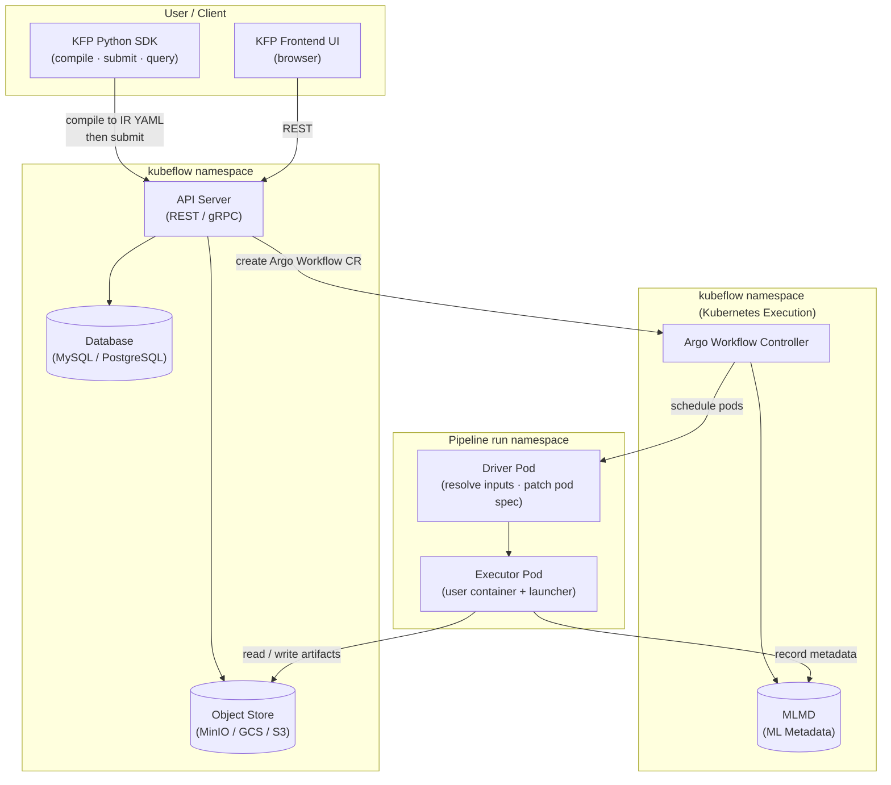
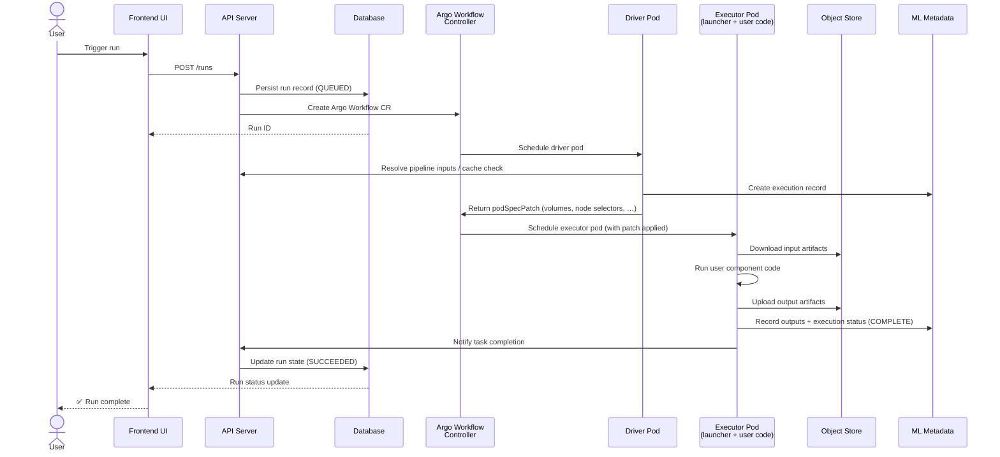
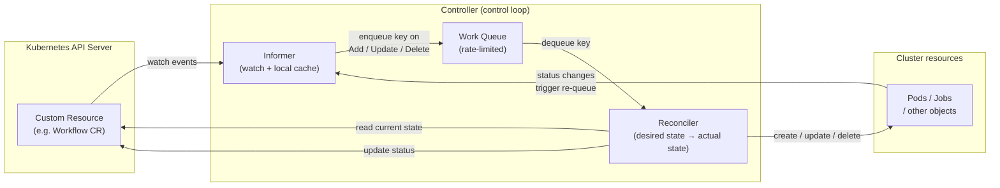

# Architecture Overview

This document provides a set of progressive, high-level architecture diagrams for
new contributors and anyone looking for a quick mental model of Kubeflow Pipelines
(KFP). Each diagram adds one layer of detail so you can stop at the level that is
useful for your current task.

For the full, detailed cluster-wide diagram see
[`images/kfp-cluster-wide-architecture.png`](../images/kfp-cluster-wide-architecture.png).
For a per-pipeline anatomy breakdown see [Pipeline Anatomy](anatomy.md).

---

## Diagram 1 — Top-level system sections

KFP is divided into four conceptual sections. Each runs in a distinct Kubernetes
namespace (or logical boundary) in a typical installation.

**Key take-aways**

| Section | Responsibility |
|---|---|
| **User / Client** | Authors pipelines in Python; compiles to IR YAML; submits runs and monitors them |
| **KFP Control Plane** | Stores pipeline definitions, run records, and artifact metadata; owns the REST/gRPC surface |
| **Kubernetes Execution** | Argo Workflow Controller translates pipeline graphs into Kubernetes pod schedules |
| **Task Execution** | One driver + one executor pod pair per component invocation; does the real ML work |

---

## Diagram 2 — Single task request lifecycle

This diagram traces one pipeline run from browser click to recorded completion.

**Key take-aways**

- The **Driver** is the only pod that talks to the API server before work begins.
  It is responsible for caching, input resolution, and dynamic pod configuration.
- The **Executor** (launcher + user container) never modifies the pipeline run
  record directly; it writes artifacts to the object store and metadata to MLMD.
- Each component in a pipeline graph produces **one Driver + one Executor pair**.

---

## Diagram 3 — Generic controller pattern

Several subsystems inside KFP (the Workflow Controller, the Scheduled Workflow
controller, the cache server) follow the same Kubernetes controller pattern. This
diagram explains it once so the pattern is recognisable whenever you encounter it.

**Key take-aways**

| Component | Role |
|---|---|
| **Informer** | Subscribes to API server watch events; maintains a local in-memory cache to reduce API load |
| **Work Queue** | Decouples event receipt from processing; provides rate limiting and deduplication |
| **Reconciler** | Compares *desired* state (the CR spec) with *actual* state (live cluster objects) and drives them to match |

This loop runs continuously. If the reconciler crashes mid-reconciliation the item
is re-queued and retried, making the controller self-healing by design.

---

## Further reading

- [Pipeline Anatomy](anatomy.md) — detailed breakdown of the Argo Workflow tasks
  generated for a single-component pipeline
- [`images/kfp-cluster-wide-architecture.png`](../images/kfp-cluster-wide-architecture.png) — full cluster diagram with every component labelled
- [`docs/agents/architecture.md`](https://github.com/kubeflow/pipelines/blob/master/docs/agents/architecture.md) — key source paths and local runner notes (contributor reference, not part of the published docs site)
