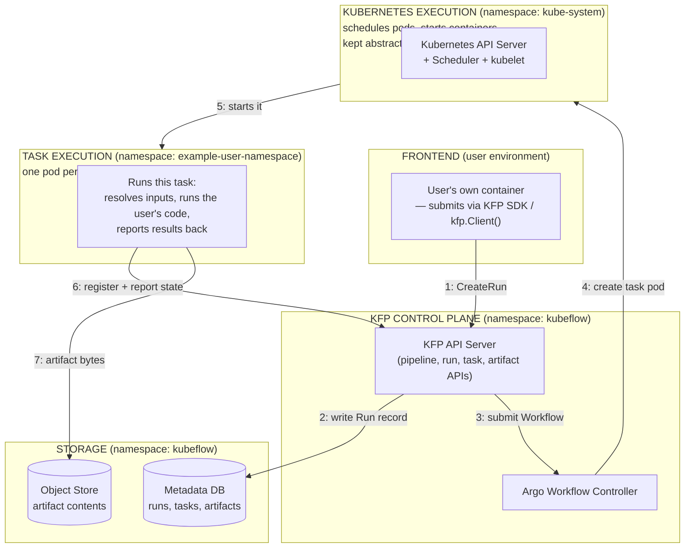

# KFP Architecture — High Level

Four groupings — Frontend, KFP Control Plane, Kubernetes Execution, and Task Execution — each labeled with the namespace it actually runs in. Keeps the same "very high level" spirit as the original master diagram, but fixes one real gap: the old version lumped Argo Workflow Controller together with the actual running task, even though they live in two different namespaces.

## Why four groupings instead of three

The diagram this replaces (`kfp_architecture_master.md`) grouped Argo Workflow Controller, Driver, and Launcher together under one "Kubernetes / Argo Execution" box. That's a real inaccuracy worth fixing even at the highest level: **Argo Workflow Controller lives in `kubeflow`** (bundled into the KFP install, always running), while **the actual task pod runs in `example-user-namespace`** (the user's own namespace, created fresh per task). Those are two different namespaces doing two different jobs — one is a standing KFP-adjacent service, the other is ephemeral user workload. Splitting them into **KFP Control Plane** and **Task Execution** makes that distinction visible from the very first diagram someone sees, instead of only showing up once they reach the full-detail doc.

## What's deliberately left out, and why

- **No Driver or Launcher.** Those are internal mechanics of how one task pod actually runs (two separate pod spin-ups, an input-resolution step, a cache check, an entrypoint process). That's real and important — covered in `kfp_architecture_full_detail.md` and `task_lifecycle_driver_launcher.md` — but naming them here would front-load vocabulary before the reader has anywhere to hang it. The `TASK_EXEC` box intentionally stays collapsed to "this is where your code actually runs."
- **No Cache Server or Persistence Agent.** Both are real `kubeflow`-namespace services, but they're supporting infrastructure (caching, state-sync) rather than part of the primary request path a new reader needs first. KFP Control Plane is kept to just the two components actually driving the flow in this diagram — the API Server and Argo Workflow Controller. Cache Server and Persistence Agent show up in `kfp_architecture_full_detail.md`.
- **No Scheduler/kubelet internals.** `KUBERNETES EXECUTION` is kept as one abstract box — "Kubernetes decides where to run it and starts it." The real internals (Informer/Reconcile pattern, Filter/Score, image pull) are a separate, later lesson (`generic_controller_architecture.md`, `kfp_architecture_full_detail.md`).
- **No color-coding.** Namespace boundaries are shown with labeled subgraph boxes, avoids introducing a second visual convention a reader… *(photo cuts off here — remainder of the line/file not captured)*
