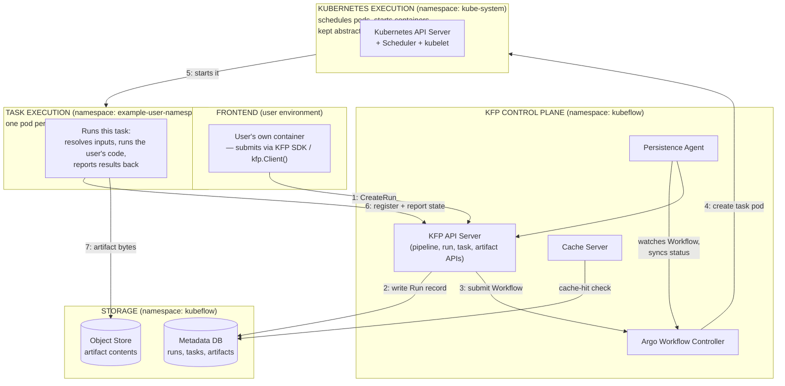

# KFP Architecture — High Level, With Cache Server + Persistence Agent

Same four groupings and namespace framing as `kfp_architecture_high_level.md` (Frontend, KFP Control Plane, Kubernetes Execution, Task Execution), but with **Cache Server** and **Persistence Agent** included in the KFP Control Plane box. Kept as a separate doc for anyone who wants the slightly fuller picture without jumping straight to the full-detail capstone.

## What this adds versus `kfp_architecture_high_level.md`

- **Cache Server** — checks/writes cache entries against the Metadata DB, so a task with a matching fingerprint (same image, command, inputs) can skip real execution and reuse a prior Artifact.
- **Persistence Agent** — watches the Argo Workflow (via the Workflow CR) and syncs Run/Task status into the Metadata DB independently of whatever Driver/Launcher directly report, so KFP's records stay correct even if something else fails to report in.

Both are real, standing `kubeflow`-namespace services — not part of the primary request path, but worth seeing one step earlier than the full-detail capstone for anyone who wants it.

## Where this fits

Optional step between `kfp_architecture_high_level.md` (#3) and `kfp_architecture_full_detail.md` (the capstone) — not currently part of the core numbered sequence. Covers the same ground as `kfp_architecture_master.md`'s original three-grouping diagram, but with the namespace split (`kubeflow` Control Plane vs. `example-user-namespace` Task Execution) that diagram was missing.
