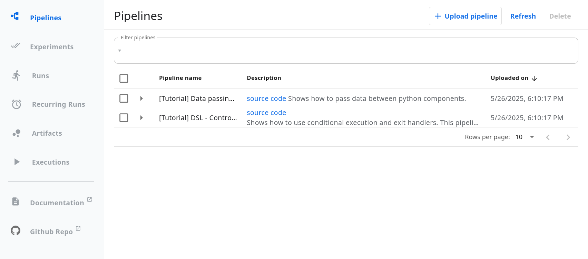

# Kubeflow Pipelines Frontend

This section of the codebase contains the Kubeflow Pipelines (KFP) Frontend.

## Current Stack

- React 19 with TypeScript on Vite 7
- MUI v5 with Emotion
- TanStack Query v5
- React Router v8 (declarative hash routing)
- Vitest with Testing Library v16 for UI tests
- Vitest for frontend server tests
- Storybook 10 for component development

## Quick Start Development

This guide will get you started with development on KFP standalone mode.

### Prerequisites

You will need the following installed in your environment:

* [Docker]
* [Kubectl]
* [Kind]
* [Kustomize]
* [Node] version specified in the [.nvmrc]
* npm version specified in [package.json]

> [!Note]
> MAC users have reported positive experiences using [Docker + Colima] when using Kind environments. Consider
> using a similar setup if you are on a MAC and encountering issues with Docker VM.

### Deploy KFP

Clone and then deploy KFP:

```bash
git clone https://github.com/kubeflow/pipelines.git ${WORKING_DIRECTORY}
cd ${WORKING_DIRECTORY}
make -C backend kind-cluster-agnostic
```

The above command will deploy KFP in standalone mode.
It uses sensible defaults (MySQL database) for quick setup. If you need to customize the backend configuration (e.g., use PostgreSQL instead of MySQL), please refer to the [backend README](../backend/README.md) for advanced deployment options using `dev-kind-cluster`.


You can access the KFP UI by port-forwarding the KFP UI Kubernetes Service:

```bash
kubectl -n kubeflow  port-forward svc/ml-pipeline-ui 3000:80
```

Navigate to [http://127.0.0.1:3000] to view the UI. You will see something like the following:



Try uploading and running a pipeline and confirm it works! You can use one of the already uploaded templates. You can also follow the [KFP docs] for instructions on how to write and submit a pipeline. You can use [http://127.0.0.1:3000] as your `Client(host=...)` value.

### Local Development

Now that you have had a chance to check out the UI, we will now scale this UI down and run the UI ourselves locally.

Scale the UI down by running the following:

```bash
# End the port-forwarding by pressing ctrl+D in your terminal, then run:
kubectl -n kubeflow scale --replicas=0 deployment/ml-pipeline-ui
```

You can confirm that the previous [http://127.0.0.1:3000] link no longer works.

Now navigate to the KFP frontend folder, install and build your NPM dependencies:

```bash
cd ${WORKING_DIRECTORY}/frontend
npm install --global "$(node -p 'require("./package.json").packageManager')"
npm ci
npm run build
```

Now run the following:

```bash
npm run start:proxy-and-server
```

You should see the following output

```bash
Server listening at http://localhost:3001
```

Follow this link, and you should be directed to the KFP UI the same as before, except this time you are using the UI running in your local environment!

If you enjoy hot reloading when developing the client side React code, you can subsequently run the following command:

```bash
npm run start
```

You should see output indicating the Vite dev server is running, for example:

```bash
VITE v7.x ready in ...
➜  Local:   http://localhost:3000/
...
```

Follow this link, it should also take you to the same UI. The difference here is that whenever you change client side (React) code locally, you will automatically get the new changes in your browser without having to restart your server.

The local dev bootstrap runs under React Strict Mode. Vitest UI tests are configured to do the same through Testing Library's global `reactStrictMode` setting so direct `render()` calls match dev behavior. Production builds remain outside Strict Mode.

### Mock backend shortcut

For fixture-backed client work that does not need a Kubernetes cluster, run:

```bash
npm run mock:api
npm run start
```

The mock backend serves the primary v2 Pipelines, Experiments, Runs, and Recurring Runs list pages with deterministic fixture data. Use `npm run start:proxy-and-server` against a real KFP deployment when validating native tasks and artifacts, pod logs, authentication, or backend behavior beyond those fixtures.

## Visual Regression Testing

When making UI changes, use the smoke test tool to capture screenshots and generate side-by-side comparisons against a base branch. This catches layout regressions, styling issues, and unintended visual changes before they reach review.

### Quick screenshot of your dev server

The fastest workflow — point the tool at your already-running `npm start` server:

```bash
node scripts/ui-smoke-test/smoke-test-runner.js --current-only --use-existing --url http://localhost:3000
```

Screenshots are saved to `.ui-smoke-test/screenshots/pr/`.

### Compare your branch against master

The full workflow — detects changed backend components, ensures a Kind cluster, builds both frontends, captures screenshots from both, and generates a side-by-side comparison with diff percentages:

```bash
node scripts/ui-smoke-test/smoke-test-runner.js --compare master
```

If your PR only touches frontend code, the backend rebuild is auto-skipped since no backend components changed.

### Compare someone else's PR

Fetch and test a PR you don't have checked out locally:

```bash
node scripts/ui-smoke-test/smoke-test-runner.js --compare master --pr 12756
```

Results are saved to `.ui-smoke-test/screenshots/comparison/`. See [scripts/ui-smoke-test/README.md] for the full command reference, troubleshooting, and architecture details.

## Contributing

For a more comprehensive guide on contributing, please read [CONTRIBUTING.md].

<!REFERENCES>
[Docker]: https://docs.docker.com/engine/install/
[Kind]: https://kind.sigs.k8s.io/#installation-and-usage
[Kustomize]: https://kustomize.io
[Node]: https://www.npmjs.com/package/node
[.nvmrc]: .nvmrc
[package.json]: package.json
[CONTRIBUTING.md]: CONTRIBUTING.md
[scripts/ui-smoke-test/README.md]: scripts/ui-smoke-test/README.md
[http://127.0.0.1:3000]: http://127.0.0.1:3000
[Kubectl]: https://kubernetes.io/docs/tasks/tools/#kubectl
[Docker + Colima]: https://github.com/abiosoft/colima?tab=readme-ov-file#docker
[sample pipeline]: https://raw.githubusercontent.com/kubeflow/pipelines/refs/heads/master/sdk/python/test_data/pipelines/pipeline_with_env.py
[sample pipeline in yaml]: https://raw.githubusercontent.com/kubeflow/pipelines/refs/heads/master/sdk/python/test_data/pipelines/pipeline_with_env.yaml
[KFP docs]: https://www.kubeflow.org/docs/components/pipelines/getting-started/

## Multi-user artifact ownership

With `ENABLE_AUTHZ=true`, artifact previews and downloads first require permission
for the requested namespace. Unsafe keys and known foreign namespace prefixes are
rejected. An exact native Artifact API match in the authorized namespace permits
an existing custom root without requiring `private-artifacts/<namespace>/`.
For example, a registered `s3://bucket/model/team-a-training/result` can be read
without moving the object. Storage endpoint, provider and credential restrictions
still apply independently.

`ARTIFACT_NAMESPACE_OWNERSHIP_MODE=artifact-then-prefix` is the default: a canonical
key under the configured namespace prefix can pass without a metadata lookup.
A genuine no-record result also uses the existing prefix fallback. `artifact-only`
requires a matching native record; it does not require a namespace prefix after
that match. The legacy spellings `mlmd-then-prefix` and `mlmd-only` remain aliases
for these native policies, not a runtime MLMD dependency. Lookup failures deny
access; invalid modes do not enable no-record fallback. Neither mode is an audit
switch. `ARTIFACT_NAMESPACE_KEY_PREFIX` changes the prefix used for those checks.

**This compatibility policy does not establish complete object authorization.**
A tenant can register an arbitrary custom-root URI in its own native metadata. If
the serving credentials can read that object, the metadata match can expose it.
A namespace proxy or distinct Secret name does not prove isolation; stock storage
grants can include shared legacy paths. The
[backend-first artifact API work](https://github.com/kubeflow/pipelines/issues/14031)
must replace this boundary before claiming 3.0 artifact remediation. Metadata
registration, including imported history, is not a trustworthy grant to object bytes.

With `ARTIFACTS_SERVICE_PROXY_ENABLED=true`, HTTP(S) requests use the namespace
artifact service and its `HTTP_BASE_URL` and HTTP credentials. Otherwise the shared
UI serves them using its configuration. Configure each actual serving process;
proxy mode does not require copying namespace HTTP credentials into the shared UI.
Absolute HTTP bases confine every request/redirect to the approved origin and path.
The scheme-less gateway form retains its domain-allowlisted redirect behavior and
strips configured authentication when the origin changes. Redirects are no longer
required to have a namespace-shaped path. Destination controls alone do not prove
object ownership. See [HTTP serving configuration](../docs/operator-guides/server-config.md#http-artifact-serving-configuration).

Updated namespace receivers retain destination, credential, path and response
protections. Old receivers retain their old behavior until their normal rollout
finishes. Central multi-user `volume://` reads remain denied; supported isolated
volume paths are unchanged.

The final 3.0 backend transition must start from actual 2.18 installations without
assuming new storage approvals, readiness records or a versioned receiver protocol
were installed. [#14883](https://github.com/kubeflow/pipelines/pull/14883) is a
reference implementation and test source, not a required intermediate deployment.
The [2.18 rollback](https://github.com/kubeflow/pipelines/pull/15044) is separate:
master retains native Artifact APIs and fail-closed lookup errors, not MLMD's
permissive missing-evidence behavior.
