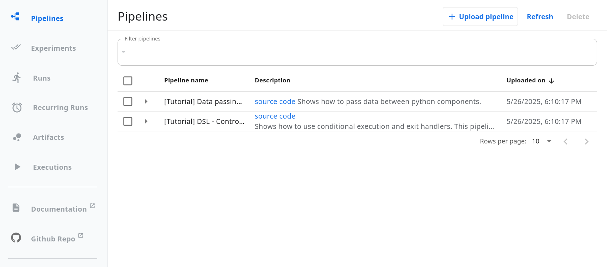

# Kubeflow Pipelines Frontend

This section of the codebase contains the Kubeflow Pipelines (KFP) Frontend.

## Current Stack

- React 19 with TypeScript on Vite 7
- MUI v5 with Emotion
- TanStack Query v5
- React Router v5
- Vitest with Testing Library v16 for UI tests
- Vitest for frontend server tests
- Storybook 10 for component development

## Quick Start Development

This guide will get you started with development on KFP standalone mode.

### Prerequisites

You will need the following installed in your environment:

* [Docker]
* [Kubectl]
* [Kind]
* [Kustomize]
* [Node] version specified in the [.nvmrc]
* npm version specified in [package.json]

> [!Note]
> MAC users have reported positive experiences using [Docker + Colima] when using Kind environments. Consider
> using a similar setup if you are on a MAC and encountering issues with Docker VM.

### Deploy KFP

Clone and then deploy KFP:

```bash
git clone https://github.com/kubeflow/pipelines.git ${WORKING_DIRECTORY}
cd ${WORKING_DIRECTORY}
make -C backend kind-cluster-agnostic
```

The above command will deploy KFP in standalone mode.
It uses sensible defaults (MySQL database) for quick setup. If you need to customize the backend configuration (e.g., use PostgreSQL instead of MySQL), please refer to the [backend README](../backend/README.md) for advanced deployment options using `dev-kind-cluster`.


You can access the KFP UI by port-forwarding the KFP UI Kubernetes Service:

```bash
kubectl -n kubeflow  port-forward svc/ml-pipeline-ui 3000:80
```


Navigate to [http://127.0.0.1:3000] to view the UI. You will see something like the following:



Try uploading and running a pipeline and confirm it works! You can use one of the already uploaded templates. You can also follow the [KFP docs] for instructions on how to write and submit a pipeline. You can use [http://127.0.0.1:3000] as your `Client(host=...)` value.

### Local Development

Now that you have had a chance to check out the UI, we will now scale this UI down and run the UI ourselves locally.

Scale the UI down by running the following:

```bash
# End the port-forwarding by pressing ctrl+D in your terminal, then run:
kubectl -n kubeflow scale --replicas=0 deployment/ml-pipeline-ui
```

You can confirm that the previous [http://127.0.0.1:3000] link no longer works.

Now navigate to the KFP frontend folder, install and build your NPM dependencies:

```bash
cd ${WORKING_DIRECTORY}/frontend
npm install --global "$(node -p 'require("./package.json").packageManager')"
npm ci
npm run build
```

Now run the following:

```bash
npm run start:proxy-and-server
```

You should see the following output

```bash
Server listening at http://localhost:3001
```

Follow this link, and you should be directed to the KFP UI the same as before, except this time you are using the UI running in your local environment!

If you enjoy hot reloading when developing the client side React code, you can subsequently run the following command:

```bash
npm run start
```

You should see output indicating the Vite dev server is running, for example:

```bash
VITE v7.x ready in ...
➜  Local:   http://localhost:3000/
...
```

Follow this link, it should also take you to the same UI. The difference here is that whenever you change client side (React) code locally, you will automatically get the new changes in your browser without having to restart your server.

The local dev bootstrap runs under React Strict Mode. Vitest UI tests are configured to do the same through Testing Library's global `reactStrictMode` setting so direct `render()` calls match dev behavior. Production builds remain outside Strict Mode.

### Mock backend shortcut

For fixture-backed client work that does not need a Kubernetes cluster, run:

```bash
npm run mock:api
npm run start
```

The mock backend serves the primary v2 Pipelines, Experiments, Runs, and Recurring Runs list pages with deterministic fixture data. Use `npm run start:proxy-and-server` against a real KFP deployment when validating MLMD, pod logs, runtime artifacts, auth, or backend behavior beyond those fixtures.

## Visual Regression Testing

When making UI changes, use the smoke test tool to capture screenshots and generate side-by-side comparisons against a base branch. This catches layout regressions, styling issues, and unintended visual changes before they reach review.

### Quick screenshot of your dev server

The fastest workflow — point the tool at your already-running `npm start` server:

```bash
node scripts/ui-smoke-test/smoke-test-runner.js --current-only --use-existing --url http://localhost:3000
```

Screenshots are saved to `.ui-smoke-test/screenshots/pr/`.

### Compare your branch against master

The full workflow — detects changed backend components, ensures a Kind cluster, builds both frontends, captures screenshots from both, and generates a side-by-side comparison with diff percentages:

```bash
node scripts/ui-smoke-test/smoke-test-runner.js --compare master
```

If your PR only touches frontend code, the backend rebuild is auto-skipped since no backend components changed.

### Compare someone else's PR

Fetch and test a PR you don't have checked out locally:

```bash
node scripts/ui-smoke-test/smoke-test-runner.js --compare master --pr 12756
```

Results are saved to `.ui-smoke-test/screenshots/comparison/`. See [scripts/ui-smoke-test/README.md] for the full command reference, troubleshooting, and architecture details.

## Contributing

For a more comprehensive guide on contributing, please read [CONTRIBUTING.md].

<!REFERENCES>
[Docker]: https://docs.docker.com/engine/install/
[Kind]: https://kind.sigs.k8s.io/#installation-and-usage
[Kustomize]: https://kustomize.io
[Node]: https://www.npmjs.com/package/node
[.nvmrc]: .nvmrc
[package.json]: package.json
[CONTRIBUTING.md]: CONTRIBUTING.md
[scripts/ui-smoke-test/README.md]: scripts/ui-smoke-test/README.md
[http://127.0.0.1:3000]: http://127.0.0.1:3000
[Kubectl]: https://kubernetes.io/docs/tasks/tools/#kubectl
[Docker + Colima]: https://github.com/abiosoft/colima?tab=readme-ov-file#docker
[sample pipeline]: https://raw.githubusercontent.com/kubeflow/pipelines/refs/heads/master/sdk/python/test_data/pipelines/pipeline_with_env.py
[sample pipeline in yaml]: https://raw.githubusercontent.com/kubeflow/pipelines/refs/heads/master/sdk/python/test_data/pipelines/pipeline_with_env.yaml
[KFP docs]: https://www.kubeflow.org/docs/components/pipelines/getting-started/

## Artifact ownership compatibility in 2.18

The stronger artifact ownership requirement is deferred to 3.0. Version 2.18 keeps
2.17's MLMD-based behavior for authenticated multi-user previews and downloads:

- A recorded namespace mismatch is denied. Matching metadata may authorize an
  existing custom root without imposing a new namespace-prefix layout.
- Missing namespace context or unavailable MLMD/protobufs retains the previous
  permissive ownership result. Authentication and namespace permission checks
  still apply and deny access if they fail.
- After a successful lookup returns no artifacts, `ARTIFACT_NAMESPACE_OWNERSHIP_MODE`
  retains its existing `mlmd-then-prefix` default or `mlmd-only` strict behavior.
  The former requires `private-artifacts/<namespace>/...`, or the single configured
  `ARTIFACT_NAMESPACE_KEY_PREFIX`; the latter denies untracked objects.
- Unsafe paths and malformed encoding remain rejected. Request identity, trusted
  storage endpoints, HTTP destination/credential controls, filesystem containment,
  and safe response handling remain enforced.

No new root migration, storage-adoption policy, or artifact audit setting is
required for 2.18. The unreleased `KFP_SECURITY_ARTIFACT_OWNERSHIP_MODE` control is
removed. This preserves previously working access; it does not make previously
unsupported, untracked custom-root objects readable.

This compatibility decision leaves the artifact ownership advisory unresolved in
2.18. Caller-associated metadata is not proof of object ownership, and permissive
MLMD failure handling can expose other tenants' objects when serving credentials
have broader access. Existing storage and network isolation remain necessary;
do not disable authentication. The backend authorization work is tracked in
[#14031](https://github.com/kubeflow/pipelines/issues/14031) for 3.0.

HTTP artifacts retain the existing direct or namespace-proxy route and its
credential placement. Updated receivers apply independent HTTP protections;
older receivers retain their previous behavior until replaced during rollout.
See [HTTP artifact configuration](../docs/operator-guides/server-config.md#http-artifact-migration-for-218)
for the supported base forms and receiver update checks.

Path hardening remains independent of ownership compatibility. Authenticated
artifact keys with traversal segments, malformed percent escapes, encoded path
separators (including a literal `%2F` object-key segment), or internal empty
segments remain rejected. A tracked directory prefix may end in one `/` without
changing the URI sent to metadata or storage. Inventory unusual historical keys
and test their actual authenticated read path; standalone storage success does
not establish authenticated compatibility.

### Pod log access

With `ENABLE_AUTHZ=true`, `/k8s/pod/logs` requires `runid` and `podname`.
The UI forwards the caller's identity to the API server for `readLog`
authorization and persisted run scope. The run's persisted namespace selects the
scope; `podnamespace` cannot redirect the read. Live Pods must carry that run's
`pipeline/runid` label before their logs are read.

Standard native historical logs remain accessible after Pod/Workflow garbage
collection. The UI retains its configured storage adapter and credentials, but
checks archive hints against the operator-configured store, bucket, and authorized
namespace/workflow path. Tenant Workflow status and ConfigMaps cannot change
that authorization policy. No data copy or per-run migration is required.

`KFP_LOG_ARCHIVE_KEY_FORMAT` configures the authorized archive layout on both the
UI and API server. Its default matches the shipped Argo layout:

```text
private-artifacts/{{workflow.namespace}}/{{workflow.name}}/{{workflow.creationTimestamp.Y}}/{{workflow.creationTimestamp.m}}/{{workflow.creationTimestamp.d}}/{{pod.name}}
```

The reader appends `/main.log`. Custom formats must include namespace, workflow
name, and Pod name as separate path segments. Optional date segments locate old
objects; they are not required to match the run's SQL creation timestamp. Retained
history can locate retry-child Pod logs within the authorized workflow path.
Configure the format consistently on both components and match the actual stored
layout. Layouts without namespace/workflow partitions cannot be enabled simply
by allowlisting an endpoint; use a separately authorized logging/storage system
for those objects. This setting validates reads; it does not change Argo's write
configuration or move existing objects.

Roll out the API server before the UI, then complete both rollouts. Verify a live
native run, an archived run whose Pod has been deleted, and an imported run if
using namespace transfer. Imported histories can read shared archives under the
same configured store/bucket and namespace/workflow policy, including standalone.
They never look up live destination Pods or Workflows. Importing metadata does
not grant `readLog`: current authorization must cover the original workflow name
in the destination namespace. A forged name cannot authorize a different path.

No log copy or re-import is required for histories retaining those fields. Missing
namespace/workflow scope and foreign archive locations fail closed. Run-specific
standalone UI requests also consult API context to distinguish imports; explicit
native contexts retain the existing direct reader, and standalone calls without
a run ID retain their legacy behavior. API errors cannot trigger an unchecked
fallback. Shared namespace names must represent the same tenant/data authority
across installations; sharing a bucket alone does not establish that authority.

`STREAM_LOGS_FROM_SERVER_API=true` still selects API streaming and requires the
API server's archive storage configuration for historical logs; otherwise the UI
uses its existing adapter after API authorization. API streaming and archives
serve the `main` container. `POD_LOG_CONTAINER_NAME` continues to select the live
container on the UI's direct path. When a custom non-`main` container is selected,
a missing Pod does not fall back to the `main` archive. Authenticated UI archive
reads require `ARGO_ARCHIVE_LOGS=true` and the configured archive bucket; the
shipped deployment already enables this.
Standalone native runs retain their existing direct/archive behavior. Changing
to standalone mode is not a multi-user compatibility workaround.
