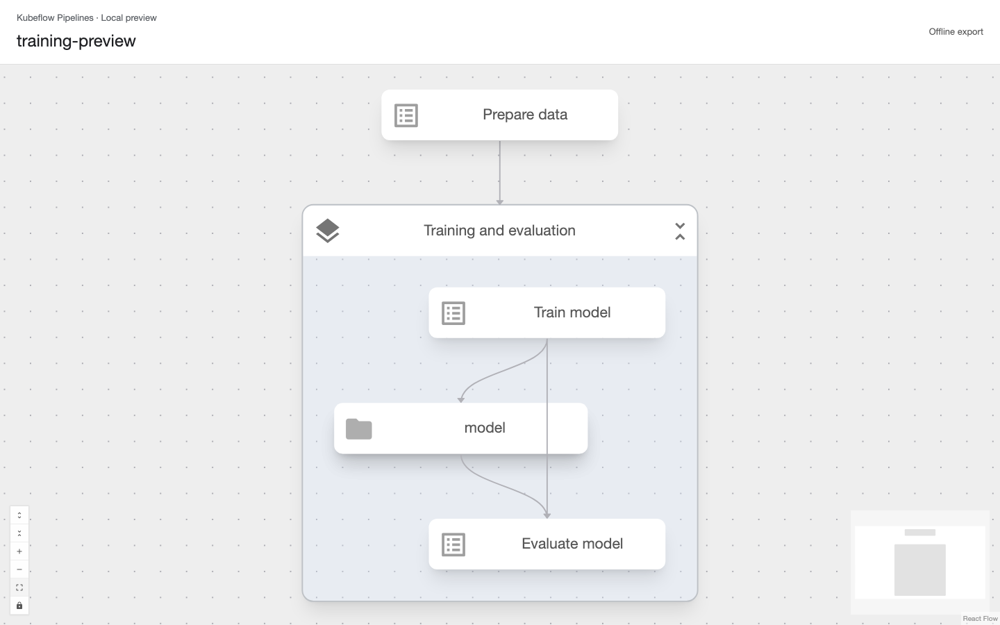
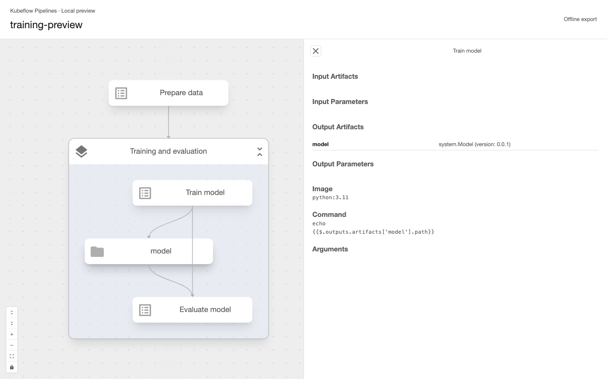

# Standalone pipeline viewer

The `kfp visualize` CLI exports a self-contained HTML document. This directory
contains its thin HTML host. It uses the same `components/graph/PipelineGraph`
and `pages/v2/DagCanvas` as the application's pipeline-details page, without a
KFP API server, router, or authentication state.

## Screenshots





## Rebuild the SDK assets

From `frontend/`, using `.nvmrc` and the npm version in `package.json`:

```sh
npm ci
npm run build:viewer
```

Commit the generated `sdk/python/kfp/cli/viewer_assets/` files alongside renderer
changes. They are included in the Python wheel/sdist so SDK users do not need
Node or a CDN. Vite emits third-party licenses, which are embedded in exports.
The checked-in frontend lockfile pins the renderer's dependencies; rebuilding
these assets is required after upgrading those dependencies.

```sh
# From frontend/
npm run test:ui -- src/standalone/Viewer.test.tsx
npm run typecheck

# Real browser + Python CLI: offline HTML, sandboxed iframe, both watch formats,
# preserved zoom/selection, imported-file changes, and compile-error recovery.
# Requires the repository .venv (or KFP_PYTHON=/path/to/python).
npx playwright install chromium
npm run test:viewer

# From the repository root
uv run pytest sdk/python/kfp/cli/visualize_test.py
```

## Data and updates

The CLI sends the validated **full PipelineSpec**, including deployment details,
to the HTML viewer. The existing `StaticFlow`/`GroupedFlow` modules convert it;
`PipelineGraph` supplies the shared canvas and `StaticNodeDetailsV2` inspector.
Task/artifact cards, inline group expansion, graph controls, and the MUI theme
are the application's own modules, not standalone copies. The bundle includes
the application's generated Tailwind styles and matches its 13px root font.

Python's `kfp.cli.visualization.validate_spec` checks each reachable DAG
component definition once, including task display names, references, and cycles.
HTML never expands reusable-component instance paths. `build_view` validates
and projects those paths only for Mermaid Markdown, with a budget of 10,000
DAGs, tasks, and dependency edges in total to prevent exponential output growth.
Exceeding the budget reports an error and leaves the previous export intact;
use HTML for heavily reused pipelines.

The HTML embeds `{state, live}` as escaped JSON. Offline artifacts never fetch.
The loopback watch page polls `./state`, using revisions to avoid re-layout on
unchanged polls. A changed graph retains its canvas instance, zoom, and selected
task, as well as inline expansion state. The inspector resolves its selection
against the latest spec, updating renamed nodes and closing for deleted nodes.
No persistent graph identity is supplied, so opaque-origin HTML previews do not
need access to local storage. Errors retain the last valid view.

The renderer is read-only: dragging nodes does not modify a pipeline. It does
not display execution status, expand runtime loop iterations, or provide
source-code editing.
