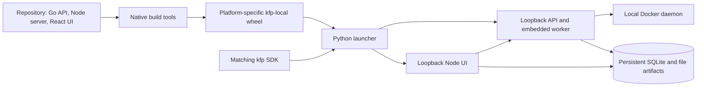

# Packaged local KFP: native-wheel proof of concept

This is a runnable proof of the packaging approach in
[Phase 2 of the local-runtime RFC](../proposals/kfp-local/README.md#phase-2-package-the-local-experience),
not a production release or a new pipeline engine. It packages the existing Go
API server/embedded Docker worker, compiled Node.js server, browser application,
and locked production Node dependencies in an optional `kfp-local` wheel.

The distribution uses the `kfp_local` Python namespace. The existing
`kfp.local.init(...)` implementation is unchanged.



## Scope and requirements

| | Requirement |
| --- | --- |
| Build host | Linux x86_64 or aarch64, Python 3.11+, the Go toolchain selected by `go.mod`, a C compiler for SQLite, Node/npm matching the frontend pins |
| Installed headless server | Python 3.11+, matching native OS/architecture and at least the builder's glibc, local Docker CLI/daemon |
| Installed UI | Headless requirements plus Node.js 24.22.1 or newer within major 24 |
| Not needed after installation | Repository checkout, Go, npm, frontend build tools, Kubernetes, Argo, an object-store server, or a database server |

The native build is implemented for Linux x86_64/aarch64; the proof is verified
on the build host, not certified across Linux distributions. Wheel tags are
`py3-none-linux_<architecture>`, **not** universal or manylinux tags. A manifest
records and checks the native platform, conservative builder-libc requirement,
and Node version. macOS, Windows, cross-compilation, release automation, signed
artifacts, and a published compatibility matrix are follow-up work.

Docker must be local: staging and workspaces use host bind mounts. Remote Docker
contexts are unsupported. Components must have images compatible with the Docker
daemon's architecture. This proof does not add a subprocess executor.

### Matching SDK caveat

The proof declares the current SDK baseline, `kfp>=2.17.0`, but the SDK's new lazy
`local` CLI commands are not in the previously published release with that same
version. **Install both wheels built below in a clean virtual environment.**
The package and SDK exchange a CLI protocol version. A real release must assign
and require the SDK release that first contains that integration; the existing
SDK version is deliberately not bumped just to demonstrate packaging.

This project is independent of the root uv workspace. Root `uv sync` continues
to install the SDK without installing the optional local server.

## Build both wheels

From a complete checkout:

```bash
uv sync --frozen --extra ci

# Use the versions in frontend/.nvmrc and frontend/package.json.
cd frontend
npm ci
cd ..

uv run python local/build.py --output-dir /tmp/kfp-local-wheels
```

The builder:

1. Builds and strips the native Go API binary with SQLite support.
2. Runs the existing frontend and Node server builds.
3. Installs only locked production Node dependencies in a temporary payload.
4. Builds a correctly platform-tagged optional wheel with those assets.
5. Builds the matching SDK wheel, including the lazy CLI integration.

Generated payloads stay in temporary staging, not the source tree. Third-party
Node package metadata and licenses are retained. Building the source directory
directly or installing it editable fails with an instruction to use the native
builder; an unbuilt installation is not reported as a working server.

## Install and run outside the checkout

```bash
python3 -m venv /tmp/kfp-local-demo
/tmp/kfp-local-demo/bin/python -m pip install \
  /tmp/kfp-local-wheels/kfp-*.whl \
  /tmp/kfp-local-wheels/kfp_local-*.whl

cd /tmp
/tmp/kfp-local-demo/bin/kfp local server \
  --data-dir "$HOME/.local/share/kfp-local-demo"
```

The command stays in the foreground and prints:

```text
KFP API: http://127.0.0.1:3002
Data and logs: ...
Press Ctrl+C to stop.
```

For the browser experience instead:

```bash
/tmp/kfp-local-demo/bin/kfp local ui \
  --data-dir "$HOME/.local/share/kfp-local-demo"
```

Open `http://127.0.0.1:3000`. The UI uses the same API, metadata, logs, and artifact
directory as the headless server. Node is checked only for `ui`; headless mode
does not require it.

Options are forwarded lazily to the optional package:

```bash
kfp local --help
kfp local server --help
kfp local ui --help
kfp-local server --help
kfp-local ui --help
kfp local ui --api-port 3102 --rpc-port 3103 --ui-port 3100
```

Without `kfp-local`, the SDK prints an installation message and does not create
a Kubernetes/API client. `python -m kfp_local server` and the `kfp-local` executable
are also available for direct invocation. SDK help stays lightweight and works
without the optional package; the direct commands show its complete option list.

## Submit and verify a pipeline

The installed package includes a small compiled-pipeline demonstration:

```bash
/tmp/kfp-local-demo/bin/python -m kfp_local.example \
  --host http://127.0.0.1:3002
```

It uses the normal SDK to compile and submit a two-task Alpine pipeline. The
producer writes a parameter and dataset; the consumer checks their contents.
It waits for success and prints the run ID. Open that run in the UI to inspect
the graph, task logs, parameters, and artifact.

Existing compiled pipelines use the normal client as well:

```python
from kfp import client

api = client.Client(host="http://127.0.0.1:3002")
run = api.create_run_from_pipeline_package("pipeline.yaml")
completed = api.wait_for_run_completion(run.run_id, timeout=300)
print(completed.state)
```

Docker's documented feature restrictions still apply. Lightweight Python
components may install their SDK/dependencies inside their containers and require
network access; the packaged server does not install those into its own Python
environment. GPU/Kubernetes-specific scheduling, Secrets, and other unsupported
requirements are not silently emulated.

## Data, shutdown, and failure behavior

The default installation directory is `$XDG_DATA_HOME/kfp-local`, or
`~/.local/share/kfp-local` when that variable is unset. `--data-dir` overrides it.

| Path | Purpose |
| --- | --- |
| `metadata.sqlite` | Persistent pipeline/run/task/artifact metadata |
| `artifacts/` | File-backed published artifacts and logs |
| `runtime/` | Worker lock, task staging, and requested run workspaces |
| `tmp/` | Child temporary files on the same filesystem as published artifacts |
| `logs/apiserver.log` | API/worker diagnostics |
| `logs/ui.log` | Optional UI diagnostics |

Stop with Ctrl+C or SIGTERM. The launcher stops only its own child PIDs, waits
for a bounded interval, and reaps them. It never kills another process to obtain
a port. Early child exit, occupied ports, a missing daemon/Node, incompatible
assets, or readiness timeout produces a nonzero exit and a diagnostic/log path.
A second launcher cannot share the same installation directory.

Restart with the same data directory to retain history and published files.
Shutdown does not implicitly delete metadata or artifacts. In-flight Docker
attempts follow the runtime's existing retained-container recovery behavior; this
is not exactly-once execution or permission to share one SQLite file across hosts.

## Boundaries and follow-up

- API, RPC, and UI listeners bind to IPv4 loopback. This is unauthenticated local
  development, not hostile-code isolation or multi-tenant production hosting.
  There is deliberately no remote-listen option.
- Docker still executes user-provided component images. Use trusted pipelines;
  containerization alone is not a security boundary for hostile workloads.
- Scheduled workflows are unsupported without their Kubernetes controller.
  Kubernetes resource viewers, TensorBoard deployment, and cluster-specific
  configuration are not provided by the packaged local server.
- This does not deprecate `kfp.local.init`, publish wheels, certify every target
  platform, or implement the RFC's subprocess experience.
- The wheel bundles production Node dependencies so installation does not run
  npm. Node itself remains a separately installed runtime, as proposed by the RFC.

## Focused tests

```bash
uv run pytest sdk/python/kfp/cli/local_test.py
uv run pytest -c local/pyproject.toml local/tests
go test ./backend/src/apiserver -run TestRegisterHTTPHandlerFromEndpoint
cd frontend
npm --prefix server test -- --run app.test.ts configs.test.ts
```

For packaging verification, install the actual wheel in a fresh environment,
start both commands from outside the checkout without Go/npm on `PATH`, submit
the bundled example, inspect the browser UI, then restart against the same data
directory and verify the prior run and artifacts remain accessible.

The child-specific temporary directory is intentional: file-backed blob
publication uses atomic renames, so a system `/tmp` on another filesystem must
not be used for its temporary writers.

## Verified proof

The native Linux x86_64 proof was built with Go 1.27.3, Node 24.22.1, and
glibc 2.42. The optional wheel is approximately 54 MB; the matching SDK wheel is
approximately 1 MB.

Both wheels were installed into a clean virtual environment. From `/tmp`, with
only Docker and Node available on `PATH` (no Go or npm), the installed commands
were exercised as follows:

1. Started `kfp local server` and confirmed that API/RPC listeners were loopback-only.
2. Submitted the bundled two-task example and observed `SUCCEEDED`.
3. Verified the exact output parameter and published dataset bytes:
   `Hello from the installed local wheel`.
4. Retrieved the task logs through the public task-UUID API.
5. Stopped the headless launcher and started `kfp local ui` with the same data
   directory. The existing successful run, graph, parameters, logs, and artifact
   preview remained accessible through the installed browser application.
6. Confirmed API/RPC/UI listeners were loopback-only and stopped the owned
   processes without deleting the installation's data.

Failure-first regressions cover explicit loopback gateway routing, UI binding,
immediate restart after TCP connections close, and file-URI preview paths.
The restart check also rejects a genuinely occupied listener. The existing SDK
unit selection passed on Python 3.11 and 3.13 (2,022 tests each); optional-package,
CLI, frontend, and Go gateway tests provide focused coverage.

These results demonstrate a working native installation, not a portable Linux
release qualification. In particular, aarch64 and other libc environments were
not exercised.
