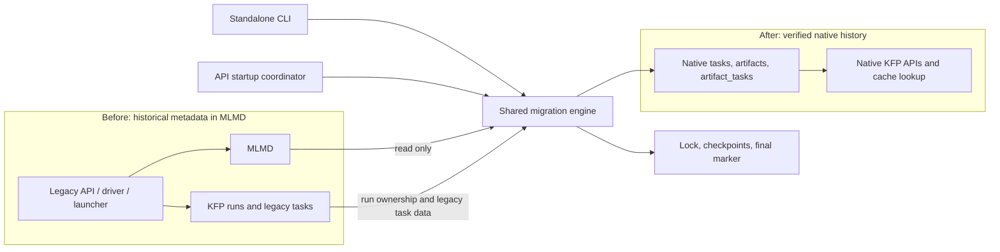

# MLMD database migration implementation plan

This plan implements the historical-data migration described in
[database-migration-design.md](./database-migration-design.md). It covers the
shared engine, standalone CLI, API-server startup, deployment changes, and
upgrade verification. It builds on the native metadata implementation already
present at repository revision `c723a58d4`; it does not recreate that runtime.

The [fixture README](../../backend/src/apiserver/migration/mlmd/testdata/README.md)
documents pinned writer data, the independently authored native projection,
and focused tests. Section 2 records the implementation decisions where the
original design's mechanisms conflict with its preservation goals or the
repository's database availability policy. The original design is unchanged.

**PR 1 is incomplete until its evidence gate passes.** The pipeline-executed
fixture, field-merge cases, and disposable writer-handoff test are required
before these decisions become migration acceptance criteria. No upgrade is
enabled or claimed safe by this plan.

## 1. Existing implementation and integration points

| Area | Current behavior | Implementation consequence |
| --- | --- | --- |
| [Native models](../../backend/src/apiserver/model/task.go), [artifacts](../../backend/src/apiserver/model/artifact.go), and [links](../../backend/src/apiserver/model/artifact_task.go) | All three target models exist, including native enums, JSON fields, uniqueness constraints, and foreign keys. | Use these models and their API contracts as the target. Reconcile the proposal SQL before using it. |
| [Database initialization](../../backend/src/apiserver/client_manager/client_manager.go) | `InitDBClient` opens the database, detects an older schema, and runs either `runLegacyUpgradeFlow` or `autoMigrate`. Both eventually reconcile `model.AllModels()`. | Detect MLMD-era schemas and migration progress before either existing migration path can alter the source tables. Separating connection setup from schema initialization is necessary. |
| [Task](../../backend/src/apiserver/storage/task_store.go), [artifact](../../backend/src/apiserver/storage/artifact_store.go), and [link stores](../../backend/src/apiserver/storage/artifact_task_store.go) | Normal create operations assign new UUIDs; artifact creation also assigns current timestamps. Cache lookup currently selects `SUCCEEDED` tasks. | Add migration-specific transactional writes that preserve supplied IDs and timestamps. Reuse serialization, hashing, and relationship validation without changing live create semantics. |
| [Migration status](../../backend/src/apiserver/model/migration_status.go) | `migration_statuses` records completed one-time backfills. | Reuse it for the final applied marker. Its existing claim mechanism is not a resumable, multi-batch migration lock or checkpoint. |
| [History import](../../backend/src/apiserver/history/history.go) | Administrative writes already preserve supplied fields, compare conflicts, omit GORM associations, and read JSON without unnecessarily rounding integers. | Reuse or extract fitting storage helpers. Do not reuse the entire importer: its `ImportedFrom` semantics disable runtime mutation and exclude records from native cache lookup. |
| [API-server startup](../../backend/src/apiserver/main.go) | The client manager initializes before HTTP and gRPC listeners start. | A blocking call inside `InitDBClient` cannot preserve legacy runtime reporting or stage the new replica safely. Startup needs an explicit bootstrap sequence. |
| [API-server deployment](../../manifests/kustomize/base/pipeline/ml-pipeline-apiserver-deployment.yaml) | Readiness, liveness, and startup probes use `/apis/v2/healthz`. | Separate process health from readiness before introducing a long migration. |
| [Backend CI](../../.github/workflows/presubmit-backend.yml) and [upgrade CI](../../.github/workflows/upgrade-test.yml) | Backend CI has MySQL 8.0 and PostgreSQL 16 services. Both upgrade workflow jobs are explicitly paused pending migration and startup gating. | Extend the existing database lanes and upgrade harness; remove the pause only with passing migration coverage. |

Use released source as the input contract, not the proposal's shorthand. For
example, tag `2.14.4` contains the old `model.Task`, MLMD client/property names,
and MLMD protobuf definitions. Its task table has `MLMDExecutionID`, `PodName`,
`CreatedTimestamp`, serialized state history, and other fields in addition to
cache fingerprints. Inventory every supported source release before promising
an upgrade range.

## 2. PR 1 migration decisions

These choices retain the design's goals of preserved history, safe upgrades,
and resumability. Where a mechanism differs from the original design, this
implementation plan is the migration implementation contract. Production
activation still requires the PR 1 evidence below and passing upgrade tests.

| Area | Chosen behavior |
| --- | --- |
| Availability and schema | Use additive, versioned changes and a staged reader/writer handoff. Keep the old service and runtime reporting available during backfill; do not stop database reads or writes or copy/rename `tasks` in production. A new replica stays unready until its native path is validated. If a nonblocking handoff cannot be demonstrated, stop rollout. Build DDL from current models, not stale proposal SQL. |
| Supported versions | Initially support KFP `2.17.3` with MLMD `1.14.0`, migrating into the current native schema on MySQL 8.0 or PostgreSQL 16. This is a same-engine KFP database upgrade, not a cross-engine transfer. Reject unverified source catalogs without deleting their history; expand the matrix only with new fixtures and upgrade tests. |
| Source graph and fields | Retain run-associated MLMD history and the legacy KFP task rows that describe it. KFP run/task rows own run identity, namespace, recorded pods, timestamps and task state history; MLMD owns execution properties, artifacts and events. Compare overlapping nonempty fields and reject unexplained conflicts. Store unmappable raw values in migration provenance, with an explicit API contract before deleting source tables. Only orphaned run contexts may be skipped, with durable accounting. |
| State | A `CANCELED` MLMD execution maps to `SKIPPED` only when a legacy task or workflow provides `NotTriggered` evidence. Otherwise map it to `FAILED`, retaining the raw `CANCELED` state and ambiguity in provenance. Preserve `CACHED` as history; do not relabel it as `SUCCEEDED`. |
| Metrics | For nonempty scalar metrics, choose the primary by ascending UTF-8 metric name; it receives `uuidv5("artifact:"+id)`, while other names receive metric-name UUIDs. Link every measurement to each source event so all are task/API-visible. A zero-measurement metrics artifact gets one metadata-only base-UUID row and its event links. Reconcile changed names and primary choice during finalization. |
| Cache | Keep legacy fingerprints as provenance, not active native cache keys. Reuse a historical result only if the full current key, namespace and outputs can be reconstructed and verified; otherwise take a safe cache miss. Historical hit continuity is not guaranteed by copying the old hash. |
| In-flight runs | Let current legacy steps report, then cancel old runs. After cutover, submit a new run from preserved pipeline IR using the native runtime; retain the old run for audit. Existing `RetryRun` must not replay an MLMD-dependent workflow. Missing IR requires explicit operator resubmission. |
| Resume and completion | Use transactional keyset checkpoints and a source-bound inventory of migrated target keys. Validate expected records, metric splits, links, parents, allowed skips and changed/deleted source records at a stable final boundary. Commit a versioned completion marker only after this verification. UUID existence or table shape alone is insufficient; use conflict-specific inserts that compare existing values, not broad `INSERT IGNORE`. |
| Events and failures | Traverse events by execution ID, because MLMD events have no ID. Derive each link UUID from the complete native relationship key and use pipeline/IR evidence for native IO types and iterations. Reject unknown variants, ambiguous ownership, truncation and other failures on eligible records; missing optional values may default with provenance. Unrelated MLMD clients are outside the selected KFP graph. |

The original design's maintenance swap, binary-search resume, unconditional
`CANCELED -> FAILED`, primary-only metric links, guaranteed historical cache
hits, and same-run retry are superseded by these choices. The current writer
fixture alone cannot prove the old workflow's state reason or a runtime handoff;
those remain PR 1 evidence requirements rather than silently assumed facts.

## 3. Invariants and ownership

1. The MLMD source is read-only to the migrator. One source database is bound to
   one migration record in the destination. Reject an accidental source change;
   UUIDs derived only from MLMD integer IDs cannot safely merge unrelated stores.
2. Every migrated task belongs to an existing run. Derive namespace from trusted
   run/context associations, check agreement, and prevent cross-namespace links.
   Only run contexts are matched to `run_details`; pipeline contexts are not runs.
3. UUID v5 names are stable across restarts and both entry points. Use the DNS
   namespace and execution/artifact prefixes specified by the design, plus a
   canonical encoding for compound link keys. New runtime writes continue using
   their existing UUID behavior.
4. Each entity insert unit contains its task row or complete artifact split and
   its progress update in one transaction. An interrupted transaction advances
   neither. Event links and parent fixup have separate phase checkpoints. A
   single metric UUID does not prove that all metrics exist.
5. Idempotency tolerates only an expected identity conflict. It never hides
   truncation, invalid JSON, missing foreign keys, or disagreement between two
   records claiming the same identity. Native records are never overwritten by
   historical imports.
6. Parents and event links are resolved only after their referenced tasks and
   artifacts exist. Parent relationships must remain within a run and be acyclic.
7. MLMD and relevant KFP source rows are stable before final verification. No old
   API, runtime, scheduler, reporting, or retention writer may publish after the
   final boundary. A pre-copy result is provisional. An advisory lock coordinates
   migrators; it does not fence these other writers.
8. Normal serving resumes only after the persisted final completion predicate
   succeeds. Keep compatible legacy runtime reporting reachable during drain.
   Losing a migration lock, failing validation, or finding an unknown schema
   never means migration can be skipped.

Place orchestration and pure transforms in a new
`backend/src/apiserver/migration/mlmd/` package. Put migration SQL and transaction
helpers in the existing storage layer, and persistent progress types in `model`.
Use the existing dialect and database-credential configuration. The CLI should
not construct a `ResourceManager` or initialize Kubernetes clients merely to
open a database. Keep workflow draining with deployment/runtime coordination,
outside the shared data-copy engine.

Use concrete reader/writer implementations with narrow test seams, not a generic
migration framework. Extract only the database-opening code both callers need.
Evaluate existing history-import primitives before introducing another generic
serializer or conflict checker. Keep domain-specific import and migration policy
in their owning packages.

Do not restore the old MLMD runtime integration. Restore or generate only the
pinned read-client bindings and required protobuf sources, with their license
and reproducible generation instructions. Keep those dependencies confined to
migration and its tests.



## 4. Implementation sequence

### Pull request boundaries

Deliver the eight steps below in **three dependent PRs**.

| PR | Scope | Exit gate |
| --- | --- | --- |
| **1. Migration contract and fixtures** | Section 2 and step 1: record approved behavior and capture pinned source/runtime evidence. | Mapping fixtures, pipeline-executed evidence and an online handoff feasibility test pass. |
| **2. Complete migration engine and CLI** | Steps 2–6: build and test resumable migration, live pre-copy and final reconciliation on MySQL/PostgreSQL. | The CLI validates, recovers and matches a stable-source migration; API migration stays disabled. |
| **3. API integration and release qualification** | Steps 7–8: implement staged startup, writer handoff, upgrade tests and operator guidance. | Enable migration only after availability, recovery and compatibility gates pass. |

Each PR includes its tests and documentation. PR 2 proves the stable-source path
before live pre-copy; PR 3 proves the drain and cutover before activation.

### PR 1 — Migration contract and fixtures

#### Step 1 — Compatibility fixtures and a repeatable upgrade reproducer

**Deliverables**

- Capture the selected `2.17.3`/MLMD `1.14.0` source catalogs against MySQL 8.0
  and PostgreSQL 16, including long values, indexes and constraints. Include
  recognized partial-upgrade shapes. Reject other source versions without
  deleting their records until separate upgrade paths are qualified.
- Add checked-in fixture inputs or a deterministic generator under
  `backend/src/apiserver/migration/mlmd/testdata/`. Seed matching KFP runs and MLMD
  contexts, all task types/states, nested DAGs, loop iterations, importer outputs,
  cached outputs, metrics, shared artifacts, sparse IDs, and orphan runs.
- Add a focused upgrade test demonstrating the current failure: legacy history
  does not become a complete native task/artifact graph on new-server startup.
  Record the observed pre-fix failure, without assuming its exact SQL error.
- Capture expected API-visible history separately from raw source records. IDs
  intentionally change from MLMD integers to UUIDs, so compare through the
  specified mapping rather than demanding byte-identical API responses.
- Include one fixture produced by a pipeline run through the pinned legacy
  driver/launcher, plus small synthetic edge fixtures. Direct metadata-client
  calls are valid writer-level evidence but do not satisfy this runtime gate.
  Capture matching KFP rows, MLMD records, the submitted pipeline/workflow and
  runtime image provenance with a repeatable execution/export command. Preserve
  execution names and DAG properties from that run instead of replacing them
  with the writer generator's simplified scenario. Hand-author the important
  expected results independently of the migrator: sharing its transform with
  the golden generator would hide bugs.
  Put skipped branches, artifact-input cache behavior, and rejection of old
  workflow retry in this first feasibility slice, before building the engine.
- Identify old API, scheduler, Argo, reporting and retention writers. Test the
  staged routing, runtime reporting and writer handoff on disposable
  infrastructure. Verify reads and writes continue throughout the transition.

**Acceptance:** the fixture is reproducible from a documented command, its
pre-fix failure is understood, and corrected schema/mapping decisions from
section 2 are resolved and reviewable. The pinned runtime fixture and focused
tests run in CI, and the rollout feasibility check establishes a viable writer
handoff. Each later implementation step retains its relevant regression tests.

The current fixture comes from direct metadata-writer calls, not a pipeline
execution. It now retains secondary and empty-metrics lineage and separates
legacy fingerprints from active cache keys. Its `CANCELED` source record has no
persisted `NotTriggered` evidence, so the native task remains `FAILED` with raw
state provenance. A pipeline-executed fixture must test a skipped branch with
workflow evidence before this mapping is accepted.

### PR 2 — Complete migration engine and CLI

#### Step 2 — Database bootstrap, ownership, and durable progress

**Deliverables**

- Refactor `InitDBClient` so connection/credential setup can be reused without
  implicitly running `AutoMigrate`, unrelated backfills, or process termination.
  Return errors to the entry point so cleanup and exit behavior remain explicit.
- Inspect catalog shape and migration state before any model reconciliation.
  Classify empty install, legacy metadata schema, recognized partial migration,
  verified native installation, and unknown/inconsistent state. Unknown states
  fail with diagnostic instructions before DDL.
- Treat inspection before acquiring ownership as advisory; reclassify under the
  lock before writing. Bootstrap only the small migration tables explicitly.
  A target-shaped database without a marker may be a valid existing native
  installation; define an adoption path rather than requiring nonexistent MLMD
  from all such deployments. Never infer fresh install from one absent table.
- Add a migration-specific progress table recording migration version, bound
  source identity, mode, phase, stable scan bounds, committed cursors, counts,
  and final validation state. Add durable exception records for allowed skips
  and unresolved failures. Reuse `migration_statuses` for the final applied
  marker; do not overload its claim token as an advisory lock. The progress row
  owns resumable phase state; the applied marker is the final readiness receipt.
  Commit their completion transition together. Keep transformation-version
  compatibility separate from ordinary future native-schema upgrades.
- Live pre-copy additionally needs an inventory mapping source records to owned
  target keys and reconciliation generations. Persist this with the derived
  rows; include its storage cost in estimates. Reuse the concepts of existing
  transfer receipts where useful, without changing their immutable semantics.
  Bind source identity to the actual source installation/snapshot provenance;
  endpoint DNS alone cannot detect a restored or replaced MLMD database.
- Acquire database-scoped ownership before schema or data mutation. Use the
  shared MySQL migration lock name from the design and an equivalent PostgreSQL
  advisory lock. Pin ownership, session settings, and migration database work to
  the same physical connection so connection loss cannot leave an unfenced
  worker writing through another pool connection.
- Require session-preserving database connectivity; a transaction-pooling proxy
  can invalidate session-lock assumptions even with a pinned client connection.
  On lock-session loss, abort writes. A reconnect must reacquire ownership and
  inspect the last committed checkpoint before any replay.
- Bound lock acquisition to 10 seconds initially. A CLI contender reports
  `migration already in progress` and exits nonzero. An API contender remains
  unready, waits with bounded backoff, then rechecks durable state or exits;
  it never opens traffic merely because another process holds the lock.
- Release locks and restore connection settings on success, error, and
  cancellation. Discard a connection if safe cleanup cannot be confirmed.

**Acceptance:** tests cover both entry points contending, multiple API replicas,
connection loss, cancellation, stale partial state, and an MLMD-free restart
after a verified completion marker. No legacy-table reconciliation occurs
before classification.

#### Step 3 — Explicit schema preparation and legacy task preservation

**Deliverables**

- Write versioned, dialect-specific DDL from the approved current target model.
  Create tables in dependency order and validate existing definitions. Protect
  migration-owned tables from relationship-driven `AutoMigrate` calls as well as
  direct calls; fresh databases may continue using GORM creation.
- Freeze the migration's schema contract. Compare its promoted result to the
  corresponding target model; later model evolution needs an explicit schema
  change rather than silently changing a partially completed migration. Protect
  `run_details` and other referenced tables from incidental GORM reconciliation.
- Inventory required changes to referenced run/experiment tables and the rest
  of actual startup. Completing the three metadata tables does not establish
  that all native stores can initialize. Verify those prerequisites for the
  selected source release without silently invoking an unsafe older upgrade
  flow or claiming this feature proves unrelated release migrations safe.
- Add normalized catalog comparisons between explicit DDL and fresh-model GORM
  creation for tasks, artifacts, links, and new migration bookkeeping. Compare
  column types/defaults/nullability, indexes, and foreign keys; normalize only
  irrelevant engine-generated differences.
- Join legacy task rows to executions through `MLMDExecutionID` where present.
  Merge cache provenance, pod data, and available history into the same
  deterministic task rather than producing a cache-only duplicate plus an
  execution task. Define precedence and reject conflicting ownership. Inventory
  legacy-only rows and require an explicit preservation rule for unsupported
  records before retiring their source table.
- Prepare additive, versioned storage compatible with the running legacy API.
  Preserve old `tasks` rows while backfilling native task, artifact and link
  data; do not perform the design's blocking `tasks` table swap. Select and
  verify online DDL algorithms separately for MySQL and PostgreSQL.
- Test crash recovery at every DDL boundary, including source and target
  constraint definitions. Do not disable foreign-key checks to force a change.
  If concurrent reads/writes cannot be sustained, stop before production DDL.

**Acceptance:** populated source-schema tests cover every supported catalog
shape, repeated initialization, interruption before/after each DDL operation,
constraint names, and preservation of legacy fields. Measure read/write impact
and lock waits on both engines before any rollout claim.

Schema preparation tests and DDL-vs-model comparisons establish shape, not the
correctness of copied data. The completed step-5 graph and native API reads are
separate promotion prerequisites.

#### Step 4 — MLMD reader and deterministic transformations

**Deliverables**

- Build a read-only gRPC adapter with host/port, optional TLS, and repeated
  request-header configuration. Reuse existing TLS utilities where applicable;
  validate settings and redact credentials from errors, progress, and logs.
- Read executions/artifacts in ascending ID order using supported filters and
  pagination. Start with 100 source entities per batch, matching the historical
  list API's documented cap; honor smaller server responses and bound payload
  bytes separately. Fetch type and context information with bounded caches.
- Separate source RPC page size from destination transaction row/byte limits.
  `GetEventsByExecutionIDs` is unary and has no event pagination in the inspected
  source protocol: split execution-ID requests on oversized responses, but fail
  explicitly if one execution still exceeds the supported receive/memory limit.
  Splitting destination inserts does not bound that source response. Benchmark
  calls per entity to avoid an execution-by-execution context/type lookup storm.
- Discover run ownership through context associations and `run_details`.
  Report and skip orphan runs as specified. Do not discard a shared artifact
  solely because one associated run is orphaned. Ambiguous or cross-namespace
  ownership blocks completion until its mapping is resolved.
- Select supported KFP run-context types and their execution/artifact closure.
  Derive missing legacy run namespaces through existing experiment/run ownership
  rules. Include cached/shared artifacts referenced by retained runs even when
  their original producer run was deleted; do not guess a tenant from a URI.
- Implement pure execution transforms using named native enum constants, not
  numbers copied from the design: current `ROOT` is 1 and `DAG` is 8. Cover the
  approved detection precedence, resolved state mapping, parent IDs, parameters, pods,
  loop/type attributes, and timestamps. Convert milliseconds to seconds
  explicitly. Preserve available custom properties in compatible metadata;
  do not invent missing history or finish times.
- Use legacy `task_name`, producer properties, parent relationships, and retained
  IR to classify tasks; `Execution.name` and string prefixes alone are not a
  reliable type contract. Cover repeated attempts and missing IR. Do not merge
  distinct executions merely because their logical names match.
- Resolve cached output references and preserve source fingerprints as
  provenance. Keep an active native fingerprint only when the complete current
  key, namespace and outputs can be verified. Otherwise require a safe miss;
  test that migrated provenance cannot create an incorrect cache hit.
- Preserve artifact type, URI, metadata, description, timestamps, and float
  metric values. Reuse URI hashing. Leave optional native deduplication/logical
  identity fields unset unless their equivalence has been established; they
  must not collapse distinct historical records.
- Check target representability before inserting: URI/name widths, unknown
  artifact schemas, integer precision above 2^53, non-finite numbers, null versus
  absent fields, and JSON encoding. Reuse precision-preserving history helpers
  where applicable. State any API representation limits; never silently truncate
  source data or claim full fidelity for an unsupported conversion.
- Split scalar metrics using the UTF-8 name order and UUID rules from section
  2. Keep one metadata-only base row for zero measurements. Preserve
  classification and sliced-classification payloads intact.
- Separate metric values from legacy bookkeeping such as `display_name` and
  `store_session_info`. Link each measurement row to the source event and verify
  that every metric remains visible through native task reads. Reconcile
  changed names and primary selection on the final scan.
- Derive event-link UUIDs from a canonical encoding of
  `(artifact UUID, task UUID, native IO type, iteration, artifact key)`, matching
  current `UniqueLink` semantics. Preserve producer metadata and event paths;
  distinguish different keys/iterations and explicitly account for collapsed
  duplicate or declared events. Never invent a numeric event cursor.
- Map full native IO semantics from IR and producer/iteration evidence, including
  `TASK_OUTPUT_INPUT`, `COMPONENT_INPUT`, `COLLECTED_INPUTS`, `ITERATOR_OUTPUT`,
  and `OUTPUT`. Source INPUT/OUTPUT alone is insufficient. Test list order,
  repeated artifact references, and case-sensitive keys against actual database
  collation. If native uniqueness cannot represent a source distinction, surface
  the design gap rather than silently deduplicating it.

**Acceptance:** table-driven tests cover every mapping, missing optional fields,
malformed required data, numeric precision, namespace conflicts, deterministic
UUID golden values, metric ordering, event variants, and cache output fidelity.

#### Step 5 — Shared migration engine, reconciliation, and validation

**Deliverables**

- First implement a source-stable path: preflight, schema preparation,
  legacy-data reconciliation, execution inserts, artifact inserts, event links,
  parent fixup, data validation, reader handoff verification, cleanup, and
  completion. Both entry points invoke this implementation. Add live pre-copy
  only after this path passes crash/restart and native-read tests.
- Preflight source/destination connectivity, required privileges, source
  compatibility, run ownership, and schema state before writes. Estimate
  storage including staging tables, indexes, metric expansion, and logs. MLMD
  gRPC cannot establish destination free disk space; use database/platform
  capacity evidence and report unavailable capacity information explicitly.
  Treat the proposal's 2× estimate as planning guidance, not a guarantee.
- Persist a cursor only in the transaction that commits its batch. Fetch source
  data before opening destination write transactions. For events, checkpoint
  completed execution IDs; subdivide large responses into bounded writes and
  replay only the incomplete execution's idempotent links after interruption.
  Oversized entities fail with a specific diagnostic rather than silently
  exceeding transaction or memory limits.
- Use duplicate-specific conflict handling and verify the existing row matches
  the expected identity. Broad MySQL `INSERT IGNORE` is not an adequate integrity
  policy: it can downgrade invalid-data errors as well as duplicates. Test strict
  validation and warnings on each supported dialect.
  [MySQL INSERT behavior](https://dev.mysql.com/doc/refman/8.0/en/insert.html).
- Under exclusive ownership, batch-read expected target keys, compare existing
  rows, and insert missing rows in groups; avoid a query per entity. Use explicit
  columns/maps and omit GORM associations so zero enum values, empty strings,
  and JSON nulls are preserved. Do not derive progress from `RowsAffected`:
  existing MySQL configuration uses `ClientFoundRows`. Handle PostgreSQL
  transaction-aborting errors before retrying a statement.
- Insert tasks with null parents, then fix parent links in bounded batches.
  Validate missing/skipped parents, cycles, and run/namespace ownership. A pass
  making no progress with unresolved parents fails; it does not loop forever.
- Support provisional pre-copy only into storage compatible with the running
  legacy server. It must not alter legacy `tasks` incompatibly. Record that
  finalization is still required even if every current row has been copied.
- After old API/runtime and other writers are drained and fenced, perform a
  complete paginated reconciliation to detect updates below previous ID
  cursors, late events, new metrics, and deletions. Update only proven
  migration-owned provisional rows; reject ambiguous overlaps with native data.
  Recompute expected derived keys
  and remove superseded provisional rows only under the defined source-deletion
  policy. A high-water ID alone is not a source snapshot.
- Mark expected target keys with a reconciliation generation in the ownership
  inventory. Only after the entire source pass completes may inventory entries
  absent from that generation become deletion candidates. Delete owned links
  before owned tasks/artifacts; preserve shared survivors and reject any native
  references that make cleanup unsafe. A crash during the mark pass must never
  authorize a sweep. Scope the sweep to this migration and eligible source graph.
- Validate expected identities and relationships, not only total counts.
  Account separately for migrated executions, derived metric rows, canonical
  event links, allowed skips, and fatal transform failures. Verify cache outputs,
  run/namespace ownership, parent links, and all foreign keys.
- After native-graph validation, switch application readers and writers under
  the staged handoff protocol. Keep old storage until no legacy reader or writer
  depends on it; remove it only in a separately verified online cleanup.
  Commit the final applied marker only after required validation and handoff.
- Revalidate an interrupted final scan unless source stability is still
  established. A completed marker skips historical work on later starts/CLI
  reruns; a pre-copy marker, leftover staging objects or incomplete validation
  never qualifies. Startup still checks compatible native schema.
- Use context-aware exponential backoff with jitter for retryable RPC/database
  failures: initially five attempts, 1-second base, 30-second cap. Do not retry
  invalid data, authentication, or schema errors as transient failures. Emit
  phase, cursor, processed/inserted/skipped counts, elapsed time, and actionable
  failure diagnostics without metadata payloads or secrets.
- Give source RPCs and database statements deadlines as well as retry limits.
  After an ambiguous commit, re-read the checkpoint under reacquired ownership
  instead of blindly replaying. Keep serialized writes initially; bounded batch
  reads and avoiding duplicate scans are simpler performance wins than workers.

**Acceptance:** failure injection after every transaction/DDL boundary converges
to the same validated state as a clean run. Include source updates below the
cursor, missing target rows, partially split metrics, late events, disk-full
errors, SIGTERM, and lock-connection loss. Re-running a completed migration
changes no rows.

#### Step 6 — Standalone CLI and packaging

**Deliverables**

- Add `backend/src/mlmd-migrate/main.go` as a thin wrapper over shared database
  configuration and the migration engine. Package a versioned binary/container
  using existing backend build conventions.
- Provide explicit pre-copy and finalization modes, MLMD address/TLS/header
  inputs, and existing destination database credentials/TLS configuration.
  Prefer mounted secrets or environment-backed configuration for sensitive
  values; do not require tokens or passwords in command-line history.
- Add a read-only inspection mode using the same classifier and transform
  validation. It must execute no DDL or persistent progress writes; SQL rollback
  does not make a mutating schema preflight read-only. Report unsupported source
  shapes and required privileges before final handoff.
- Handle SIGINT/SIGTERM through context cancellation. Exit zero only for the
  requested mode's success, explicitly labeling pre-copy as provisional.
  Return nonzero for ownership contention, invalid configuration, incomplete
  finalization, or exhausted retries. Print a durable-state summary on exit.
- Document preconditions for finalization, including how the deployment proves
  legacy source writes have stopped. A standalone data-copy tool
  cannot infer that from database connectivity or a quiet observation interval.
- Make that division explicit: a deployment coordinator owns writer fencing and
  the drain before finalization; the engine consumes that contract. A CLI flag or
  snapshot of current RUNNING rows is an assertion, not proof that new writers
  cannot arrive. Do not imply this database-only CLI can enforce cluster drain.
- Document CLI configuration, modes, exit states, resume behavior and the
  finalization preconditions alongside the binary. Keep the full operator
  upgrade and recovery guide in PR 3.
- Extend backend MySQL/PostgreSQL CI with explicit migration environment setup;
  required lanes fail if database tests are skipped. Exercise the real CLI and
  populated prior-release schemas on both engines, not only SQLite or empty
  databases.

**Acceptance:** CLI smoke tests invoke the built binary against disposable
services, including authenticated/TLS MLMD, interruption/resume, conflicting
owners, and completion without MLMD on subsequent runs. Required MySQL and
PostgreSQL database CI lanes execute these tests.

### PR 3 — API integration and release qualification

#### Step 7 — API startup and staged deployment handoff

**Deliverables**

- Classify schema/progress before GORM can alter legacy tables. Keep old API
  replicas serving during backfill; new replicas stay unready until native
  validation and handoff. Fresh and durably completed installations start
  without MLMD; unknown or partial states fail closed on the new replicas.
- Keep process health separate from serving readiness. Preserve authenticated
  legacy runtime reporting through the actual Service/ingress route while
  old workflows drain. Test both HTTP and gRPC routing during the overlap.
- Coordinate all API replicas, CLI contenders, recurring-run creators,
  schedulers, Argo workflows, reporting and retention writers. Suspend runs,
  allow current steps to report, then cancel/drain under a bounded protocol.
  Keep the old API and MLMD available until no old writer can publish. A
  migrator lock does not fence components that never acquire it.
- Run or resume final reconciliation and validation before new-version
  readiness. On failure, keep old serving available and preserve recovery data.
  Restore scheduling only under an explicit recurring-run policy.
- Reject `RetryRun` for legacy workflows and prove new-run submission from
  preserved IR uses native images and IDs. Prove legacy fingerprint provenance
  cannot seed an unsafe cache hit; exact-key verified reuse is optional.
- Update probes, deployment overlays, CLI packaging, network and secret
  settings. Retain the source MLMD service and backup until recovery is verified.

**Acceptance:** tests cover API-only migration, CLI pre-copy plus API true-up,
CLI finalization plus API skip, competing replicas, missing MLMD config, long
drain, concurrent reads/writes on both transports, legacy runtime reachability,
failed migration and restart after MLMD removal. Measure read/write latency
and recovery behavior on both database engines.

#### Step 8 — Upgrade CI, operator guide, and release qualification

**Deliverables**

- Add a dedicated pinned MLMD-era upgrade lane. The current workflow fetches
  `releases/latest`; once that release is native-only it no longer tests this
  migration. Keep latest-release compatibility testing as a separate concern.
  Build the pinned MLMD service/source fixtures into the test setup explicitly.
- Extend [upgrade API tests](../../backend/test/v2/api/upgrade_api_test.go) with
  deterministic task/artifact/lineage fixtures and snapshots. Use the legacy API
  prefix for preparation and `/apis/v2` after upgrade as the harness requires.
  Where old APIs do not expose a field, record that baseline through the pinned
  MLMD client, then prove its expected visibility through the new KFP API.
- Verify run/task listing and retrieval, nested parents, every split metric,
  artifact reads, lineage and tenant isolation. Assert only verified native
  keys reuse migrated outputs; unmatched legacy keys safely miss. Confirm new
  native runs work alongside migrated history.
- Exercise native hydration/resolution of loops, conditions, and multi-metric
  outputs, not just list counts. Assert evidence-based `CANCELED` mapping and
  new-run submission from legacy IR. Check raw storage preservation separately from API
  numeric precision and other representational limits.
- Remove both checked-in upgrade workflow pauses and their scoped actionlint
  exception only once these paths pass. Regenerate the workflow inventory as
  required by [CI guidance](../../docs/agents/ci.md).
- Add `docs/operator-guides/mlmd-migration.md`: supported versions, capacity
  estimation, coherent backups of KFP and MLMD, restore verification, CLI modes,
  MLMD credentials, staged drain/cancel/resubmission sequencing, diagnostics,
  resume behavior, final completion evidence and eventual MLMD removal.
- Exercise restore of the pre-upgrade databases with the previous API/runtime
  images. Preserved legacy tables are not a database backup or a complete
  rollback strategy.
- Preserve object-store data and required secrets/configuration for recovery;
  metadata migration does not copy artifact bytes. Define the rollback boundary
  before new native writes: restoring a pre-upgrade backup after accepting new
  runs loses those newer runs unless a separate recovery procedure exists.
- Run representative small, medium, and large histories. Record data volume,
  metric expansion, throughput, peak memory/storage, schema/backfill/validation
  durations, lock waits and total handoff duration. Measure final full
  reconciliation separately; pre-copy does not guarantee a short cutover if
  verification must scan all history.

**Acceptance:** publish the passing upgrade/database CI evidence and measured
operational limits. Unsupported source shapes, unresolved fidelity decisions,
or unverified availability requirements block release qualification.

## 5. Test and delivery checklist

Implement tests alongside each PR. PR 1's fixture and characterization tests
already exist, but its completion gates remain open. The PR 2 and PR 3 commands
below target proposed packages and upgrade paths; passing PR 1 tests does not
verify them. Database DSNs must refer to disposable instances and be wired
explicitly into the migration test harness.

```bash
# PR 1: pinned fixture, native projection, and startup characterization.
go test ./backend/src/apiserver/migration/mlmd ./backend/src/apiserver/server \
  ./backend/src/apiserver/client_manager \
  -run 'Test(Fixture|Legacy|ExpectedNative|MigrationContract|MigrationIdentity|MLMDLegacy)' -count=1

# PR 2: transforms, checkpoints, engine failure injection, and CLI.
go test ./backend/src/apiserver/migration/mlmd/... ./backend/src/mlmd-migrate/...

# PR 2: database bootstrap and existing storage behavior.
go test ./backend/src/apiserver/client_manager ./backend/src/apiserver/storage

# PR 2: populated MySQL/PostgreSQL bootstrap with isolated databases.
go test ./backend/test/integration -run '^TestDB$' -runIntegrationTests
go test ./backend/test/integration -run '^TestDB$' -runIntegrationTests -runPostgreSQLTests

# PR 3: API integration and upgrade in a disposable cluster.
go test ./backend/src/apiserver
ginkgo -v --label-filter='UpgradePreparation' ./backend/test/v2/api -- -useLegacyAPIPrefix=true
ginkgo -v --label-filter='UpgradeVerification' ./backend/test/v2/api
```

| Required proof | Minimum scenarios |
| --- | --- |
| Schema safety | Fresh install; each supported populated legacy schema; current native install; unknown/partial catalog; DDL interruption; schema parity; bounded lock contention. |
| Data fidelity | All native task types; states and precision; parameters/pods/history; cache provenance and outputs; all metric forms; event paths/iterations; orphan and namespace rules. |
| Resume and ownership | Crash before/after commit; lost advisory-lock connection; competing CLI/API processes; sparse IDs; target holes; incomplete split metrics; parent-fixup and cleanup interruption. |
| Source consistency | Pre-copy followed by changes to old IDs, new IDs, late events, deleted records and changed metric names; incomplete reconciliation must never sweep; integration tests prove old writers are fenced before finalization. |
| Serving behavior | Fresh/current startup without MLMD; missing source settings when required; old and new API overlap; runtime reporting during drain; readiness through real routing; no premature scheduling. |
| Upgrade outcome | API-visible graph matches mapped source data; verified native cache hits and safe legacy misses; resubmission uses native images and IDs; successful new runs; second startup/rerun with MLMD absent; backup restoration. |

Follow the three-PR dependency sequence in section 4, with steps 3 and 4 both
complete before enabling final engine writes. Ship no automatically enabled
legacy upgrade path until PR 3's gates pass. For bug-fix PRs, include the exact
reproducer/test commands, before-fix failure, after-fix result, passing CI links
when available, and a before/after diagram as required by the repository
instructions. Report unverified checks explicitly.
