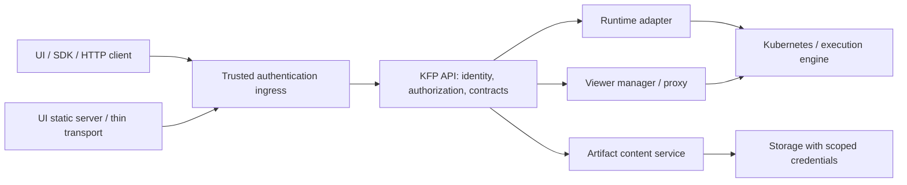

# KEP-14668: Backend API contracts and UI separation

- **Status:** Draft for discussion; not approved for implementation.
- **Author:** Jeff Spahr (@jeffspahr).
- **Tracking:** [#14668](https://github.com/kubeflow/pipelines/issues/14668).
- **Target:** staged work on master / 3.0, with graduation based on evidence;
  this document does not promise every optional read model in that release.
- **Source baseline:** [master `8a79799a2`](https://github.com/kubeflow/pipelines/commit/8a79799a2f54a678b7535eb4697dfc6812a4bb66).

## Contents

- [Summary](#summary)
- [Motivation](#motivation)
- [Proposal](#proposal)
- [API change inventory](#api-change-inventory)
- [Shared identity, authorization and errors](#shared-identity-authorization-and-error-contracts)
- [Artifact content](#artifact-content-api-and-storage-authority)
- [Operational APIs](#operational-apis-and-removal-of-ui-infrastructure-ownership)
- [Metadata APIs](#metadata-api-changes-proposed-design-for-review)
- [Migration](#migration-strategy)
- [Frontend](#frontend-considerations)
- [KFP Local](#kfp-local-considerations)
- [Tests](#test-plan)
- [Graduation](#graduation-criteria)
- [Review decisions](#decisions-required-before-implementation)
- [History](#implementation-history)
- [Drawbacks](#drawbacks)
- [Alternatives](#alternatives)
- [Related work](#related-work)

## Summary

Make the KFP backend the owner of runtime and storage operations consumed by
all clients. The web UI becomes a presentation client with a thin same-origin
transport where needed. It no longer resolves Kubernetes resources, selects
storage credentials, parses launcher configuration, or manages viewers itself.
UI, SDK and direct HTTP clients share resource identity, authorization, errors
and limits.

This KEP proposes concrete API additions and changes, distinguishes them from
existing interfaces, and stages their delivery. Artifact access, logs,
diagnostics/events, viewer lifecycle and bootstrap must reach parity before UI
infrastructure permissions are removed. Task snapshots and additional discovery
read models are independent improvements with separate acceptance criteria.
The operation names and schemas below are proposed contracts for review, not
newly shipped endpoints or evidence that linked implementation PRs have merged.

## Motivation

The current Node UI server is also a Kubernetes client, storage policy engine,
credential resolver, log reader and viewer manager. This duplicates backend
knowledge, ties requests to the UI server's configured cluster, and makes
non-browser clients depend on UI-specific routes. Existing backend log and
artifact reads provide useful starting points, but do not cover all frontend
behavior or native artifact-provider contracts.

The issue inventory now has owners for these gaps. A common design is needed so
implementations do not invent different task-attempt identities, storage grants,
pagination rules, or authentication adapters for each screen. Moving code into
a backend process is useful only if the resulting public contract removes that
knowledge from the UI and preserves supported behavior.

### Goals

1. Give every migrated UI operation a typed, authenticated backend contract.
2. Resolve execution and storage identities from authorized domain resources;
   caller-supplied pod names, URIs or namespace headers are not authority.
3. Preserve supported live/archived logs, previews, downloads, directory reads,
   viewers, custom roots, imported history and standalone/multi-user behavior.
4. Define streaming, cancellation, bounded reads, errors and compatibility once.
5. Qualify the UI with Kubernetes/object-store access denied and storage secrets
   absent, then remove obsolete clients, permissions and token mounts.
6. Enable bounded, consistent task read models without coupling that work to
   every infrastructure-access migration.

### Non-Goals

- Full multi-cluster scheduling or a new execution engine. Public identities
  leave room for backend execution-location resolution without exposing routing
  configuration to browsers.
- Reintroducing MLMD, adopting a particular UI framework, or rewriting the entire
  backend into a new service framework.
- A public arbitrary Kubernetes proxy, arbitrary URL fetcher, generic object-store
  administration API, or user-supplied credentials in frontend requests.
- New release-2.17 backports or making this migration a release-2.18 prerequisite.
- Treating a wording fix, storage SDK replacement, or one log proxy as completion
  of UI separation.

## Proposal

The backend owns resource resolution and policy. A runtime adapter owns
execution-engine-specific Kubernetes access. A content service owns storage I/O
under the resolved storage authority. A viewer manager/proxy owns viewer runtime
and session state. These are logical boundaries: the first implementation may
share processes, and a separate serving deployment is appropriate where
isolation or large streaming transfers require it. A universal new deployment
per namespace is not mandated.



The UI may retain static assets, base-path routing, browser authentication
integration and a same-origin transport. That transport forwards validated caller
context to the same backend contracts. It cannot choose credentials, broaden a namespace, retry
through a weaker route, or act as a second policy engine. Preserve the current public route
restrictions at ingress/transport: UI-facing `/apis/v2/workflows` and `/scheduledworkflows`
remain denied, and the generic `/_proxy/*` tombstone remains 410, including base-path and
compatibility rewrites. API forwarding must not expose internal runtime or arbitrary proxy
routes.

### User Stories

- A pipeline author diagnoses an image-pull failure, follows the correct attempt's
  logs, and downloads available history without Kubernetes access.
- A viewer reads authorized artifacts from existing custom or historical roots
  using the UI or SDK, with the same permissions and actionable errors.
- An operator removes workload Kubernetes permissions and storage secrets from
  the UI after capability-by-capability qualification.
- A user inspecting a large active run refreshes bounded summaries without
  mixing pages from different logical states or losing updates after a retry.

### Risks and Mitigations

| Risk | Mitigation |
| --- | --- |
| Relocating privileged access without correcting authority | Cross-tenant tests cover public APIs and internal serving boundaries; metadata possession is not a storage grant. |
| Losing an existing UI feature during migration | Inventory all routes/configuration modes, retain compatible adapters, and qualify before client cutover. |
| Large streams or snapshots overload the API | Independent data paths, explicit byte/time/concurrency quotas, cancellation, short DB transactions and load tests. |
| Old clients or mixed writers violate new guarantees | Additive schemas, capability negotiation, rollout gates and explicit incompatibility errors. |
| Requiring new infrastructure for every installation | Keep logical ownership independent of deployment topology; document standalone and multi-user profiles. |
| Unreviewed design choices become accidental compatibility promises | Keep this KEP draft until the decision checklist is resolved and contract fixtures are reviewed by API, runtime, frontend and deployment owners. |

## Design Details

### API change inventory

Paths in the detailed sections are proposals unless explicitly identified as
existing. JSON control operations use proto/OpenAPI contracts; content and proxy
transports have explicit HTTP specifications. The tracking issue mirrors this
inventory and links here for design detail.

| Capability / delivery track | Existing surface | Proposed API change | Tracking |
| --- | --- | --- | --- |
| Artifact content — separation | Artifact metadata APIs; run/node/name `:read` JSON/base64; UI artifact routes | Add `ResolveArtifactContent` and authenticated raw read, preview, entry-list and archive operations; adapt legacy routes to the same backend authority. Add output-only run readability warnings. | [#14031](https://github.com/kubeflow/pipelines/issues/14031), [#14046](https://github.com/kubeflow/pipelines/issues/14046), [#14134](https://github.com/kubeflow/pipelines/issues/14134), [#14354](https://github.com/kubeflow/pipelines/issues/14354) |
| Live/archived logs — separation | Backend run/node `/log`; UI `/k8s/pod/logs` | Add paginated log-source discovery and source-ID reads with authoritative task/attempt/UID/container identity. Preserve existing log authorization and archive behavior. | [#14668](https://github.com/kubeflow/pipelines/issues/14668), [#14032](https://github.com/kubeflow/pipelines/issues/14032), [#14981](https://github.com/kubeflow/pipelines/issues/14981) |
| Run-wide logs — independent enhancement | Per-task log controls only | Add source-tagged aggregate stream and bounded asynchronous log archive APIs using the same discovery contract. | [#14986](https://github.com/kubeflow/pipelines/issues/14986), [#14987](https://github.com/kubeflow/pipelines/issues/14987) |
| Diagnostics/events — separation | Native lifecycle fields; UI `/k8s/pod` and `/k8s/pod/events` | Extend structured/attempt diagnostic fields; add authorized task diagnostics and bounded event reads. | [#13192](https://github.com/kubeflow/pipelines/issues/13192), [#10740](https://github.com/kubeflow/pipelines/issues/10740); state reconciliation [#14989](https://github.com/kubeflow/pipelines/issues/14989) |
| Viewer lifecycle — separation | UI `/apps/tensorboard` CRUD and signed proxy | Add backend viewer CRUD, approved profiles and session-open/proxy contracts, including artifact/experiment contexts without runs. | [#14668](https://github.com/kubeflow/pipelines/issues/14668), [#14391](https://github.com/kubeflow/pipelines/issues/14391) |
| Bootstrap/configuration — separation | UI pod discovery, GKE metadata and signing initialization | Add `server_info` and namespace-aware `capabilities`; move signing/bootstrap to backend deployment and retain static UI configuration. | [#14668](https://github.com/kubeflow/pipelines/issues/14668), [#14391](https://github.com/kubeflow/pipelines/issues/14391) |
| Attempt identity/lifecycle — shared correctness | `TaskPod` name/UID/type; runtime task writes; private retry claim token | Add authoritative namespace and accepted execution-attempt identity; fence stale writes and define legal terminal/retry transitions. These correctness slices can ship independently of snapshots. | [#14032](https://github.com/kubeflow/pipelines/issues/14032), [#14322](https://github.com/kubeflow/pipelines/issues/14322), [#14981](https://github.com/kubeflow/pipelines/issues/14981) |
| Task read model — independent scale track | Full `GetTask`/`ListTasks`, sequential page drains | Add `ListTaskSummaries`/`ListTaskChanges`, revision-bound pagination, tombstones and selected-task detail reads. | [#14032](https://github.com/kubeflow/pipelines/issues/14032), [#14040](https://github.com/kubeflow/pipelines/issues/14040), [#14028](https://github.com/kubeflow/pipelines/issues/14028) |
| Relationships — independent scale track | `ListArtifactTasks` selects one IO type | Add mutually exclusive repeated-type/direction selectors; separately design bounded lineage traversal. | [#14032](https://github.com/kubeflow/pipelines/issues/14032) |
| Artifact grouping/task discovery — independent product track | Flat artifacts and run-scoped tasks | Reserve grouped artifact reads and namespace task search for product-approved schemas; trusted legacy-execution mapping is a distinct migration contract. | [#14041](https://github.com/kubeflow/pipelines/issues/14041), [#14301](https://github.com/kubeflow/pipelines/issues/14301), [#14029](https://github.com/kubeflow/pipelines/issues/14029) |
| Existing API correctness/efficiency — separate fixes | Parent pipeline/version lookup; run-list version fan-out | Validate parent relationships; design a bounded metadata batch/projection. Neither requires waiting for UI infrastructure removal. | [#14920](https://github.com/kubeflow/pipelines/issues/14920), [#11346](https://github.com/kubeflow/pipelines/issues/11346) |


### Shared identity, authorization and error contracts

Use opaque public IDs for accepted execution epochs, task attempts, log sources, content
references, viewers and sessions. `run_attempt_id` identifies an accepted execution epoch of one
logical run (including a manual retry); `task_attempt_id` identifies an executor attempt within
that epoch (including automatic retries). A source or pod reference carries both when known.
Run-level plugin output may omit task identity. Public filters use these exact dimensions; an
ambiguous generic `attempt_id` is not part of this proposal. IDs are bound to their parent
resource
and namespace UID; lookup verifies the requested relationship. An automatic task
retry and a manually retried run are different dimensions. Imported history may
have unknown identity or incomplete history; responses state that explicitly.
Private reconciliation/fencing tokens are not user-visible attempt numbers.

Authenticate at the existing trusted ingress/API boundary. Preserve end-user
identity across a thin UI transport, strip untrusted forwarded identity headers,
and authenticate any internal service hop. A gateway workload identity never
substitutes for the user's namespace/resource permissions. Check current
permissions on every operation, including page continuations, downloads and
viewer session opens; opaque handles do not confer authorization by themselves.
Backend resource resolution remains behind engine-neutral interfaces.

Retain existing `readLog` and `readArtifact` policy semantics during compatible
migration. New diagnostic/event and viewer operations require an explicit RBAC
mapping reviewed for read-only viewers, editors and administrators. Metadata
`get/list` permission must not accidentally grant access to artifact bytes or
logs. Availability/capability responses are hints, never authorization grants.

New JSON APIs use `google.rpc.Status` and typed details, including
`google.rpc.ErrorInfo` with a stable reason, domain `kubeflow.pipelines`, and
allowlisted safe metadata. Preserve legacy envelopes on compatibility routes.

| Condition | gRPC / HTTP | Representative stable reason |
| --- | --- | --- |
| Malformed selector, unsupported combination | `INVALID_ARGUMENT` / 400 | `INVALID_SELECTOR` |
| Missing authentication | `UNAUTHENTICATED` / 401 | `AUTHENTICATION_REQUIRED` |
| Authenticated caller denied | `PERMISSION_DENIED` / 403 | `ACCESS_DENIED` |
| Authorized resource lookup absent | `NOT_FOUND` / 404 | `RESOURCE_NOT_FOUND` |
| Expired cursor/reference, required configuration unavailable | `FAILED_PRECONDITION` / 400 | `SNAPSHOT_EXPIRED`, `CONTENT_REFERENCE_EXPIRED`, `CONFIGURATION_REQUIRED` |
| Optimistic update/retry conflict | `ABORTED` / 409 | `REVISION_CONFLICT` |
| Quota exceeded | `RESOURCE_EXHAUSTED` / 429 | `READ_LIMIT_EXCEEDED` |
| Unsupported operation | `UNIMPLEMENTED` / 501 | `CAPABILITY_UNSUPPORTED` |
| Temporary upstream failure | `UNAVAILABLE` / 503 | `UPSTREAM_UNAVAILABLE` |

Authorization precedes sensitive existence checks. Responses redact credentials,
signed query strings and internal service addresses. Retry information is bounded
and distinguishes transient failure from an operator-required correction.
Binary/text handlers validate before writing success headers; after commitment,
terminate incomplete transfers rather than append a JSON error to content.
Structured streaming transports define terminal/error frames separately.


### Artifact content API and storage authority

This section proposes the artifact slice of
[#14668](https://github.com/kubeflow/pipelines/issues/14668), owned by
[#14031](https://github.com/kubeflow/pipelines/issues/14031) with provider semantics in
[#14046](https://github.com/kubeflow/pipelines/issues/14046) and removal of UI YAML parsing in
[#14134](https://github.com/kubeflow/pipelines/issues/14134). The route and message names below
are a concrete design for review, not an approved or implemented contract. Source baseline:
master `8a79799a2f54a678b7535eb4697dfc6812a4bb66`.

#### Existing and proposed operations

The current
[ArtifactService](https://github.com/kubeflow/pipelines/blob/8a79799a2f54a678b7535eb4697dfc6812a4bb66/backend/api/v2/artifact.proto#L55)
provides metadata CRUD subsets and artifact/task relationships. Preserve these APIs. The
existing [run/node/name read
handler](https://github.com/kubeflow/pipelines/blob/8a79799a2f54a678b7535eb4697dfc6812a4bb66/backend/src/apiserver/server/run_artifact_server.go#L43)
streams base64 inside JSON `{data:...}` from the configured object store; it is not the proposed
native multi-provider content contract.

| Status | Proposed RPC/HTTP operation | Contract |
| --- | --- | --- |
| Existing; retain | `GetArtifact`, `ListArtifacts`, artifact/task relationship methods | Metadata and relationships retain their identities and permissions. |
| Existing; adapt | `GET /apis/v2/runs/{run_id}/nodes/{node_id}/artifacts/{artifact_name}:read` | Preserve its JSON/base64 representation during compatibility support; resolve through the new authority boundary after cutover. |
| New | `ResolveArtifactContent`; `POST /apis/v2/artifact_content:resolve` | Resolve a registered artifact or constrained historical locator to an opaque content reference and safe operation metadata. |
| New | `GET /apis/v2/artifact_content/{content_ref}:read` | Raw bytes, download disposition, conditional reads and byte ranges where supported. |
| New | `GET /apis/v2/artifact_content/{content_ref}:preview` | Bounded JSON preview with `media_type`, `encoding` (`utf-8` or `base64`), `data`, `truncated`, and `limits_applied`; renderer-specific transformations require a declared supported format. |
| New | `ListArtifactContentEntries`; `GET /apis/v2/artifact_content/{content_ref}/entries` | Bounded directory/archive-entry listing with opaque pagination tokens. |
| New | `GET /apis/v2/artifact_content/{content_ref}:archive` | Bounded streaming directory download with a completion/partial-result manifest. |

Define control messages in `backend/api/v2` and generate UI/SDK clients. Document binary HTTP
operations in the same API specification; do not force raw content into unary protobuf byte
arrays or JSON/base64. API gateways must preserve streaming, disconnect cancellation and
response headers.

#### Identity and resolution

`ResolveArtifactContentRequest` has a `oneof` selector: `artifact_id`, or `historical_locator
{namespace, uri}`. Optional relative entry selection is validated against the resolved
object/directory; it cannot select another root. A locator names an object, not an endpoint
permission or credential. It is accepted only when the backend can establish current storage
authority from trusted operator configuration or privileged imported context. Existing
authorized roots need neither object relocation nor creation of native Artifact rows. Runtime
MLMD access is not required.

The backend derives the namespace from registered metadata, checks caller permissions,
canonicalizes producer/reader identity, and establishes the object's storage grant.
Tenant-created Artifact/importer records, exact URI matches and claimed `legacy=true` flags
cannot manufacture that grant. Where namespace credentials cover other tenants' historical
objects, require a trustworthy narrower object/root grant or explicit sharing policy that
identifies the viewer audience.

The response contains `content_ref`, expiry, supported operations, safe media/size information
and enforced limits. It contains no Secret references, provider session or credential-selection
instructions. The proposed reference is authenticated and caller-bound, not a bearer download
capability. Bind it to namespace UID, object identity, allowed operations and
authorization/configuration revision; recheck authorization and revocation for each operation.
Credential refresh remains internal. A stale reference requires resolution again rather than a
broader-credential retry.

#### Backend ownership and transfer behavior

The proposed data path is an authenticated artifact content service behind the KFP API ingress.
The UI forwards caller context and renders content; it neither reads Kubernetes storage
configuration nor contacts object stores. Deployment may share the core API process initially or
use a separate serving process. A separate process authenticates backend requests and enforces
scoped namespace/object/operation bindings; forwarded headers alone are insufficient. A
universal per-namespace deployment and
[#14883](https://github.com/kubeflow/pipelines/pull/14883)'s approval/readiness protocol are not
prerequisites.

Resolve provider precedence, endpoints, credentials and network restrictions in the trusted
backend/storage boundary. Preserve S3-compatible services, GCS and supported HTTP/archive/volume
paths. Retain destination/redirect guards, resolve-time network protection, namespace credential
isolation and central multi-user `volume://` denial. Supported single-user or isolated volume
access needs an explicit mount/provenance model. Reuse
[#15058](https://github.com/kubeflow/pipelines/pull/15058)'s adapter contracts and transfer
fixtures where useful; replacing Node with Go does not itself establish these guarantees.

Reads preserve raw bytes, use bounded buffering and cancel upstream I/O on disconnect. Range
responses identify the same canonical object authorized for full reads; unsupported
transformations return a defined unsupported-range response. Preview limits apply after
decompression as well as to input bytes. Listings bound entries, page size and traversal work,
and state consistency behavior for a changing directory. Archives bound bytes, entries, duration
and concurrency; include unavailable entries and a final completion record. A truncated stream
is never presented as a complete successful download.

Errors use a shared structured envelope and stable reasons: invalid locator (400), denied
access/unapproved endpoint (403), missing content (404), stale reference or unavailable required
configuration (failed precondition), exceeded limits, and transient storage failure (503).
Distinguish permanent operator action from retryable failure. Return validated safe origins
where useful, never credentials or signed query values. Once bytes are committed, abort on
transfer failure; clients recognize incomplete framing rather than parsing an error as content.

The proposed archive format is ZIP with generated collision-free safe member names and a final
`.kfp/manifest.json` mapping members to authorized source/object identities and omissions. Treat
names as data: exclude traversal, absolute paths, symlink entries and credentials. Preserve unusual
object keys through safe names and manifest mappings instead of interpreting them as filesystem
paths. A missing final manifest or ZIP completion record means the download is incomplete. Apply
the same representation rules to run-log archives.

#### Compatibility, rollout and acceptance

Test native and historical contexts with `kfp-launcher` present and absent. Native resolution
uses trusted root/query/override rules or compiled defaults when absent; absence never
authorizes environment-credential fallback. Historical approved roots retain their trusted
storage context even outside today's launcher root and with a ConfigMap present. Configuration
presence is not a historical/native classifier; changed roots, rotated credentials, revocation
and namespace recreation must not restore old authority.

Start with one complete preview/download path, then add remaining providers and operations.
Temporarily forward old UI URLs with authenticated context and preserve documented v2beta1
compatibility. Qualify actual populated 2.18-to-3.0 installations without assuming new approval
records exist. Mixed versions either obey the same contract or fail with an actionable
compatibility error; rollback cannot restore known cross-tenant reads. Remove artifact-specific
UI clients, configuration parsing, credentials and permissions only after parity/isolation tests
pass.

The acceptance matrix includes viewer/editor/unauthorized callers, forged metadata, internal
receiver spoofing, broad and shared roots, rotating credentials, canonical escaping, interrupted
transfers and configuration recovery. For
[#14354](https://github.com/kubeflow/pipelines/issues/14354)'s transferred early-warning
requirement, propose an additive output-only `Run.readability_warnings` list returned by
CreateRun/GetRun: `{reason, scope, observed_at, configuration_revision, safe_message}`. Populate
it when trusted root/provider resolution shows that the shared reader cannot use a configured
destination, and refresh/clear it when that configuration changes. It is best-effort for
runtime-selected destinations, not a promise to predict every future object URI or grant. Keep
the warning distinct from run execution failure: a legitimate workload write must not be
rejected merely because the shared reader has narrower authority.

#### Decisions requiring review

Approve exact route/RPC naming, reference lifetime/storage and revocation mechanism; public RBAC
mapping preserving viewer access; trusted historical grants and intentional-sharing
administration; process placement and internal authentication; preview/archive representations
and numerical limits; listing consistency; supported mixed-version window. The proposed default
is authenticated service delivery, with delegated download capabilities deferred until their
lifetime, revocation and leakage properties are reviewed. These decisions must be resolved
before the first production implementation claims the contract is stable.

### Operational APIs and removal of UI infrastructure ownership

Unless explicitly identified as existing, the routes below are proposed additions under
`/apis/v2`. Relative paths in this section use that prefix. The inventory is checked against
master `8a79799a2f54a678b7535eb4697dfc6812a4bb66`. Issue
[#14668](https://github.com/kubeflow/pipelines/issues/14668) owns the canonical migration
inventory; [#14032](https://github.com/kubeflow/pipelines/issues/14032) owns attempt/snapshot
identity, [#14981](https://github.com/kubeflow/pipelines/issues/14981) historical log
references, [#13192](https://github.com/kubeflow/pipelines/issues/13192) structured diagnostics,
[#10740](https://github.com/kubeflow/pipelines/issues/10740) events, and
[#14391](https://github.com/kubeflow/pipelines/issues/14391) viewer signing-key adoption.

#### Existing boundary

The [UI
router](https://github.com/kubeflow/pipelines/blob/8a79799a2f54a678b7535eb4697dfc6812a4bb66/frontend/server/app.ts#L278)
owns TensorBoard CRUD/proxy, Kubernetes pod/log/event routes, GKE metadata routes, health
metadata composition and API forwarding. Logs can already proxy to the backend, controlled by
`streamLogsFromServerApi`. The [backend HTTP
router](https://github.com/kubeflow/pipelines/blob/8a79799a2f54a678b7535eb4697dfc6812a4bb66/backend/src/apiserver/main.go#L609)
exposes `/runs/{run_id}/nodes/{node_id}/log` and run-node artifact reads. These streaming
handlers are registered directly, outside generated gRPC services. There is no registered
viewer, pod-diagnostics or server-info service today.

Existing log reads already authorize `readLog` against the run, verify the live pod's run label,
and fall back to the archive only before any bytes have been written. Imported runs use archived
logs. Preserve those protections while replacing caller-selected pod names with server-resolved
sources. The existing native task API provides pod name/UID/type, state history and lifecycle
diagnostics; extend that contract rather than resurrecting removed MLMD structures.

#### Logs and attempt discovery

Add `GET /runs/{run_id}/log_sources`, filtered by `task_id`, `run_attempt_id`,
`task_attempt_id`, `role`, and bounded
`page_size/page_token`. Return:

```text
LogSource { source_id, task_id?, run_attempt_id, task_attempt_id?,
  role, container?, stream_name?, locations[], availability, unavailable_reason?,
  first_observed_at?, last_observed_at?, expires_at?, supports_follow }
ListLogSourcesResponse { sources[], next_page_token, discovery_revision,
  history_complete, history_incomplete_reason? }
```

`discovery_revision` and page tokens identify one bounded source-catalog view, independent of
the optional task-summary snapshot subsystem. Bind tokens to caller/run/filter scope; expired
views require rediscovery. `source_id` names one logical stream for an attempt/role/container or
plugin stream name. `locations[]` describes its live-pod/archive/plugin locations and their
availability/expiry. Live and archived copies of the same stream are not separate sources:
discovery, aggregation and archive export select one location per logical source and never count
both as independent output. Absence of driver pods is normal. Discovery must not synthesize
nonexistent pod streams. Identities come from the shared attempt model: automatic task retries
and manual run retries are distinct. Persist source references before destructive retry cleanup;
retain prior attempt identity and diagnostic history independently of object-store retention.
Imported or pre-migration runs can report incomplete history; never equate unknown history with
no attempts.

Add `GET /runs/{run_id}/log_sources/{source_id}:read` with validated `follow`, `tail_lines`,
`since_time` and `max_bytes`. A source resolves its namespace, pod UID/container or archived
object internally and selects an available location without changing logical identity. A failed
stream can be retried explicitly against a newly discovered location; the client must show the
restart/overlap rather than silently append repeated bytes. Authorize run access with the
dedicated log verb and validate
run/task/attempt/source relationships against authoritative persisted execution evidence. A
caller-provided namespace, pod name, URI or matching mutable label alone is insufficient.
Recheck the live UID against the recorded attempt to prevent pod-name reuse.

Use bounded copying, cancellation, backpressure, idle/absolute stream deadlines and
per-principal concurrency limits. Return plain text with attachment/nosniff headers. Validate
before committing response headers; after streaming begins, terminate on failure without
appending JSON or replaying an archive prefix. Clients may rediscover availability, but cannot
silently splice different attempts. For
[#14987](https://github.com/kubeflow/pipelines/issues/14987), propose `GET
/runs/{run_id}/logs:stream` with bounded source filters and NDJSON frames `{kind, source_id,
run_attempt_id, task_attempt_id?, sequence, source_time?, observed_at, text?, reason?}`. Frame
kinds are `line`, `gap`, `source_error` and `end`. Sequence is stream-local; missing timestamps
and clock skew prevent a guaranteed global chronological order. Explicitly report partial
availability. Bound fan-in, queues and individual records. Propose a 64 KiB maximum encoded
NDJSON frame, with UTF-8-safe continuation chunks (`line_id`, `chunk_index`, `line_complete`)
for long or newline-free lines. IDs are stream-local, not reconnect offsets. Slow consumers
receive a gap/termination indication instead of silent loss; a missing final `end` frame means
incomplete delivery. The final frame states complete versus partial results. Do not promise
exactly-once reconnect from pod logs without stable
source offsets: document overlap/duplication or restart semantics and advertise resume only for
sources that support it.

For [#14986](https://github.com/kubeflow/pipelines/issues/14986), `POST
/runs/{run_id}/log_archives` accepts bounded selected logical source IDs, an idempotency key and
immutable `submitted_at`, returning `{archive_id, state, expires_at, limits}`. `GET
/runs/{run_id}/log_archives/{archive_id}` returns state, manifest availability and safe failure
reasons; `GET .../{archive_id}:download` performs an authenticated expiring download. States
distinguish pending/running/cancel_requested/cancelled/complete/partial/failed/expired. `POST
.../{archive_id}:cancel` idempotently requests cancellation, which workers observe promptly and
clean up bounded scratch/partial objects; status remains queryable. Abort/archive lifetime,
byte/entry/time quotas and run-deletion cleanup are server-owned. A manifest names requested
sources and omissions; workers stream or spool within configured quotas rather than buffer whole
archives. Scope idempotency to authenticated principal, namespace UID, run and operation. The
same key/body retries return one operation; reusing a key for different inputs is a conflict.
Validate `submitted_at` against a bounded admission window and retain deduplication records for
the operation lifetime and at least through that window, independently of archive-byte expiry. A
replay with stale submission time fails explicitly rather than creating a second job after its
payload or deduplication window expires. Set admission, retention, cancellation and expiry
bounds in the reviewed contract. Archive history cannot recreate references or objects already
lost.

#### Pod diagnostics and events

Add `GET /runs/{run_id}/diagnostics` and `/runs/{run_id}/events`, with optional task/attempt
filters and cursor pagination for event lists. Task-scoped
`/runs/{run_id}/tasks/{task_id}/diagnostics` and `/events` are bindings to the same
ownership-checked implementation. Run-level reads include authorized orchestration/startup
evidence that can precede task creation; they do not require a task ID or invent a pod for
plugin/non-pod execution. Filters use `run_attempt_id` and `task_attempt_id` consistently.
Diagnostics return task/run state, observation time, source freshness, lifecycle
message/category, structured reason/exit code when known, and pod references/conditions. Events
return source UID, reason, message, type, first/last observed time and occurrence count.
Distinguish `not_created`, `expired`, `unavailable` and `unsupported` from empty successful
results. These reads do not terminalize tasks;
[#14989](https://github.com/kubeflow/pipelines/issues/14989) reconciles authoritative state.

Resolve ownership through run/task/attempt records, then fetch only their Kubernetes objects.
Authorize diagnostics/events explicitly; do not copy the current namespace-level `VIEWERS` check
as sufficient ownership proof. Never expose arbitrary pod YAML containing unrelated
environment/configuration. Namespace, task and UID mismatch tests are mandatory. Event TTL is
not durable history: include the observation window and cursor expiry, and instruct clients to
restart a listing after expiry. Missing-image and missing-Secret fixtures must render useful
warnings while preserving recovery and current-attempt state.

#### Viewer lifecycle and proxy sessions

Add `POST/GET /viewers`, `GET/PATCH/DELETE /viewers/{viewer_id}`, and `POST
/viewers/{viewer_id}:open`. Creation accepts a typed `kind`, namespace, approved `profile_id`,
bounded input handles and one context: run/task, artifact, or experiment. Artifact and
experiment viewers must work without a run ID; standalone installation defaults must not become
authenticated namespace fallbacks. Experiment aggregation authorizes every contributing source
and reports partial/unavailable inputs explicitly.

Resolve input handles through the artifact authorization/content contract. Metadata URI equality
is not an independent grant to stored bytes. Require viewer create/get/update/delete permission
in the owning namespace plus authorization for the selected source context. Store the resolved
ownership and source identities with the viewer. Expose status, readiness, diagnostics and
expiry; PATCH permits a documented field mask for mutable fields, with profile/runtime changes
requiring controlled recreation. Accept no arbitrary pod template, service account, image or
network target from visualization metadata; deployment-approved profiles own those choices.
Before cutover, inventory existing authorized image/template customizations and provide explicit
profile translations or documented incompatibility. An adapter cannot silently elevate untrusted
legacy inputs into approved profiles.

`:open` returns a short-lived session and an `open_url` on an operator-approved isolated viewer
origin. Viewer HTML/JavaScript must not share the authenticated UI/API origin merely because the
proxy URL is scoped. A standalone trusted-viewer same-origin mode requires explicit policy and
separate review; it is not the multi-user default. A dedicated backend viewer
proxy resolves the fixed viewer service, validates the session, current caller authorization and
current source-content grants, and constrains HTTP/WebSocket upgrade paths, origin and cookie
scope. Source revocation invalidates viewer access even if TensorBoard cached the data. Define a
bounded authorization lease/recheck interval and close existing sessions/WebSockets on
revocation; test the permitted revocation latency. Use a reviewed server-side session exchange
or narrowly scoped HttpOnly viewer cookies, never broad UI/API cookies on the viewer origin.
Session expiry/deletion closes
access; viewer lifetime is separate. Never expose service DNS or a bearer capability in an
unrestricted query string. Create/open inputs also require CSRF protection; define a bounded
idempotency key for viewer creation to avoid duplicate resources after lost responses. Signing
keys and rolling adoption belong to the backend/proxy deployment, coordinated with
[#14391](https://github.com/kubeflow/pipelines/issues/14391); they
are not secrets fetched by the UI process.

#### Bootstrap, capabilities and rollout

Add `GET /server_info` for backend build/API versions, multi-user mode, pipeline-store kind and
supported feature versions. Add `GET /capabilities?namespace=...` for caller-authorized
operations, limits, viewer profiles and unavailable-feature reasons. Capabilities guide
presentation; each operation still authorizes independently. Preserve health probes separately.
Optional cluster/project display metadata is backend-configured and omitted when unsupported,
replacing UI GKE metadata calls. UI-only asset version, base path and navigation preferences
remain static bootstrap configuration, with no Kubernetes credentials.

Publish JSON contracts through proto/OpenAPI and document HTTP streaming/proxy operations
explicitly. Use consistent status/error reasons for invalid input, denied access, missing
resources, expired handles/cursors, unsupported capability, throttling and unavailable
upstreams; redact credentials and internal locations. Advertise capabilities before frontend
activation. Retain legacy route adapters during a bounded compatibility window, all forwarding
to the same backend authorization; never fall back to direct Kubernetes access after denial or
backend failure.

Migrate each inventory row with contract, authorization, rollout and removal tests. Finally
remove UI Kubernetes clients, Secret/ConfigMap/provider reads, viewer management, workload RBAC
and automatic service-account-token mounts. If a gateway needs workload authentication, use an
explicitly projected, rotating token restricted to the backend audience, with no Kubernetes
workload privileges; user identity remains separately validated and cannot be replaced by that
gateway identity. Test standalone/multi-user installs, non-root base paths, browser
authentication, imported history, retry races, expired sessions and rolling upgrades before
deleting adapters.

### Metadata API changes: proposed design for review

This section proposes API shapes and consistency rules; it does not record an approved contract.
It addresses [#14032](https://github.com/kubeflow/pipelines/issues/14032) and frontend adoption
in [#14040](https://github.com/kubeflow/pipelines/issues/14040)/#14028. Snapshot optimization,
grouped artifacts, and cross-run discovery are independent of the first artifact-content
migration under [#14031](https://github.com/kubeflow/pipelines/issues/14031). Removing UI
storage credentials and Kubernetes access must not wait for the entire metadata performance
roadmap.

#### Existing operations and compatibility

The current `backend/api/v2/run.proto` provides `GetTask` (`GET
/apis/v2/runs/{run_id}/tasks/{task_id}`), `ListTasks` (`GET /apis/v2/runs/{run_id}/tasks`),
`UpdateTask` (`PATCH` on the task resource), and `UpdateTasksBulk` (`POST
/apis/v2/runs/{run_id}/tasks:batchUpdate`). `FindCachedTask` (`POST /apis/v2/tasks:findCached`)
is a namespace/fingerprint cache lookup, not task search.

`backend/api/v2/artifact.proto` provides `ListArtifacts`, `GetArtifact`, and `ListArtifactTasks`
(`GET /apis/v2/artifact_tasks`). The relationship request accepts one `IOType`; it has no
direction predicate. These endpoints remain supported. Introduce additive protobuf fields and
operations, regenerate Go/Python/TypeScript clients, and preserve the documented v2beta1
compatibility behavior. Do not replace current task reads until server capability detection and
mixed-version tests exist.

#### Proposed bounded summary and change operations

Add two unary RPCs with JSON HTTP bindings; defer watch/SSE transport until resume semantics are proven:

| Proposed operation | HTTP binding | Response |
| --- | --- | --- |
| `ListTaskSummaries` | `GET /apis/v2/runs/{run_id}/task_summaries` | `tasks`, `run_summary`, `snapshot_revision`, `next_page_token`, final-page `changes_cursor` |
| `ListTaskChanges` | `GET /apis/v2/runs/{run_id}/task_changes?cursor=…` | ordered `changes`, `through_revision`, `next_page_token`, final-page `changes_cursor` |

A task summary contains task/run IDs, name/display name, parent/scope/iteration, task
type/state, timestamps, bounded diagnostic summary, current executor references, I/O-presence
markers, `task_revision`, and execution-attempt identity. It excludes parameter values, artifact
metadata, pipeline specifications, and full state history. `GetTask` continues serving
selected-task details and gains an output-only `task_revision`. Detail reads return a
transactionally consistent current record, explicitly not historical snapshot I/O; clients must
not splice newer detail fields into an older graph snapshot silently.

The first summary request captures committed revision R. Pages use deterministic task-ID keyset
order at R; mutations during pagination cannot change membership or values in that snapshot.
Initially support whole-run summaries without mutable-state filters, avoiding ambiguous delta
filter-exit semantics. Proposed initial limits are 500 rows and 1 MiB per response, with
15-minute cursor validity; benchmarks must validate defaults before approval. Individual summary
fields are bounded, and any diagnostic truncation is explicit, so a single row cannot cause a
zero-progress page loop. All cursors are opaque, integrity-protected, and bound to run, caller
scope, projection version, ordering, revision, expiry, and last key. Authorization is rechecked
on every request; possession of a token grants nothing.

The first change request captures a fixed upper watermark U and returns changes after R through
U. Later pages remain at U. Changes contain complete replacement summaries or deletion
tombstones, plus run-summary/attempt-transition records. Clients apply records by `(revision,
ordinal)`, ignore already-applied records, and advance their durable cursor only after the final
page. An unchanged run returns an empty page and fresh cursor. A lost response can be replayed
without losing or duplicating visible state. Work scales with changed data, subject to
pagination, rather than pretending every arbitrarily large change fits one response.

#### Storage, retention, deletion, and retry consistency

One feasible implementation is a bounded, transactionally maintained summary-version table plus
change journal. Every task mutation increments its task record revision; every mutation
affecting a summary—including task creation, pod publication, relevant relationship changes,
deletion, and retry reset—updates its projection/journal in the same database transaction as
canonical state. Full I/O-only changes also publish the new `task_revision` through the versioned summary
projection and change journal, even when all other summary fields are unchanged, so incremental
clients invalidate stale selected-task details.
Allocate a monotonically increasing per-run
revision under the run row lock, using one documented run-before-task lock order. Existing bulk
updates remain individually committed; this proposal does not silently make them atomic.

Summary versions have validity intervals, allowing reads at R without keeping a database
transaction open across HTTP requests. Retain the last version visible at the compaction floor
plus later versions; index snapshot lookup by run/task/revision and journal reads by
run/revision/ordinal. Each page validates its retention floor and reads under one short
consistent transaction. Run status and summaries must come from the same revision boundary.
Benchmark contention from per-run revision allocation and MySQL/PostgreSQL query plans before
accepting this design.

History has finite age and byte/row quotas. Compaction can invalidate old cursors explicitly; it
must never silently skip changes. Return `FAILED_PRECONDITION` with
`google.rpc.ErrorInfo.reason=SNAPSHOT_EXPIRED` or `CHANGE_CURSOR_EXPIRED`, requiring a fresh
snapshot while the UI retains its last successful view. Invalid tokens return
`INVALID_ARGUMENT`; quota exhaustion returns `RESOURCE_EXHAUSTED`. Tombstones persist through
the supported replay window. Deleting a run terminates its stream under normal authorized
not-found behavior.

A manual run retry establishes a new accepted execution epoch and a revisioned reset before
accepting its task writes. Automatic task retries create a new `task_attempt_id` within the
existing `run_attempt_id`; they do not reset the whole run snapshot. Earlier run-epoch writers
are fenced transactionally; stale cursors receive an attempt-reset record and restart snapshots
rather than merge generations. Coordinate this mechanism with
[#14322](https://github.com/kubeflow/pipelines/issues/14322). Existing `RetryGeneration` is a
claim/fencing token: failed claims can increment it without executing a new attempt. Do not
expose it as a human attempt number. Terminal task-write protection can ship separately under
[#15008](https://github.com/kubeflow/pipelines/pull/15008); snapshot storage must later preserve
the same invariant.

#### Pod identity and relationship additions

Extend `TaskPod` additively with authoritative `namespace`, `run_attempt_id` and
`task_attempt_id`; preserve name, UID, and role. The two opaque attempt fields have the same
meaning as log-source fields and filters. Missing historical identities are explicit rather than
fabricated. Bind published identities to backend-verified run/task execution
ownership, not caller-selected namespace/pod coordinates. Publish the regular launcher's
executor identity before component execution, with an explicit failure/retry policy, and advance
the task revision even if state remains RUNNING. Preserve the importer's existing early
publication. Imported history may report unavailable identity; never guess the UI's namespace.
Log retrieval consumes backend-issued source identity and verifies current/historical attempt
and pod UID.

Extend `ListArtifactTasksRequest` with `repeated IOType types` and optional `PRODUCER|CONSUMER`
direction. Preserve old `type`; because it is a non-optional proto3 enum, only a non-UNSPECIFIED
value counts as a selected legacy filter. Reject combinations of active legacy `type`, nonempty
`types`, and explicit `direction`; omitted/default legacy enum values do not conflict with new
selectors. Retain artifact/task/run IDs and key filters, namespace authorization, stable
pagination, and explicit unknown-type behavior. This removes the four-request
producing-relationship lookup. A purpose-built lineage subgraph API remains separately designed;
the existing bounded neighborhood UI remains valid.

#### Deferred product projections and verification

[#14041](https://github.com/kubeflow/pipelines/issues/14041) owns proposed `ListArtifactGroups`
and group-member reads after choosing pipeline/workspace equivalents and
multi-producer/imported/orphan semantics.
[#14301](https://github.com/kubeflow/pipelines/issues/14301) owns namespace-scoped `SearchTasks`
and separately an authorized legacy-execution mapping lookup. Neither should scan runs/artifacts
in the browser; neither is required to remove UI infrastructure access.

Install transactional capture on every writer first. Bootstrap existing runs in bounded,
restartable batches with conditional projection upserts and journal catch-up; use only short
watermark/finalization barriers, never a whole-run scan while holding the run lock. Captured
deletion/reset tombstones must defeat stale bootstrap upserts. Retain capture history throughout
bootstrap or explicitly restart if compaction overtakes it. Publish a completed baseline
watermark and serve only revisions at or after it; prove that baseline gap-free before
advertising snapshot capability. Mixed-version API replicas that bypass
capture invalidate these guarantees; keep the feature disabled until rollout completes. Define
legacy-runtime attempt handling with
[#14322](https://github.com/kubeflow/pipelines/issues/14322) instead of assuming an omitted
epoch is safe.

Qualification must race pagination with writes/deletes/retry, replay lost pages, expire cursors,
recover compaction, revoke authorization, and publish executor identity during a running
component. Measure initial and unchanged/changing refreshes at 100/1,000/2,000/10,000 tasks,
database contention, response bytes, and cancellation. Gate snapshot adoption behind capability
detection; unsupported servers retain current bounded polling without fabricating revision
guarantees.

## Migration Strategy

Use independent server capabilities and operator-controlled activation for each
family. The initial proposed names are `artifact_content.v1`,
`runtime_sources.v1`, `runtime_diagnostics.v1`, `viewers.v1`, and
`task_snapshots.v1`; names and configuration placement require review. Keep new
paths disabled until their contract and migration checks pass. Capability
publication describes actual availability, supported contract version and limits,
not a frontend build assumption.

| Stage | Deliverable and evidence required |
| --- | --- |
| 0: design/contract | Approve identity, RBAC, schemas, bounds and compatibility; capture current-route behavior in fixtures. |
| 1: backend artifact slice | Deliver one complete authorized preview/download flow; pass real existing-root and tenant-isolation cases. Preserve legacy wire representations through adapters. |
| 2: runtime reads | Deliver source discovery, log reads and diagnostics/events; validate imported history, retries, absent driver pods and cancellation. Archive/aggregation enhancements have independent acceptance. |
| 3: viewer/bootstrap | Move lifecycle, source authorization, session proxy/signing and configuration discovery. Qualify old viewer URLs, signing-key adoption and browser entry paths. |
| 4: UI cutover | Enable clients only for advertised capabilities; preserve successful data and actionable unsupported/error states. Old URLs forward into the same backend policy. |
| 5: infrastructure removal | Demonstrate parity with UI Kubernetes/object-store access denied, then remove client libraries, credentials, RBAC/token mounts and storage-network access across supported overlays. |
| Parallel read-model track | Deliver identity/lifecycle correctness independently; ship query sharing against the current API independently, then adopt snapshots when available. Grouping/search/lineage designs remain separately accepted. |

Start upgrade qualification from the actual populated 2.18 state, including its
retained artifact ownership policy, existing roots and namespace credentials.
Do not assume deferred approval/readiness resources or new history metadata
already exist. Resolve trustworthy historical storage grants before cutover;
missing authority yields an actionable state, not automatic broader-credential
fallback. Configuration changes, credential rotation, revocation, namespace
recreation, interrupted rollout and recovery are part of qualification.

Adapters preserve supported `/apis/v2beta1` routes and the documented generated
client aliases. New schema definitions belong only in `backend/api/v2`; the frozen
legacy descriptor remains a compatibility-test fixture. New capabilities require
explicit version negotiation for older UI/SDK clients. Do not generate a second
editable v2beta1 schema. Keep JSON/base64 legacy artifact reads distinct from new
raw-byte transports.

A rollout may disable an optional new read model and use existing bounded polling
before snapshot adoption. After a security boundary is activated, failure or
downgrade must not restore direct shared-credential storage access or a known
cross-tenant path. Roll back only to a release/configuration that preserves the
active boundary; otherwise keep the affected capability unavailable with a clear
recovery procedure. Publish the supported mixed-version window and irreversible
activation conditions before release; do not claim unrestricted rollback.

Schema work for summaries, source references and viewer/history resources must
follow [nonblocking migration guidance](../../docs/agents/database-migrations.md).
Use additive tables/fields and bounded, restartable backfills. Preserve stored
values and support old readers/writers until capture/epoch enforcement is
activated. Verify explicit supported DDL algorithms, bounded lock waits and
replica coordination on populated MySQL and PostgreSQL. No blocking table-copy or
whole-table startup backfill is an acceptable fallback.

## Frontend Considerations

Generate typed control clients; provide a small transport wrapper for documented
streaming/content endpoints. Pages render domain data rather than reconstructing
provider configuration or execution topology. Share stable per-run query keys
and cancellation policy under [#14040](https://github.com/kubeflow/pipelines/issues/14040) while
preserving each view's completeness
and retry requirements. Clear stale warnings after recovery, preserve user
selection/zoom/filter state on refetch, and display incomplete history and partial
streams explicitly.

The UI may render artifact previews, but active HTML/SVG must remain downloads or
execute only inside the existing isolated/sandboxed preview boundary; moving the
fetch must not make untrusted active content same-origin with authenticated API
pages. Preserve CSP, safe disposition, escaping, and byte/decompression limits.
Keep browser credentials and same-origin/base-path integration intact. KEP-14668
does not prescribe React/MUI/shadcn changes or require the modernization PR.

## KFP Local Considerations

Python subprocess/Docker local execution, local artifact paths and exported
offline graphs remain usable without a remote API, Kubernetes or viewer service.
This proposal does not replace local filesystem access with remote content
handles. Generated SDK clients expose the optional remote contracts; local
execution remains independent. A local UI feature that requests remote-only
capabilities must explain unavailability rather than silently requiring a
cluster. Any later local feature that reuses these contracts needs its own scope
and tests.

## Test Plan

- [x] The proposal author understands component owners may require additional
  tests before implementation is accepted.

This is a documentation proposal. Source and existing regression contracts were
inspected; the tests below are required implementation evidence, not passing
results claimed by this KEP. Current aggregate coverage has not been measured.

### Prerequisite testing updates

Inventory routes, consumers and configuration modes in `frontend/server`,
`frontend/src/lib/Apis.ts`, `backend/api/v2`, backend HTTP handlers and manifests.
Record current behavior for legacy artifact encoding, log archive fallback,
viewer proxy paths, auth, base paths and standalone defaults. Mark delivered work
such as [#15058](https://github.com/kubeflow/pipelines/pull/15058) and native lifecycle warnings
as a baseline to preserve.

### Unit and contract tests

- Encode/decode request selectors and field masks; reject ambiguous selectors,
  mismatched parent IDs, unknown required fields, expired/tampered tokens and
  unsupported version combinations. Validate error-envelope compatibility.
- Exercise attempt/source mapping, name reuse with different pod UIDs, ordinary
  task failures, image pull/OOM events, recovered warnings and stale reports.
- Cover content canonicalization/escaping, relative traversal, range and preview
  representations, archive manifests, incomplete streams and cancellation.
- Cover shared frontend queries, refetch recovery, duplicate events, preserved
  user state, keyboard/focus behavior and meaningful unavailable states.

### Integration tests

- Exercise authenticated public APIs and internal service boundaries with two
  tenants, read-only viewers, editors and unauthorized callers. Spoof headers,
  Artifact/importer records, namespace IDs, source IDs and session references;
  never infer an object grant merely from a matching row or broad credentials.
- Test real S3-compatible stores and supported provider fixtures; keep live
  interoperability evidence separate from mocked cloud coverage. Include GCS,
  approved HTTP redirects, archives, supported isolated volumes, and central
  multi-user volume denial. Cover native/historical × ConfigMap present/absent,
  custom/shared roots, credential rotation, revocation and configuration recovery.
- Run populated MySQL/PostgreSQL upgrade tests with concurrent reads/writes,
  bounded lock contention, competing replicas, interruption and rollback. Capture
  actual generated DDL and latency while migration is active.
- Race snapshots/pages with writes, deletion, compaction and retry; replay lost
  responses; prove that mixed-version writers cannot advertise false consistency.
  Test manual and automatic retries independently, including failed retry claims.
- Exercise viewer create/open/delete and session expiry during HTTP/WebSocket
  use, artifact/experiment viewers without runs, namespace recreation, and
  signing-key rollout/key-loss recovery. Preserve authorized customization through
  approved profiles and explicitly document unsupported legacy options.

### End-to-end and scale tests

- Use the production UI and SDK against the same authorized fixtures. Validate
  previews/downloads, live/archived/plugin logs, missing/expired history,
  consolidated ordering limitations, archive manifests, events and viewers.
- Deny the UI all Kubernetes and object-store network access, remove its storage
  secrets, workload RBAC and automatic token mounts, and rerun every migrated flow.
  Include standalone/multi-user deployments, non-root base paths and ingress auth.
- Qualify populated 2.18 upgrades, new/old UI/API combinations, temporary backend
  failures and safe rollback. No 2.17 backport is required by this KEP.
- Measure 100/1,000/2,000/10,000-task runs and 2/5/10-run comparisons: requests,
  bytes, refresh latency, rows scanned, lock contention and browser render time.
  Load streams/archives with slow consumers and cancellations; prove enforced
  per-principal/global limits and bounded memory. Set numerical release budgets
  from these results before graduating the relevant capability.

Implementation PRs update this section with retained test names and CI evidence.
Regeneration follows [the canonical v2 API guide](../../docs/agents/generation.md),
including `make -C backend/api API_VERSION=v2 generate`, the SDK-owned Python
client generation and `frontend`'s `npm run apis:all`. Hand-maintained HTTP specs
need matching route/representation contract tests.

## Graduation Criteria

- **Draft to implementable:** API/runtime/frontend/deployment owners agree each
  first-slice schema, RBAC mapping, identity and error contract; numerical limits,
  compatibility fixtures and migration strategy are reviewed. Remaining optional
  designs are explicitly deferred, not implicitly approved.
- **Capability enabled:** that capability's required contract, isolation,
  migration and failure-recovery tests pass; documentation distinguishes known
  limitations from missing configuration. Advertised capabilities match reality.
- **UI separation complete:** all mandatory inventory rows reach parity and the
  no-UI-infrastructure E2E test passes across supported overlays. No hidden old
  route can fall back to UI storage/Kubernetes credentials. Required permission
  and dependency removal is merged and documented.
- **Optional read models complete:** snapshot/discovery contracts meet their own
  consistency and measured scale criteria. Their completion is tracked separately
  and does not redefine completion of the mandatory separation work.

## Decisions Required Before Implementation

| Decision | Proposed default / review owner |
| --- | --- |
| Final routes, RPCs and schema field types | Use the shapes below under canonical v2; API owners reserve additive field numbers and HTTP specifications before implementation. |
| Accepted attempt identity and legacy writers | Opaque accepted-execution epoch distinct from retry claims; runtime/API owners coordinate [#14322](https://github.com/kubeflow/pipelines/issues/14322), [#14032](https://github.com/kubeflow/pipelines/issues/14032) and [#14981](https://github.com/kubeflow/pipelines/issues/14981). |
| Content authority and historical sharing | Trusted backend/operator grants, caller-bound references, no implicit row/URI authority; storage/deployment owners approve grant administration and revocation. |
| Read-only RBAC and internal service identity | Preserve dedicated content/log permissions and review diagnostics/viewer verbs; deployment/API owners approve the complete matrix. |
| Limits and cursor/session/reference lifetimes | Enforced server bounds; snapshot defaults below are provisional. Runtime/storage/frontend owners set numbers and retry behavior from tests. |
| Viewer profiles and old customization | Operator-approved profiles; viewer/deployment owners inventory supported image/template choices and define translations before cutover. |
| HTTP representation and live-log ordering | Raw content, typed bounded previews, source-tagged NDJSON aggregation, explicit partial/gap semantics; API/frontend owners approve envelopes. |
| Snapshot storage and activation | Transactional version/journal capture with bounded bootstrap; database/runtime owners validate contention, online DDL and all-writer rollout. |
| Capability deployment and retirement window | Logical services first, split data paths where needed; release/deployment owners approve supported combinations and safe rollback limits. |

These are review decisions within this proposal; accepting the document as a
draft does not declare the feature implementable or relax any existing issue's
security, compatibility or retention acceptance criteria.

## Implementation History

- 2026-11-10: Initial draft and canonical API-change inventory linked from [#14668](https://github.com/kubeflow/pipelines/issues/14668).
- No implementation or release graduation is claimed by this proposal.

## Drawbacks

The backend takes on additional operational responsibilities, authorization
surfaces and contracts. Snapshot/source history adds storage, cleanup and write
coordination cost. Maintaining old adapters during migration increases temporary
complexity. Viewer isolation and historical storage authority require operator
configuration that cannot be inferred safely from tenant-authored metadata.
These costs should be measured and delivered in independent slices.

## Alternatives

1. **Keep extending the UI server.** Lower initial migration cost, but retains
   duplicated storage/runtime policy and UI deployment coupling.
2. **Rewrite Node handlers in Go without a shared contract.** Can reuse code and
   libraries, but leaves ambiguous identity, authority and compatibility rules.
3. **Expose raw Kubernetes or object-store APIs to clients.** Moves infrastructure
   knowledge and credentials into clients and bypasses domain ownership checks.
4. **Route every byte through the core API process.** Simplifies ingress, but can
   couple large transfers to run-management capacity. Allow a separately isolated
   serving process behind the same authenticated contract.
5. **Require every new metadata feature before migration.** Unnecessarily couples
   architecture changes to product/performance design; use independent graduation.
6. **Copy [#14883](https://github.com/kubeflow/pipelines/pull/14883)'s full adoption/readiness framework.** Retain it as reference
   evidence and reusable components; choose only the mechanisms needed by the
   reviewed backend authority model.

## Related Work

The API inventory maps work to existing issues rather than creating duplicate
implementation trackers. See also [MLMD removal](../12147-mlmd-removal/README.md),
[native pipeline storage](../11551-kubernetes-native-api/README.md),
[pod lifecycle diagnostics](../12843-pod-lifecycle-failure/README.md), and
[KFP Local](../15214-kfp-local/README.md). Their historical implementation claims
must be interpreted against the source baseline above.
