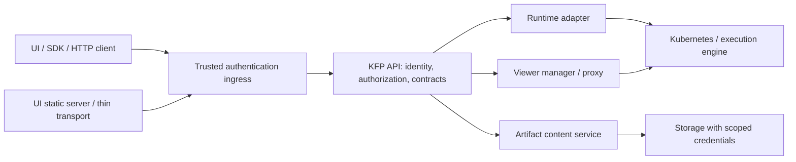
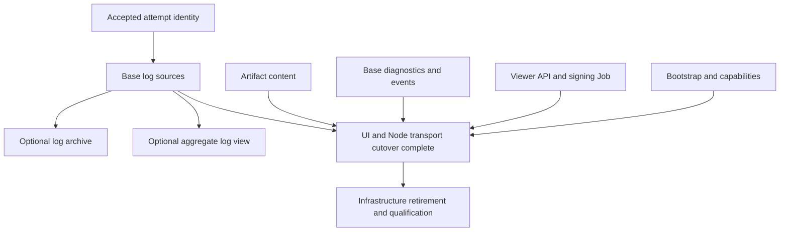

# KEP-14668: Backend API contracts and UI separation

- **Status:** Draft for discussion; not approved for implementation.
- **Author:** Jeff Spahr (@jeffspahr).
- **Tracking:** [#14668](https://github.com/kubeflow/pipelines/issues/14668).
- **Target:** staged delivery on `main` for 3.0. Each mandatory capability graduates
  on its own compatibility and isolation evidence.
- **Source references:** [`8a79799a2`](https://github.com/kubeflow/pipelines/commit/8a79799a2f54a678b7535eb4697dfc6812a4bb66)
  pins the original route and API inventory.
  [`b5e247523`](https://github.com/kubeflow/pipelines/commit/b5e247523201027c2c0b05c3260f53bd0c89008b)
  records the November 11 boundary check. The standalone authorization and namespace examples
  use `c1ff1d265`. The archived JSON log fix uses its merge commit `abb7982bb`.
  [`7780f12ac`](https://github.com/kubeflow/pipelines/commit/7780f12acfbde9f16169c7fcbfdfb6c3ef5432ea)
  was the November 18 `main` review baseline. Relative links open files in the same tree as
  this proposal.

## Contents

- [Summary](#summary)
- [Motivation](#motivation)
- [Proposal](#proposal)
- [Design Details](#design-details)
  - [API change inventory](#api-change-inventory)
  - [Shared identity, authorization and errors](#shared-identity-authorization-and-error-contracts)
    - [Caller permissions](#caller-permissions)
    - [Service account permissions](#service-account-permissions)
    - [Audit and metrics](#audit-and-metrics)
    - [Shared error vocabulary](#shared-error-vocabulary)
  - [Artifact content](#artifact-content-api-and-storage-authority)
  - [Operational APIs](#operational-apis-and-removal-of-ui-infrastructure-ownership)
  - [Required task and executor identity](#required-task-and-executor-identity)
- [Implementation ownership and dependencies](#implementation-ownership-and-dependencies)
- [Migration](#migration-strategy)
- [Frontend](#frontend-considerations)
  - [Frontend server responsibility inventory](#frontend-server-responsibility-inventory)
- [KFP Local](#kfp-local-considerations)
- [Tests](#test-plan)
- [Graduation](#graduation-criteria)
- [Review decisions](#decisions-required-before-implementation)
- [History](#implementation-history)
- [Drawbacks](#drawbacks)
- [Alternatives](#alternatives)
- [Related work](#related-work)

## Summary

Make the KFP backend the owner of runtime and storage operations consumed by all clients. The
web UI becomes a presentation client with a thin same-origin transport where needed. It no
longer resolves Kubernetes resources, selects storage credentials, parses launcher
configuration, or manages viewers itself. UI, SDK and direct HTTP clients share resource
identity, authorization, errors and limits.

This KEP proposes concrete API additions and changes, distinguishes them from existing
interfaces, and stages their delivery. Artifact access, logs, diagnostics/events, viewer
lifecycle and bootstrap must reach parity before UI infrastructure permissions are removed. The
[separate versioned task read-model proposal](https://github.com/kubeflow/pipelines/pull/15774)
owns snapshot design and qualification. The operation names and schemas below are proposed
contracts for review, not newly shipped endpoints or evidence that linked implementation PRs
have merged.

## Motivation

The current Node UI server is also a Kubernetes client, storage policy engine, credential
resolver, log reader and viewer manager. This duplicates backend knowledge, ties requests to the
UI server's configured cluster, and makes non-browser clients depend on UI-specific routes.
Existing backend log and artifact reads provide useful starting points, but do not cover all
frontend behavior or native artifact-provider contracts.

The issue inventory now has owners for these gaps. A common design is needed so implementations
do not invent different task-attempt identities, storage grants, pagination rules, or
authentication adapters for each screen. Moving code into a backend process is useful only if
the resulting public contract removes that knowledge from the UI and preserves supported
behavior.

### Goals

1. Give every migrated UI operation a typed, authenticated backend contract.
2. Resolve execution and storage identities from authorized domain resources;
   caller-supplied pod names, URIs or namespace headers are not authority.
3. Preserve supported live/archived logs, previews, downloads, directory reads,
   viewers, custom roots, imported history and standalone/multi-user behavior.
4. Define streaming, cancellation, bounded reads, errors and compatibility once.
5. Qualify the UI with Kubernetes/object-store access denied and storage secrets
   absent, then remove obsolete clients, permissions and token mounts.
6. Publish executor and attempt identity early enough for authorized live reads.

### Non-Goals

- Full multi-cluster scheduling or a new execution engine. Public identities
  leave room for backend execution-location resolution without exposing routing
  configuration to browsers.
- Reintroducing MLMD, adopting a particular UI framework, or rewriting the entire
  backend into a new service framework.
- A public arbitrary Kubernetes proxy, arbitrary URL fetcher, generic object-store
  administration API, or user-supplied credentials in frontend requests.
- New release-2.17 backports or making this migration a release-2.18 prerequisite.
- Treating a wording fix, storage SDK replacement, or one log proxy as completion
  of UI separation.

## Proposal

The backend owns resource resolution and policy. A runtime adapter owns
execution-engine-specific Kubernetes access. A content service owns storage I/O under the
resolved storage authority. A viewer manager/proxy owns viewer runtime and session state. These
are logical boundaries: the first implementation may share processes, and a separate serving
deployment is appropriate where isolation or large streaming transfers require it. A universal
new deployment per namespace is not mandated.



The UI may retain static assets, base-path routing, browser authentication integration and a
same-origin transport. That transport forwards validated caller context to the same backend
contracts. It cannot choose credentials, broaden a namespace, retry through a weaker route, or
act as a second policy engine. Preserve the current public route restrictions at
ingress/transport: UI-facing `/apis/v2/workflows` and `/scheduledworkflows` remain denied, and
the generic `/_proxy/*` tombstone remains 410, including base-path and compatibility rewrites.
API forwarding must not expose internal runtime or arbitrary proxy routes.

### User Stories

- A pipeline author diagnoses an image-pull failure, follows the correct attempt's
  logs, and downloads available history without Kubernetes access.
- A user reads authorized artifacts from existing custom or historical roots
  using the UI or SDK, with the same permissions and actionable errors.
- An operator removes workload Kubernetes permissions and storage secrets from
  the UI after capability-by-capability qualification.
- A user opening an imported run sees which archived sources are available even when older
  records lack a task or attempt identifier.

### Risks and Mitigations

| Risk | Mitigation |
| --- | --- |
| Relocating privileged access without correcting authority | Cross-tenant tests cover public APIs and internal serving boundaries; metadata possession is not a storage grant. |
| Losing an existing UI feature during migration | Inventory all routes/configuration modes, retain compatible adapters, and qualify before client cutover. |
| Content transfers or live logs exhaust serving capacity | Separate data paths, enforce byte/time/concurrency limits, and test slow consumers and cancellation. |
| Old clients or mixed writers violate new guarantees | Additive schemas, capability negotiation, rollout gates and explicit incompatibility errors. |
| Requiring new infrastructure for every installation | Keep logical ownership independent of deployment topology; document standalone and multi-user profiles. |
| Unreviewed design choices become accidental compatibility promises | Keep this KEP draft until the decision checklist is resolved and contract fixtures are reviewed by API, runtime, frontend and deployment owners. |

## Design Details

### API change inventory

Paths in the detailed sections are proposals unless explicitly identified as existing. JSON
control operations use proto/OpenAPI contracts; content and proxy transports have explicit HTTP
specifications. The tracking issue mirrors this inventory and links here for design detail.

| Capability | Delivery track | Existing surface | Proposed API change | Tracking |
| --- | --- | --- | --- | --- |
| Artifact content | separation | Artifact metadata APIs; run/node/name `:read` JSON/base64; UI artifact routes | Address registered content by artifact ID. Resolve constrained historical locators to caller-bound references. Support raw reads, previews, entry listing and archives for both paths, and adapt legacy routes to the same backend authority. Migrate profile-controller writer roots and storage policy on namespace reuse. Add output-only run readability warnings. | [#14031](https://github.com/kubeflow/pipelines/issues/14031), [#14046](https://github.com/kubeflow/pipelines/issues/14046), [#14134](https://github.com/kubeflow/pipelines/issues/14134), [#14354](https://github.com/kubeflow/pipelines/issues/14354) |
| Live/archived logs | separation | Backend run/node `/log`; UI `/k8s/pod/logs` | Add paginated log-source discovery and source-ID reads with authoritative task/attempt/UID/container identity. Preserve existing log authorization and archive behavior. Supply native live tail-and-follow for UI cutover. | [#15517](https://github.com/kubeflow/pipelines/issues/15517) after [#15516](https://github.com/kubeflow/pipelines/issues/15516); new history remains [#14981](https://github.com/kubeflow/pipelines/issues/14981) |
| Run-wide logs | independent enhancement | Per-task log controls only | Add source-tagged aggregate stream and bounded asynchronous log archive APIs using the same discovery contract. | [#14986](https://github.com/kubeflow/pipelines/issues/14986), [#14987](https://github.com/kubeflow/pipelines/issues/14987) |
| Diagnostics/events | separation | Native lifecycle fields; UI `/k8s/pod` and `/k8s/pod/events` | Add ownership-checked diagnostics and bounded event reads preserving current fields; additional structured/per-attempt history is separately accepted. | [#13192](https://github.com/kubeflow/pipelines/issues/13192), [#10740](https://github.com/kubeflow/pipelines/issues/10740); state reconciliation [#14989](https://github.com/kubeflow/pipelines/issues/14989) |
| Viewer lifecycle | separation | UI `/apps/tensorboard` CRUD and signed proxy | Add backend viewer CRUD, approved profiles and session-open/proxy contracts, including artifact/experiment contexts without runs. | [#15518](https://github.com/kubeflow/pipelines/issues/15518); adoption policy [#14391](https://github.com/kubeflow/pipelines/issues/14391) |
| Bootstrap/configuration | separation | UI GKE metadata, health/configuration composition | Add `server_info` and namespace-aware `capabilities`; retain static UI configuration and health compatibility. Signing Job belongs to viewers; host-pod volume discovery belongs to artifacts. | [#15519](https://github.com/kubeflow/pipelines/issues/15519) |
| Attempt identity/lifecycle | shared correctness | `TaskPod` name/UID/type; runtime task writes; private retry claim token | Add authoritative namespace and accepted execution-attempt identity; fence stale writes and define legal terminal/retry transitions. These correctness slices can ship independently of snapshots. | [#15516](https://github.com/kubeflow/pipelines/issues/15516); lifecycle coordination [#14322](https://github.com/kubeflow/pipelines/issues/14322), terminal guard [#14032](https://github.com/kubeflow/pipelines/issues/14032) |
| Task read model | independent scale track | Full `GetTask`/`ListTasks`, sequential page drains | Add `ListTaskSummaries`/`ListTaskChanges`, revision-bound pagination, tombstones and selected-task detail reads. See [KEP-14032](https://github.com/kubeflow/pipelines/pull/15774). | [#14032](https://github.com/kubeflow/pipelines/issues/14032), [#14040](https://github.com/kubeflow/pipelines/issues/14040), [#14028](https://github.com/kubeflow/pipelines/issues/14028) |
| Relationships | independent scale track | `ListArtifactTasks` selects one IO type | Add mutually exclusive repeated-type/direction selectors; decide or separately own bounded lineage traversal before closing. | [#15522](https://github.com/kubeflow/pipelines/issues/15522) |
| Artifact grouping/task discovery | independent product track | Flat artifacts and run-scoped tasks | Reserve grouped artifact reads and namespace task search for product-approved schemas; trusted legacy-execution mapping is a distinct migration contract. | [#14041](https://github.com/kubeflow/pipelines/issues/14041), [#14301](https://github.com/kubeflow/pipelines/issues/14301), [#14029](https://github.com/kubeflow/pipelines/issues/14029) |
| Existing API correctness/efficiency | separate fixes | Parent pipeline/version lookup; run-list version fan-out | Validate parent relationships; design a bounded metadata batch/projection. Neither requires waiting for UI infrastructure removal. | [#14920](https://github.com/kubeflow/pipelines/issues/14920), [#11346](https://github.com/kubeflow/pipelines/issues/11346) |
| Frontend server/consumer cutover | separation | Node domain handlers, browser clients and existing API forwarding | Replace domain handlers with capability-aware adapters; preserve health/static/auth, uploads/specs/transfer and route denials. | [#15520](https://github.com/kubeflow/pipelines/issues/15520) |
| Deployment retirement | separation | UI credentials/RBAC/SDKs; frontend image also used by artifact receivers and signing Job | Qualify all supported deployments with UI infrastructure access denied; relocate image consumers before package/permission removal. | [#15521](https://github.com/kubeflow/pipelines/issues/15521) |

### Shared identity, authorization and error contracts

Use opaque public IDs for accepted execution epochs, task attempts, log sources, content
references, viewers and sessions. `run_attempt_id` identifies an accepted execution epoch of one
logical run (including a manual retry); `task_attempt_id` identifies an executor attempt within
that epoch (including automatic retries). A source or pod reference carries both when known.
Run-level plugin output may omit task identity. Lookups bind each identifier to its parent and
namespace UID. In imported history either attempt ID may be absent. Report the source of the
available evidence and the limits of the history. An omitted ID never broadens a filtered
request to include another attempt. Private reconciliation/fencing tokens are not user-visible
attempt numbers. The trusted backend/runtime boundary assigns or validates identities
idempotently; ordinary task/metadata updates cannot mint attempts or rebind their ownership.
Lost responses cannot allocate another accepted execution.

Authenticate at the existing trusted ingress/API boundary. Preserve end-user identity across a
thin UI transport, strip untrusted forwarded identity headers, and authenticate any internal
service hop. A gateway workload identity never substitutes for the user's namespace/resource
permissions. Check current permissions on every operation, including page continuations,
downloads and viewer session opens; opaque handles do not confer authorization by themselves.
Backend resource resolution remains behind engine-neutral interfaces.

Send `Cache-Control: private, no-store` on protected content, logs, diagnostics, events,
capabilities and viewer responses, including resolves, session opens and errors.

The [artifact proxy][artifact-proxy] drops upstream `cache-control` when it rebuilds headers
from its allowlist. [#15520] must set the required value itself after filtering and set it before
any local denial or error can commit headers. This applies even if the upstream omits the
header or supplies `public`. The [Go log handler][log-handler] currently sets
`no-cache, private` after authorization. [#15517] must replace it with `private, no-store` at
handler entry, before validation or authorization, on both legacy and new log reads. Verify the
effective success and error headers on the direct API and through the UI adapter and ingress.

[artifact-proxy]: ../../frontend/server/handlers/artifacts.ts
[log-handler]: ../../backend/src/apiserver/server/run_log_server.go

#### Caller permissions

The shipped [multi-user role rules][multi-user-roles] grant `runs.readLog` and
`runs.readArtifact` to view and edit callers. The following bindings are
proposed for namespace-scoped SubjectAccessReviews in `pipelines.kubeflow.org`. A role cell
describes the proposed stock grant. Resolve the actual subject, namespace and resource for each
request, including continuations. Here “admin” means a project administrator in the namespace.
The storage operator who controls cross-namespace grants has a separate deployment role.

[multi-user-roles]: ../../manifests/kustomize/base/installs/multi-user/view-edit-cluster-roles.yaml

Stock single-user mode currently
[skips the multi-user Artifact access review](https://github.com/kubeflow/pipelines/blob/c1ff1d2658d497b189509e67c32658bc2c3cfa89/backend/src/apiserver/server/artifact_server.go#L695-L699).
For stock standalone, the installer configures one installation-local read principal on the
trusted single-user entry path. It may read registered metadata and content under the
installation grant. Use that principal for authorization, quotas and audit in this mode.
A standalone deployment with external authentication binds its intended subjects explicitly.
Public or untrusted traffic cannot assert the local identity through a header, and multi-user
installs always use the namespace-scoped caller checks below.

| Operation | SubjectAccessReview resource and verb | View | Edit | Admin | Additional check |
| --- | --- | --- | --- | --- | --- |
| Discover or read log sources, including legacy run/node logs | `runs.readLog` (existing) | Yes | Yes | Yes | Requested source belongs to the authorized run and attempt where known. |
| Legacy run/node artifact bytes | `runs.readArtifact` (existing) | Yes | Yes | Yes | Verify run/node/object relationship and effective storage grant. |
| Registered content, including preview, entries and archive | `artifacts.get` and proposed `artifacts.readArtifact` | Yes | Yes | Yes | Verify the registered object and each derived entry under the effective grant. |
| Resolve/read a historical locator | Proposed `artifacts.readArtifact` in the authorized namespace | Yes | Yes | Yes | Apply current storage grant and caller binding on resolve and on each read. |
| Run/task diagnostic projection and event pages | Proposed `runs.readDiagnostics` for both | Yes | Yes | Yes | Bind every record to the authorized run and execution evidence. |
| List/get viewers or open a session | Proposed `viewers.list/get/open`, according to operation | Yes | Yes | Yes | Filter lists by visibility. On open and renewal verify viewer access and every source grant. |
| Create, patch, delete viewers | Proposed `viewers.create/update/delete`, respectively | No | Yes | Yes | Verify namespace, profile and context. Check source access before creating or changing inputs. |
| Inspect bootstrap and capabilities | Deployment-visible build facts, authenticated capability query | Filtered | Filtered | Filtered | Expose only authorized namespace features. Each underlying operation repeats its own check. |
| Maintain historical storage grants | Deployment/storage operator configuration | No | No | No | Separately delegated operators maintain grants and record changes. |

Today the [pod info and event handlers](../../frontend/server/handlers/pod-info.ts) both check
namespace `get` on `kubeflow.org/viewers`. The
[artifact UI handler](../../frontend/server/handlers/artifacts.ts) also uses that check in
authenticated mode. Map each custom role's intended workflows before enabling the new routes:

| Existing workflow | Proposed opt-in binding in the same namespace |
| --- | --- |
| Read pod info or events | Grant `runs.readDiagnostics` for both bounded projections. Both expose the same run-scoped diagnostic evidence. A future API exposing broader event data needs separate review. |
| Read registered artifact bytes | Grant `artifacts.readArtifact` and metadata `artifacts.get`. Historical reads need the content verb and an object grant. Keep the existing `runs.readArtifact` check on the legacy run/node route. |
| Manage or open a Viewer | Map the existing `kubeflow.org` Viewer permissions to the corresponding KFP `viewers` operations, including `open` for session users. |

Ship the stock role changes before cutover. Publish example Role rules and an opt-in migration
for operators to bind to the same subjects, namespaces and intended resource restrictions.
Verify allowed and denied operations for each custom role through the UI, SDK, direct API and
compatibility routes before switching its traffic. A metadata-only role keeps metadata access.
A denied new check is final on every adapter. Approving content access also requires an object
grant. The workload permission to list Kubernetes Events is independent of the caller verb.

#### Service account permissions

Use a separate workload identity for a component that needs extra authority. Compare rendered
standalone and multi-user manifests at cutover. The current
[API Role](../../manifests/kustomize/base/pipeline/ml-pipeline-apiserver-role.yaml) and
[multi-user ClusterRole](../../manifests/kustomize/base/installs/multi-user/api-service/cluster-role.yaml)
are the baseline for the following proposed changes. Existing execution controllers retain
permissions needed for their separate reconciliation responsibilities.

| Identity | Existing access to reuse | Proposed access when enabling the feature | Scope and qualification |
| --- | --- | --- | --- |
| Core API server | Pod/log reads, workflow reads and configured authorization reviews | With separate adapters, authenticated backend calls only. If it hosts the runtime adapter, add the event read below. | Compare actual per-overlay bindings. Never copy the UI role wholesale. |
| Runtime adapter | Reuse pod `get`, `pods/log.get` and workflow reads where already bound | Add `list` for core Events in served namespaces (or the selected events API group), using the resolved subject UID. | No new pod mutation, event writes or cluster-wide discovery for UI requests. |
| Content service / receiver | Namespace-scoped object-store identity and explicit permitted mounts | Where needed, `get` only named launcher/provider configuration and named credential Secrets in the serving namespace. Read grant policy from the authorized resolver. Grant the resolver read access at the policy scope selected before installation. | Exclude Secret listing, grant writes and shared cross-tenant fallback credentials. Test rotation and revocation. |
| Viewer manager / proxy | Viewer controller reconciles Viewer resources into workloads | Manager reads/creates/patches/deletes Viewer objects in enabled namespaces. Proxy receives scoped session/source checks and connects only to the resolved viewer. | No new generic proxy route, arbitrary deployment creation or signing-key mutation by the proxy. |
| Signing-key initialization Job | Existing [named Secret get/update](../../manifests/kustomize/base/pipeline/ui-signing-key/rbac.yaml) | Move those two verbs to the dedicated viewer bootstrap identity. Mount only necessary key material in the signer. | Verify old-key adoption and rotation before retiring the frontend-image Job. |
| UI server | Move each current infrastructure consumer to its owner | No Kubernetes workload verbs or storage credentials after cutover. | Remove automatic token mount. If backend hop authentication uses a projected token, restrict its audience to that backend. |

Test each allowed operation with its caller role and actual service identity. Repeat denied
cases with a read-only custom role, a revoked grant, and a resource in a different namespace.
Record the rendered role diff beside each implementation PR. For a co-located first release, the
API server service account needs the union of only those adapter permissions it actually uses.
Record that union per installation. In particular, moving viewer or storage work behind an
independently authenticated service adds no Viewer or storage Secret privileges to the core API
server. In standalone the existing API service account has a namespaced Role and
[RoleBinding](../../manifests/kustomize/base/pipeline/ml-pipeline-apiserver-rolebinding.yaml).
Grant scope is open. A cluster-scoped CRD requires a ClusterRole and ClusterRoleBinding in
both overlays, limited to `get/list/watch` on `ArtifactStorageGrant`. A namespaced CRD in one
operator-controlled namespace needs only a Role and RoleBinding there. Bind the chosen reader
to the resolver service account, or to the API service account if it hosts the resolver. Show
the actual privilege delta for each overlay. Bind grant writes separately to the authorized
provisioner. The resolver cannot write grants and tenants cannot read or change them.

#### Audit and metrics

For content and log reads, the owning backend records one structured authorization/dispatch
event and a correlated completion event with result, duration, bytes transferred and completion
state (complete, client cancellation, limit, or upstream error). Include request ID, operation,
authenticated subject or approved pseudonymous ID, namespace UID and opaque resource identity in
the access-controlled audit sink. Audit grant creation, replacement and revocation with operator
and policy revision. Apply the deployment's retention and access rules.

Record request and denial counts, latency and byte histograms, and counts of cancellations,
partial transfers and limit hits. Use bounded labels such as operation, result and source type.
Keep caller IDs, namespace names, paths and resource IDs out of metric labels. Exclude object
URIs, signed queries, headers, session tokens, secret values and payload/log text from both
outputs. A test fixture must correlate a denied request and an interrupted transfer with the
expected events and verify redaction through the backend and compatibility transport.

#### Shared error vocabulary

New JSON APIs use `google.rpc.Status` and typed details, including `google.rpc.ErrorInfo` with a
stable reason, domain `kubeflow.pipelines`, and allowlisted safe metadata. Preserve legacy
envelopes on compatibility routes.

| Condition | gRPC / HTTP | Representative stable reason |
| --- | --- | --- |
| Malformed selector, unsupported combination | `INVALID_ARGUMENT` / 400 | `INVALID_SELECTOR` |
| Missing authentication | `UNAUTHENTICATED` / 401 | `AUTHENTICATION_REQUIRED` |
| Authenticated caller denied | `PERMISSION_DENIED` / 403 | `ACCESS_DENIED` |
| Authorized resource lookup absent | `NOT_FOUND` / 404 | `RESOURCE_NOT_FOUND` |
| Expired cursor/reference, required configuration unavailable | `FAILED_PRECONDITION` / 400 | `CURSOR_EXPIRED`, `CONTENT_REFERENCE_EXPIRED`, `CONFIGURATION_REQUIRED`. KEP-14032 defines `SNAPSHOT_EXPIRED`, `CHANGE_CURSOR_EXPIRED` and per-run `SNAPSHOT_NOT_READY`. |
| Optimistic update/retry conflict | `ABORTED` / 409 | `REVISION_CONFLICT` |
| Quota exceeded | `RESOURCE_EXHAUSTED` / 429 | `READ_LIMIT_EXCEEDED` |
| Unsupported operation | `UNIMPLEMENTED` / 501 | `CAPABILITY_UNSUPPORTED` |
| Temporary upstream failure | `UNAVAILABLE` / 503 | `UPSTREAM_UNAVAILABLE` |

After parent authorization, catalog entries may use `SOURCE_IDENTITY_UNAVAILABLE` or
`SOURCE_AUTHORITY_UNAVAILABLE` as availability reasons. Direct unauthorized reads return
`ACCESS_DENIED`. Authorization precedes sensitive existence checks. Responses redact
credentials, signed query strings and internal service addresses. Retry information is bounded
and distinguishes transient failure from an operator-required correction. Binary/text handlers
validate before writing success headers; after commitment, terminate incomplete transfers rather
than append a JSON error to content. Structured streaming transports define terminal/error
frames separately.

### Artifact content API and storage authority

[#14031](https://github.com/kubeflow/pipelines/issues/14031) owns this slice, with provider
semantics in [#14046](https://github.com/kubeflow/pipelines/issues/14046) and parser retirement
in [#14134](https://github.com/kubeflow/pipelines/issues/14134). The following contracts and
limits are proposed for review. Delivery targets `main` / 3.0; source links use the historical
`8a79799a2` revision.

#### Operations: use registered IDs directly

Registered artifacts need no preliminary resolution request or content reference. Every
operation loads the Artifact, derives its namespace and canonical object identity, and
authorizes current access. A caller-selected URI cannot override that identity. All paths below
use `/apis/v2`.

| Operation | Registered artifact | Historical object without an Artifact ID |
| --- | --- | --- |
| Raw read, conditional read and supported byte ranges | `GET /artifacts/{artifact_id}/content` | `GET /artifact_content/{content_ref}` |
| Bounded preview | `GET /artifacts/{artifact_id}/content:preview` | `GET /artifact_content/{content_ref}:preview` |
| Bounded directory/archive-entry listing | `GET /artifacts/{artifact_id}/content/entries` | `GET /artifact_content/{content_ref}/entries` |
| Streaming directory archive | `GET /artifacts/{artifact_id}/content:archive` | `GET /artifact_content/{content_ref}:archive` |

Only historical locators use `ResolveArtifactContent`, bound to `POST /artifact_content:resolve`
with `{namespace, uri}`. The backend validates that locator against current operator-owned
grants and returns a five-minute, authenticated, caller-bound reference plus safe operation
metadata. The reference binds namespace UID, canonical object, allowed operations and grant
UID/generation; it contains no credentials or provider-session instructions and confers no
access without authorization. Expiry or a changed grant requires resolution again. Existing
roots require neither object relocation nor native metadata registration, and there is no
runtime MLMD dependency.

Preserve
[ArtifactService metadata and relationship operations](https://github.com/kubeflow/pipelines/blob/8a79799a2f54a678b7535eb4697dfc6812a4bb66/backend/api/v2/artifact.proto#L55).
The existing run/node/name `:read` route retains its
[JSON/base64 wire representation](https://github.com/kubeflow/pipelines/blob/8a79799a2f54a678b7535eb4697dfc6812a4bb66/backend/src/apiserver/server/run_artifact_server.go#L43)
through a backend adapter. Specify control/preview/list messages in `backend/api/v2` and
generate clients; document raw/archive HTTP streaming explicitly rather than embedding large
bytes in unary protobuf or JSON.

#### Operator-owned storage grants

The proposed authority record is an `ArtifactStorageGrant`, writable only by
storage/deployment administrators or a narrowly authorized provisioning controller. Tenant
namespace editors cannot create or change it. The CRD scope is a pre-installation decision.
Each record contains:

| Field | Meaning |
| --- | --- |
| `audience.namespace_uids` | Exact current namespace identities allowed to use the grant; names alone do not survive namespace recreation. |
| `destination` | Approved provider, endpoint/account and bucket, or an explicitly configured isolated volume root. |
| `object_scope` | Canonical exact object keys or a delimiter-bounded root prefix; never an arbitrary URL or browser-supplied glob. |
| `credential_binding` | Backend-only reference to the scoped workload identity or credential source. Rotation does not disclose credentials to clients. |
| `operations`, `sharing` | Permitted read/preview/list/archive operations; private versus explicitly shared scope and its complete viewer audience. |
| `generation`, `state` | Current revision and active/revoked state; invalid updates are rejected before activation. |

Every read requires an active matching object grant. New content operations also require the
effective `artifacts.readArtifact` permission in the authorized namespace. Registered IDs
additionally require Artifact metadata access. The legacy run/node route uses its existing
`runs.readArtifact` permission with the same object-grant enforcement. Grants
cannot expand the actual storage identity's permissions. Artifact/importer rows, URI queries,
namespace labels and tenant-editable launcher ConfigMaps cannot create grants or select a
broader credential binding. Resolve provider settings under [#14046], then match the actual
destination and canonical object; do not authorize one spelling and fetch another.

An allocation is a durable reservation created by the installer, storage administrator or
authorized profile provisioner. It records the installation and namespace UIDs, canonical
provider endpoint/account, bucket and exact key or delimiter-bounded prefix, the scoped
credential binding and the exclusive owner or approved sharing audience. The provisioner must
control the allocation and verify storage ownership. Serialize overlapping reservations per
canonical destination, persist the decision, then activate the grant. Concurrent provisioners
cannot both claim the same private prefix. Reconciliation is idempotent for the same allocation
and UID. A root string, an empty listing, a writable launcher ConfigMap, an Artifact/importer
row or the ability to read the bucket does not establish that reservation. An operator can
attest a historical scope from protected provisioning or storage inventory with the same facts.

**Default grants and activation.** These are proposed installer and upgrade behaviors for the
first artifact slice. The [compiled standalone fallback](../../backend/src/v2/config/env.go)
is `minio://mlpipeline/v2/artifacts`. The
[stock profile provisioner](../../manifests/kustomize/base/installs/multi-user/pipelines-profile-controller/sync.py)
configures a private root per namespace name and also provisions access to shared paths.

- **Fresh standalone, stock storage.** The installer reserves `v2/artifacts/` exclusively in
  its newly provisioned bucket at the actual backend endpoint. It issues one private grant for
  read, preview, list and archive to the installation namespace UID and its scoped storage
  identity. It provisions the grant before advertising content or accepting default allocations
  as ready. For standalone Artifact records, map the backend's
  [empty namespace sentinel](https://github.com/kubeflow/pipelines/blob/c1ff1d2658d497b189509e67c32658bc2c3cfa89/backend/src/apiserver/resource/resource_manager.go#L4006-L4012)
  to this configured UID. Requests cannot select another audience. Reused or external stores
  require an operator reservation before activation.
- **Fresh multi-user, stock profile.** The profile provisioner reserves the private
  `private-artifacts/{namespace}/v2/artifacts/` prefix in the configured bucket for the
  current namespace UID and issues the same four operations to that one audience before
  enabling reads there. The stock default creates no grant on the common `artifacts/` or
  `shared/` prefix. Custom roots need a separate reservation or explicit sharing policy.
- **Recreated namespace.** [#14031] owns the profile controller's writer migration with the
  manifests maintainers. Read the UID from the observed Namespace. When a name is reused,
  reserve a fresh UID-specific prefix disjoint from the former identity's private prefixes
  and wildcard permissions. Update both the launcher's `defaultPipelineRoot` and the Argo
  `artifact-repositories` archive `keyFormat`. Reconcile the per-user object policy, bucket
  listing policy and the workload credential to that allocation. A Secret left under the
  expected name cannot establish ownership. Retire the old grant and credentials, and publish
  the new writer configuration only once its permissions match. Retries must reuse the same
  reservation. Keep old objects in place under their existing retention policy. The new
  identity gets no read, list, write or delete access to the old private allocation. An
  operator can authorize historical reads separately through the adoption rules below.
- **Populated 2.18 upgrade.** Install the new policy support with the new routes disabled.
  Create no blanket or inferred grants. Inventory existing roots and representative registered,
  imported and legacy reads. An operator can adopt a proven private scope in place, assign
  exact keys or narrower prefixes from trusted records, or record an explicit shared audience.
  Compare authorized and denied reads in shadow mode without returning bytes. Enable per
  namespace only after the operator accepts the parity report and dispositions for unresolved
  objects. Keep unresolved objects denied by the new path and report the remediation. Keep
  the pre-cutover configuration until the namespace is ready. Once switched, all aliases
  enforce the same grants and cannot fall back on missing evidence or operator revocation.

Admission rejects undeclared cross-audience overlap and isolates invalid grants. Losing a
namespace, changing its UID or rebinding a storage endpoint requires a new allocation decision.

For example, two namespace credentials may both read the old `bucket/artifacts/` root. That does
not justify private grants for that whole prefix. An operator can bind an evidenced
`artifacts/a-old-output` object to namespace UID A and a separate object to UID B; a genuinely
shared collection uses a grant declaring both audiences. Namespace B importing A's URI still
cannot read A's object, and a newly created namespace named A cannot reuse A's former UID grant.

Check current permissions and grant revision on every operation and page continuation. Grant
updates/deletion invalidate caches and historical references. Proposed authorization-cache age
for control responses is at most five seconds; refresh authoritative state or fail closed.
Transfers start with an authoritative decision and hold an authorization lease for at most
fifteen seconds from that observation. Refresh authoritative state every ten seconds with a
five-second deadline; stop on denial or lease expiry, including during stalled reads. Recheck
before opening each archive member. Already delivered bytes cannot be recalled. Namespace
recreation, credential rebinding and endpoint changes require a new valid decision, never
fallback to the former identity.

Review CRD scope, schema, overlap admission, controller permissions and scalability before
implementation. [#14883] remains a reference for adoption and readiness.

#### Serving behavior and proposed bounds

Serve through an authenticated backend content component behind the KFP ingress. It may share
the API process or run separately; internal requests authenticate the service and bind caller,
namespace, grant revision, object and operation. The UI receives content and safe metadata,
never storage Secrets, provider sessions or credential-selection authority. Preserve endpoint,
redirect and resolve-time network restrictions, namespace credential isolation and current
storage permission checks. [#15058](https://github.com/kubeflow/pipelines/pull/15058) merged on
October 25, 2026 into the then-`master` branch; its Node adapter and tests are reusable assets,
not completed backend separation.

These are initial operator-configurable ceilings to validate before enabling the capability.
Operators may lower them or approve higher finite values after capacity qualification; clients
cannot disable enforcement. Advertise effective limits through capabilities.

| Resource | Proposed default |
| --- | --- |
| Historical reference / listing cursor | Five-minute expiry; caller, namespace, selector and grant-revision binding. |
| Preview | 64 KiB returned content, 1 MiB source-read budget, 30-second deadline; apply output bounds after decompression. Producer sidecars exceeding 64 KiB are rejected, not truncated. |
| Entry listing | 200 entries per page, maximum 1,000; at most 10,000 examined entries or 30 seconds per request, with an explicit continuation/incomplete result. |
| Raw read | 20 GiB response cap, 30-minute absolute and 30-second idle deadline; preserve raw bytes and support ranges without changing authorized identity. |
| Directory archive | 10,000 members, 10 GiB aggregate source bytes, 30-minute absolute deadline; at most four concurrent object reads. |
| Raw/archive admission | Two per principal, eight per namespace, 32 per serving instance. Budget 16 MiB of application buffers per transfer and measure SDK/process overhead separately. |
| Preview/list admission | Separate short-read pool of eight per principal, 32 per namespace and 64 per serving instance. The preview source-byte, output and time ceilings still apply. |

The byte and absolute time limits both apply. Reaching 20 GiB of raw bytes in 30 minutes
requires about 11.4 MiB/s sustained. The archive gets the same 30 minutes for 10 GiB of source
bytes (about 5.7 MiB/s before object opens, encoding and downstream backpressure). Its byte
limit measures input before compression. A slower transfer can reach its deadline first.
Treat it as incomplete after headers. For raw reads, authorize before evaluating conditional
or range headers, including responses with status 304, 206 or 416. To resume, request a range
with `If-Range` using a strong ETag for the same byte representation. Append only a matching
206 response whose `Content-Range` starts at the expected offset. When the representation
changes, discard the partial copy before consuming a fresh 200 response. If the provider
cannot supply a strong validator, restart at byte zero. Request incomplete archives again.

Previews and listings use the short-read pool even while two raw downloads are active. Apply
principal and namespace limits across replicas and the instance limit locally. When a pool is
full, return HTTP 429 with retry guidance (`Retry-After`) before opening storage.

Preview JSON declares `representation`, `media_type`, `encoding` (`utf-8` or `base64`), `data`,
`truncated` and `limits_applied`. Only report truncation when content was removed; arbitrary
renderer transformations are not implied. Range requests over transformations receive an
explicit unsupported-range response. Stop upstream reads on cancellation or limit exhaustion.
List tokens state their consistency model; a changing directory must not silently yield a
claimed immutable snapshot.

New directory archives use ZIP with collision-free safe names and a final `.kfp/manifest.json`
that maps members to authorized objects and omissions. Exclude traversal, absolute paths,
symlinks and credentials. A missing manifest or ZIP completion record is incomplete. Apply the
same representation rules, but separately reviewed quotas, to run-log archives. Validate before
committing success headers; afterward terminate an incomplete stream instead of appending JSON.
Use the shared error envelope with stable reasons for denial, invalid locator/configuration,
missing content, expired reference, exceeded limits and transient storage failure. Diagnostics
may name a validated safe origin, never credentials, signed queries or internal service URLs.

#### Existing-route and deployment parity

| Existing behavior | Required transition |
| --- | --- |
| `/artifacts/get`, `/artifacts/:source/:bucket/*` and base-path aliases | Preserve raw downloads versus extracted previews, bounded directory summaries, legacy tar.gz directory downloads, filenames and headers. ZIP and new preview envelopes are additive; old routes do not silently change representation. |
| `/artifacts/{artifact_id}/preview` | Preserve Dataset/Model `_kfp_preview` v1 `/_kfp_preview.json` and v2 sibling `.kfp-preview.json` layouts. Derive only those fixed locations from the registered parent and validate the descriptor and actual object's grant. Keep UTF-8, deadline/cancellation, missing/unsupported behavior and legacy marker/JSON attachment; expose no general sibling selector. |
| GCS wildcard/multi-object reads | Specify bounded membership/order, per-object authority and preview/download behavior, or approve an explicit client migration; do not silently substitute ZIP or unrestricted wildcard authority. |
| Supported volume reads | Move `getVolumeArtifactsHandler` → `serverInfo.getHostPod()` mount resolution to trusted serving configuration/discovery. Preserve filesystem containment and isolated/standalone reads; central multi-user `volume://` remains denied. |
| Namespace receivers using `FRONTEND_IMAGE` / `FRONTEND_TAG` | Migrate or separate their serving package/image before pruning UI dependencies; retain namespace credentials, mounts, routing and mixed-version behavior. |
| Uploads, pipeline specs and transfer import/export | These already execute in the backend. Preserve multipart boundaries, archive bytes, identity, cancellation and v2beta1/base-path forwarding without JSON reencoding; no new upload/template storage API is needed. |

#### Rollout and acceptance

Test native/historical contexts with `kfp-launcher` present and absent. Native resolution uses
trusted root/query/override rules or compiled defaults; configuration absence never enables
broader environment credentials. Historical approved roots use their trusted context even
outside today's launcher root. ConfigMap presence is not a historical/native classifier.

Deliver one complete registered-ID preview/download path, then historical locators and remaining
providers/operations. Grant administration, isolation and compatibility evidence gate each
activation. Start upgrade tests from actual populated 2.18 installations without assuming new
grants or approval records already exist. Approve their existing scopes before cutover; missing
authority remains explicit. Old UI and v2beta1 URLs forward into the same authority boundary.
Mixed versions either obey it or fail clearly; rollback must not restore cross-tenant reads.
Remove UI storage clients, parsing, Secrets, permissions and receiver-image dependencies only
after the corresponding parity tests pass.

Acceptance covers viewers/editors/unauthorized callers, forged metadata, internal-hop spoofing,
broad/shared/historical roots, namespace recreation, rotating credentials, revocation during
streaming, escaping, producer sidecars, cancellation, bounds and configuration recovery. Preserve
[#14101] canonical-identity and [#14368]/[#14278] backpressure/truncation cases.
[#14134]'s extraction is
independent; deleting its parser requires migrated consumers, not vice versa.

For [#14354]'s transferred early-warning requirement, add output-only `Run.readability_warnings`
to CreateRun/GetRun: `{reason, scope, observed_at, configuration_revision, safe_message}`.
Populate and refresh/clear warnings from trusted provider/grant decisions; runtime-selected
destinations remain best-effort. A legitimate workload write must not fail merely because the
shared reader has narrower authority.

Before implementation, review the exact RPC/field numbers, grant schema and admission rules,
RBAC mapping, authenticated internal delegation, cursor consistency, these numerical ceilings,
and the supported mixed-version window. Authenticated service delivery is the proposed default;
bearer download capabilities are deferred. Draft publication does not approve these choices.

### Operational APIs and removal of UI infrastructure ownership

Routes in this section are proposed additions under `/apis/v2` unless marked existing. The
source baseline is commit `8a79799a2f54a678b7535eb4697dfc6812a4bb66`, not a claim about current
default-branch behavior. Later delivered changes are identified separately.
[#14668](https://github.com/kubeflow/pipelines/issues/14668) owns the migration inventory.

| Mandatory capability | Owner | Required boundary |
| --- | --- | --- |
| Log-source discovery and reads | [#15517](https://github.com/kubeflow/pipelines/issues/15517), identity [#15516](https://github.com/kubeflow/pipelines/issues/15516) | Resolve authorized current and already-readable historical sources without UI Kubernetes/storage access. |
| Diagnostics and events | [#10740](https://github.com/kubeflow/pipelines/issues/10740) | Backend-owned run/task status and safe executor evidence, including failures before task creation. |
| Viewer lifecycle and proxy | [#15518](https://github.com/kubeflow/pipelines/issues/15518) | Backend-owned source grants, approved runtimes, sessions and signing bootstrap. |
| Bootstrap and capabilities | [#15519](https://github.com/kubeflow/pipelines/issues/15519) | Publish safe backend facts and actual capability availability. |

New manual-retry log-reference retention
([#14981](https://github.com/kubeflow/pipelines/issues/14981)), extended diagnostic history
([#13192](https://github.com/kubeflow/pipelines/issues/13192)), aggregate logs and downloadable
archives have separate acceptance. Their absence must not block preserving currently available
reads through the backend.

#### Existing boundary and limits

The UI registers
[TensorBoard CRUD/proxy](https://github.com/kubeflow/pipelines/blob/8a79799a2f54a678b7535eb4697dfc6812a4bb66/frontend/server/app.ts#L278),
[conditional backend log forwarding](https://github.com/kubeflow/pipelines/blob/8a79799a2f54a678b7535eb4697dfc6812a4bb66/frontend/server/app.ts#L295)
and
[pod/event and GKE routes](https://github.com/kubeflow/pipelines/blob/8a79799a2f54a678b7535eb4697dfc6812a4bb66/frontend/server/app.ts#L342).
The backend already registers
[run/node log and artifact HTTP handlers](https://github.com/kubeflow/pipelines/blob/8a79799a2f54a678b7535eb4697dfc6812a4bb66/backend/src/apiserver/main.go#L613)
outside generated gRPC services. This baseline has no registered viewer, pod-diagnostics or
server-info service.

Existing log protections and their limits are distinct:

- [RunLogServer.authorize](https://github.com/kubeflow/pipelines/blob/8a79799a2f54a678b7535eb4697dfc6812a4bb66/backend/src/apiserver/server/run_log_server.go#L114)
  checks the dedicated `readLog` verb against the run, including shared-read mode.
- [ResourceManager.readRunLogFromPod](https://github.com/kubeflow/pipelines/blob/8a79799a2f54a678b7535eb4697dfc6812a4bb66/backend/src/apiserver/resource/resource_manager.go#L1742)
  verifies the requested pod's run label. It selects `main`, disables timestamps and does not
  verify a persisted attempt/pod UID. The proposed contract strengthens this existing check.
- [ResourceManager.ReadLog](https://github.com/kubeflow/pipelines/blob/8a79799a2f54a678b7535eb4697dfc6812a4bb66/backend/src/apiserver/resource/resource_manager.go#L1695)
  sends imported runs directly to archive reading and falls back from live logs only before
  any bytes have been written. Cancellation stops fallback; a partial stream never restarts
  from the archive.
- [Archive resolution](https://github.com/kubeflow/pipelines/blob/8a79799a2f54a678b7535eb4697dfc6812a4bb66/backend/src/apiserver/resource/resource_manager.go#L1781)
  needs a runtime manifest and configured object store. The [object-key resolver](https://github.com/kubeflow/pipelines/blob/8a79799a2f54a678b7535eb4697dfc6812a4bb66/backend/src/apiserver/archive/log.go#L257)
  uses a recorded `main-logs` key or a configured path convention. It is not a retained-attempt
  catalog, per-source ownership proof or discovery of arbitrary missing history.

The archived JSON-line loss in [#15490](https://github.com/kubeflow/pipelines/issues/15490) is
**delivered** by merged [#15506](https://github.com/kubeflow/pipelines/pull/15506) (November 13).
The [fixed parser](https://github.com/kubeflow/pipelines/blob/abb7982bbfd640f28587c70a7f70e54edc55afd9/backend/src/apiserver/archive/log.go#L290)
unwraps only an explicit string `log` field and preserves other JSON. Retain its regression
tests when migrating readers; it is not outstanding work or a migration prerequisite.

#### Logs and source identity

Add `GET /runs/{run_id}/log_sources` with optional `task_id`, `run_attempt_id`,
`task_attempt_id`, `role`, `page_size` and `page_token` filters:

```text
LogSource { source_id, task_id?, run_attempt_id?, task_attempt_id?,
  identity_state, role, container?, stream_name?,
  locations[], availability, unavailable_reason?,
  first_observed_at?, last_observed_at?, expires_at?, supports_follow, supports_tail_follow }
ListLogSourcesResponse { sources[], next_page_token, discovery_revision,
  history_complete, history_incomplete_reason? }
```

`source_id` is a backend-issued opaque identity for one logical stream. `locations[]` exposes
safe availability/expiry metadata for its live, archived or plugin copies, not storage URLs,
Secret names or credential instructions. Select one location per source; never count live and
archived copies as independent output. No driver pod is required for a source to exist.
`identity_state` distinguishes `accepted`, `historical_only` and `unavailable`; the latter
carries an explicit reason.

**Identity and historical compatibility:**

- Registered `task_id` values refer to real Task records. For newly accepted executions,
  [#15516](https://github.com/kubeflow/pipelines/issues/15516) supplies run/task attempt IDs and
  authoritative executor identity. Automatic task retries and manual run retries remain distinct.
- Existing imported/legacy sources may have neither a registered task nor accepted attempt
  IDs. Those fields are absent, with `identity_state=historical_only`; the run-scoped
  `source_id` remains the read selector. Never put an old execution ID in `task_id`,
  fabricate an attempt ID or reconstruct one from a pod name. Missing identity alone
  does not discard an otherwise authorized, currently readable archive.
- Historical sources require trusted run/import provenance and current content authority.
  A URI, mutable label or client-supplied namespace/pod is not proof. If evidence cannot establish
  ownership, report `SOURCE_IDENTITY_UNAVAILABLE` or `SOURCE_AUTHORITY_UNAVAILABLE` rather than
  broadening credentials. Unknown provenance is explicit, never a guessed binding. Attempt
  filters match only known IDs; unknown historical sources remain discoverable without them.
- Report incomplete history when references were never retained. New retention captures references
  before destructive reset under [#14981]; discovery does not scan storage to invent them.

`discovery_revision` identifies a bounded catalog view independent of task snapshots. Bind page
tokens to caller, namespace UID, run and filters. An expired view returns `CURSOR_EXPIRED` and
requires rediscovery. Recheck current authorization on every page and read.

Add `GET /runs/{run_id}/log_sources/{source_id}:read` with `follow`, `tail_lines`, `since_time`
and `max_bytes`. Authorize `runs.readLog`, validate the source's registered or trusted
historical binding, and resolve its location internally. For live pods, recheck the recorded UID
before streaming. Unsupported follow/time/tail selectors return `CAPABILITY_UNSUPPORTED`; they
are not silently ignored. Timestamp absence and source precision remain explicit.

Without `tail_lines`, start at the earliest available record that matches `since_time`, or the
earliest retained record if omitted. Return the head of that selection up to `max_bytes`
(10 MiB by default). A follow first drains this selection. If the backlog exhausts the byte
budget it ends before waiting for new output.

The current live pod reader sets `Follow` and leaves `PodLogOptions.TailLines` unset. [#15517]
must support tail and follow in the same upstream request and advertise `supports_tail_follow`
for each source that can do both. Preserve an explicit zero for `tail_lines` through parsing
and the pod request. [#15520] gates the UI Follow control on this capability and sends
`follow=true&tail_lines=0` to start at live output without draining the backlog. A request
for recent context can supply a bounded positive tail. If the combined operation is unavailable,
keep finite reads available and show why Follow is unavailable. The UI transport must carry
both selectors to the source read. The existing run/node proxy rewrite drops the query.

Use the same 15-second authorization lease as content transfers for live, archived and plugin
reads, including follows and compatibility adapters. Before opening, verify current
`runs.readLog`, namespace UID, run/source binding and applicable source or archive grants.
Renew from authoritative state every ten seconds with a five-second timeout, measured from the
last successful observation. Stop immediately on denial and by lease expiry on failure. An
independent timer cancels upstream reads and downstream writes even when either is stalled.
Discard pending output and record an incomplete transfer after headers. Revocation never
triggers live-to-archive fallback. The 30-minute absolute limit applies to both one-shot
reads and follows.

**Streaming contract:** return plain text with attachment/nosniff headers. Validate before
committing headers; use bounded copying, cancellation and backpressure. Expose the effective
byte limit and absolute deadline in response headers before streaming. After bytes start, abort
the transport on failure without appending JSON, sending a clean completion, or replaying an
archive prefix. Reaching the advertised byte/time limit ends this bounded read; the client
counts delivered bytes/time and marks limit-reaching responses as possibly truncated, even if
the final source byte coincides with the bound. A plain-text EOF carries no historical-completeness
guarantee. Follow expiry/idle termination requires an explicit restart indicator in the UI;
transport failure is incomplete delivery. Rediscovery may find another location, but retries
must show possible overlap and never splice attempts silently.

#### Mandatory diagnostics and events

[#10740](https://github.com/kubeflow/pipelines/issues/10740) owns both the base backend contract
and the visible diagnostic flow. These operations replace `/k8s/pod` and `/k8s/pod/events`:

| Operation | Scope and behavior |
| --- | --- |
| `GET /runs/{run_id}/diagnostics` | Run status and orchestration/startup evidence, including evidence before any task exists. It does not expand every task in the run. |
| `GET /runs/{run_id}/tasks/{task_id}/diagnostics` | One registered task's authoritative state, lifecycle message and safe executor conditions. |
| `GET /runs/{run_id}/events` | Bounded events for the run, optionally filtered by registered `task_id`, known attempt IDs. Sources without those IDs remain visible in the run-level listing. |
| `GET /runs/{run_id}/tasks/{task_id}/events` | Task-scoped binding to the same ownership-checked event implementation. |

Diagnostic source collections and event lists accept bounded `page_size/page_token`. Do not
return all task/pod observations in one unbounded response. Proposed fields:

```text
Diagnostics { run_id, task_id?, run_attempt_id?, task_attempt_id?,
  identity_state, observed_at,
  run_state, task_state?, state_updated_at?, availability, unavailable_reason?,
  sources[], truncated, next_page_token? }
DiagnosticSource { source_id, executor_kind, observed_at?, freshness,
  lifecycle_message?, category?, reason?, exit_code?, pod_ref?, conditions[],
  container_statuses[], truncated_fields[] }
Event { event_id, source_id, source_uid?, task_id?, run_attempt_id?, task_attempt_id?,
  reason, message, type, first_observed_at?,
  last_observed_at?, occurrence_count?, message_truncated }
ListEventsResponse { events[], next_page_token, observed_at, window_start,
  window_end, availability, unavailable_reason?, history_complete }
```

Run-level responses include trusted historical/startup evidence even when no registered task or
attempt ID exists; mark its identity/provenance availability explicitly. A task route never
accepts a historical execution ID in its `task_id` slot. Known attempt filters select that
attempt's evidence, not the latest pod with a reused name. A mismatch is `INVALID_ARGUMENT`; an
unavailable historical source stays explicit. Base migration can use already-trusted current
run/task/UID evidence without waiting for new diagnostic-history retention.

**State and evidence:** `run_state`/`task_state` come from persisted backend state, separately
from timestamped executor observations. Conditions and container status include safe phase,
waiting/termination reasons, exit codes, restart counts and observation times; exclude arbitrary
pod YAML, environment values, mounts and credentials. Unknown source timestamps/counts remain
absent. Warning events can describe a recovered condition and never override authoritative
state. Reads do not terminalize tasks; [#14989](https://github.com/kubeflow/pipelines/issues/14989)
owns reconciliation. Plugin/non-pod execution may provide diagnostics without pod references.

**Availability and pagination:** distinguish `not_created`, `expired`, `unavailable` and
`unsupported` from a successful empty result. Parent authorization failure is an error, not an
empty list. For an authorized parent with partial evidence, return available sources and safe
per-source reasons. Kubernetes event TTL does not provide durable history. Return the effective
observation window and `history_complete=false` when completeness is unknown. Bind event cursors
to caller/run/filter/window and upstream snapshot; expiry/compaction returns `CURSOR_EXPIRED` and
requires a new listing. Use deterministic ordering by observed time plus stable event ID;
repeated counts update one event rather than inventing new occurrences. The UI polls with
cancellation and backoff, retaining successful data while displaying freshness or recovery.

**Authorization and acceptance:** both projections require `runs.readDiagnostics` and a
verified run/task/source binding. The custom-role migration covers existing namespace Viewer
readers. Fetch only objects resolved by those bindings and verify pod UID. Test missing
Secret/image, pre-task orchestration failure, no-driver/plugin execution, recovered warnings,
missing/expired history, namespace recreation, stale pod names, bounded refresh and
two-namespace denial. Run the production view with UI Kubernetes access denied. [#13192]'s
extended per-attempt history remains separate.

#### Viewer lifecycle and proxy sessions

[#15518](https://github.com/kubeflow/pipelines/issues/15518) owns these proposed operations:

| Operation | Contract |
| --- | --- |
| `POST /viewers` | Typed `kind`, explicit namespace, approved `profile_id`, bounded input selectors (`artifact_id` or historical-only `content_ref`) and a validated context binding. Return persisted viewer ID, status and expiry. |
| `GET /viewers`, `GET /viewers/{viewer_id}` | Paginated caller-authorized resources; safe context, status, readiness, diagnostics and expiry. |
| `PATCH /viewers/{viewer_id}` | Documented field mask for mutable fields. Profile/runtime changes require controlled recreation. |
| `DELETE /viewers/{viewer_id}` | Idempotent deletion closes sessions and schedules bounded runtime cleanup. |
| `POST /viewers/{viewer_id}:open` | Current caller/source authorization, short-lived session and isolated-origin `open_url`. |

**Bindings and profiles:** use real registered run/task, artifact or experiment IDs when those
records exist; artifact/experiment viewers do not require a run. Registered artifact inputs
accept `artifact_id` directly and are resolved by the backend. Historical-only inputs instead
accept caller-bound `content_ref` values from trusted content resolution and use a validated
namespace context without inventing native rows. These are alternative input selectors, not a
requirement to pre-resolve every registered artifact. Namespace identity and current storage
authority come from backend resolution. Experiment aggregation authorizes each contributing
source and reports partial or unavailable inputs. Persist canonical source identities and
grant bindings. Later opens reauthorize those identities even after the five-minute transport
reference expires. Require the matching `viewers` verb and source-context/content
authorization. Authenticated requests cannot use the standalone default namespace as a
fallback.

Profiles select deployment-approved images, templates, service accounts and network targets.
Visualization metadata cannot choose these values. Inventory supported customization and supply
profile translations or explicit incompatibility before cutover. Create/open use CSRF
protection; creation uses bounded, server-recorded idempotency and safe retry semantics.

**Sessions and isolation:** the open URL uses an operator-approved isolated viewer origin.
Viewer HTML/JavaScript must not share the authenticated UI/API origin merely because its proxy
path is scoped. A trusted-viewer same-origin standalone mode needs explicit policy and separate
review. The backend proxy resolves only the fixed viewer service, constrains HTTP/WebSocket
paths/origins/cookies, and validates current caller and source grants. Use a reviewed server-side
exchange or narrowly scoped HttpOnly viewer cookies; never send broad UI/API cookies, service
DNS or unrestricted query-string bearer tokens to the viewer.

Bind each runtime and session to one immutable viewer revision containing its profile and exact
authorized source set. A change to the configured sources or profile retires that revision,
rejects new opens on it and closes its HTTP/WebSocket sessions within the revocation bound.
Publish the replacement only after a clean runtime can serve it without the old cache. A
partial experiment view may use a separately initialized runtime for the exact approved
subset. If that isolation is unavailable, report the unavailable inputs and decline to open.

On each open and lease renewal, check the revision and the caller's current viewer and source
permissions. An individual caller losing access closes that caller's sessions within the same
bound. Revoking a backing source for the runtime retires the affected revision. Viewer
lifetime is separate from session lifetime. Signing keys, the separate initialization Job and
its image/RBAC references move to the backend viewer deployment; coordinate the adoption policy
with [#14391](https://github.com/kubeflow/pipelines/issues/14391). The UI never fetches those
keys.

#### Proposed operational limits

These are concrete review defaults, not measurements or approved release guarantees. Operators
may lower them; capabilities publish actual limits. Requests above a supported maximum fail with
`INVALID_ARGUMENT` rather than silently becoming unlimited. Shared admission exhaustion returns
`RESOURCE_EXHAUSTED` with retry guidance. Review deployment-wide concurrency budgets before
activation.

| Surface | Proposed default and maximum |
| --- | --- |
| Source/event/viewer listing | 100 entries/page, maximum 500; cursor lifetime 15 minutes. |
| Log bytes | `max_bytes=10 MiB`, maximum 64 MiB per read/follow session; the same cap bounds decompressed archive output. |
| Log tail and follow | Omitting `tail_lines` reads the head of the selected interval. Maximum requested tail is 10,000 lines. One-shot reads and follows have a 30-minute absolute and 5-minute idle limit. All open log reads renew a 15-second authorization lease. |
| Concurrent log reads | Four per authenticated principal and namespace UID; deployments also enforce a finite global budget. |
| Diagnostics/events | Maximum 1 MiB encoded response and 16 KiB per message; explicit truncation markers, bounded field collections and source pagination. Never silently discard a source. |
| Event window | Last hour by default; maximum requested lookback 24 hours. Report actual retained coverage rather than promising that retention. |
| Viewer lifetime | Eight hours by default; maximum 24 hours. Renewal requires current authorization. |
| Viewer session | 15 minutes by default; maximum one hour, bounded by viewer expiry. |
| Viewer revocation | Check the viewer revision, caller permissions and source grants at least every 30 seconds. Close affected sessions and WebSockets within 60 seconds of a change or revocation, including when renewal fails. |

Retain cancellation, long-line/slow-reader, quota, mixed-history and revocation tests alongside
these settings. Any limit-induced truncation or unsupported selector must be visible to clients.

#### Independent log enhancements

[#14987](https://github.com/kubeflow/pipelines/issues/14987) owns proposed
`GET /runs/{run_id}/logs:stream`: bounded source-tagged NDJSON aggregation with explicit partial
results, continuation/gap/end semantics and honest ordering/reconnect behavior.
[#14986](https://github.com/kubeflow/pipelines/issues/14986) owns asynchronous
`POST /runs/{run_id}/log_archives`, status/download/cancel operations, manifests, quotas and
payload/deduplication retention. Its retry window is based on server first-seen time, not a
client `submitted_at`. Detailed schemas and lifecycle defaults belong in those issues. Both
consume [#15517]'s logical-source contract, permit absent historical attempt IDs, select one
location per source and cannot recover lost references or bytes. Neither enhancement gates UI
infrastructure separation or requires the other.

#### Bootstrap, capabilities and rollout

Add `GET /server_info` for backend build/API versions, multi-user mode, pipeline-store kind and
supported feature versions. Add `GET /capabilities?namespace=...` for caller-authorized
operations, limits, viewer profiles and unavailable-feature reasons. Capabilities guide
presentation. Each operation authorizes independently. If `task_snapshots.v1` is installed,
advertise its namespace support and limits here. The first authorized summary read reports
per-run readiness under [KEP-14032](https://github.com/kubeflow/pipelines/pull/15774).
Preserve health probes separately.
Optional cluster/project display metadata is backend-configured and omitted when unsupported,
replacing UI GKE metadata calls. UI asset version, base path and navigation preferences remain
static configuration; artifact-volume `getHostPod` discovery belongs to the content service.

Publish JSON contracts through proto/OpenAPI and document HTTP streaming/proxy operations
explicitly. Use the shared error/RBAC contracts, redact credentials/internal locations and
advertise actual capabilities before frontend activation. Legacy adapters forward into the same
backend policy during a bounded compatibility window; denial or failure never restores direct UI
Kubernetes/storage access.

Migrate each mandatory row with contract, authorization, rollout and removal tests. Then remove
UI Kubernetes clients, provider/Secret/ConfigMap reads, viewer management, workload RBAC and
automatic service-account-token mounts. If a gateway requires workload authentication, use a
rotating projected token restricted to the backend audience with no Kubernetes workload rights;
validated user identity remains separate. Qualify standalone/multi-user installs, non-root base
paths, browser authentication, imported history, retry races, expired sessions and mixed-version
upgrades before deleting adapters.

### Required task and executor identity

Backend log-source discovery needs an authoritative execution identity before a component
finishes. [#15516](https://github.com/kubeflow/pipelines/issues/15516) owns additive `TaskPod`
fields for `namespace`, `run_attempt_id` and `task_attempt_id`, using the shared opaque attempt
contract above. Preserve `name`, `uid`, and the existing `type` field (`UNSPECIFIED`, `DRIVER`,
`EXECUTOR`). Missing historical identities remain explicitly unavailable rather than fabricated.

Bind published identities to backend-verified run/task execution ownership, not caller-selected
namespace/pod coordinates. Publish the regular launcher's executor identity before component
execution, with an explicit failure/retry policy, and preserve the importer's existing early
publication. Imported history must not cause clients to guess the UI namespace. Log retrieval
uses the issued source ID. Verify the pod UID before live reads. For archives, verify trusted
run/source provenance and any recorded attempt binding, including when the attempt ID is absent.
The accepted-attempt and publication contract coordinates with
[#14322](https://github.com/kubeflow/pipelines/issues/14322) without waiting for all lifecycle
recovery or optional task history.

The independent
[task read-model proposal, KEP-14032](https://github.com/kubeflow/pipelines/pull/15774) is
tracked in [#14032](https://github.com/kubeflow/pipelines/issues/14032). That proposal retains
the summary/change APIs, finite cursor history, transactional capture/bootstrap,
retry/finalization semantics, frontend adoption, and independent qualification. It also records
the separately owned relationship selectors/conditional lineage
([#15522](https://github.com/kubeflow/pipelines/issues/15522)), grouped artifacts
([#14041](https://github.com/kubeflow/pipelines/issues/14041)), and task discovery
([#14301](https://github.com/kubeflow/pipelines/issues/14301)) designs. None is a prerequisite
for removing UI infrastructure access. Shared queries
([#14040](https://github.com/kubeflow/pipelines/issues/14040)), terminal-write protection
([#15008](https://github.com/kubeflow/pipelines/pull/15008)), and focused reconciliation fixes
remain independently shippable.

## Implementation ownership and dependencies

The tracking issues below own implementation and retained validation, not just design
discussion. GitHub native blocking edges represent whole-deliverable completion gates; partial
contract/activation dependencies are explicit in the table so broad existing trackers remain
actionable. The KEP remains draft: each capability needs reviewed schemas, RBAC, bounds,
compatibility fixtures and evidence before production activation.



| Work | Tracking | Prerequisite and completion boundary |
| --- | --- | --- |
| Accepted attempt identity and executor publication | [#15516](https://github.com/kubeflow/pipelines/issues/15516) | Coordinate the minimum contract with [#14322](https://github.com/kubeflow/pipelines/issues/14322)/[#14032](https://github.com/kubeflow/pipelines/issues/14032)/[#14989](https://github.com/kubeflow/pipelines/issues/14989); no wait for all lifecycle recovery or snapshots. |
| Artifact authority/content | [#14031](https://github.com/kubeflow/pipelines/issues/14031) | Reviewed provider/canonical semantics from [#14046](https://github.com/kubeflow/pipelines/issues/14046)/[#14101](https://github.com/kubeflow/pipelines/issues/14101) for the affected slice; no runtime identity prerequisite. Owns preview formats, volumes, receiver deployments and the profile controller writer migration (launcher and Argo roots, object/list policies and credentials). |
| Base log sources/reads | [#15517](https://github.com/kubeflow/pipelines/issues/15517) | Blocked by [#15516](https://github.com/kubeflow/pipelines/issues/15516); preserve existing archive behavior and [#15490](https://github.com/kubeflow/pipelines/issues/15490)'s JSON-log regression. Native live tail-and-follow gates the Follow control in [#15520]. New manual history [#14981](https://github.com/kubeflow/pipelines/issues/14981) remains independent. |
| Diagnostics/events | [#10740](https://github.com/kubeflow/pipelines/issues/10740) | Own base authorized API and view migration; use available trusted run/task/UID evidence. [#13192](https://github.com/kubeflow/pipelines/issues/13192)'s extended history consumes shared identity at that slice, not as a blanket blocker for diagnostics. |
| Viewer API/proxy/signing Job | [#15518](https://github.com/kubeflow/pipelines/issues/15518) | Reviewed [#14031](https://github.com/kubeflow/pipelines/issues/14031) source-authority slice and explicit [#14391](https://github.com/kubeflow/pipelines/issues/14391) adoption decision gate activation, not every artifact provider or optional automation alternative. |
| Bootstrap/capability registry | [#15519](https://github.com/kubeflow/pipelines/issues/15519) | Can ship before features and advertise them unavailable. Each feature supplies its activation evidence; preserve health compatibility. |
| Browser/Node transport cutover | [#15520](https://github.com/kubeflow/pipelines/issues/15520) | Complete only after [#14031](https://github.com/kubeflow/pipelines/issues/14031), [#15517](https://github.com/kubeflow/pipelines/issues/15517), [#10740](https://github.com/kubeflow/pipelines/issues/10740), [#15518](https://github.com/kubeflow/pipelines/issues/15518) and [#15519](https://github.com/kubeflow/pipelines/issues/15519). Land per-capability slices as available. Enable Follow for a source only after [#15517] advertises combined tail-and-follow. |
| Infrastructure retirement | [#15521](https://github.com/kubeflow/pipelines/issues/15521) | Blocked by completed [#15520](https://github.com/kubeflow/pipelines/issues/15520); relocate namespace receivers and signing Job before pruning the frontend image. Denied-access E2E, overlays, upgrade/recovery and documentation close [#14668](https://github.com/kubeflow/pipelines/issues/14668)'s mandatory work. |
| Aggregate logs/archive | [#14987](https://github.com/kubeflow/pipelines/issues/14987), [#14986](https://github.com/kubeflow/pipelines/issues/14986) | Each blocked by [#15517](https://github.com/kubeflow/pipelines/issues/15517); independent of each other and not required for separation. |
| Task snapshots | [KEP-14032](https://github.com/kubeflow/pipelines/pull/15774), [#14032](https://github.com/kubeflow/pipelines/issues/14032) | Snapshot activation consumes shared identity/finalization plus all-writer capture. Its terminal guard remains independently deliverable. |
| Shared queries and snapshot adoption | [#14040](https://github.com/kubeflow/pipelines/issues/14040), [#14028](https://github.com/kubeflow/pipelines/issues/14028) | [#14040](https://github.com/kubeflow/pipelines/issues/14040) closes against current APIs; actual snapshot adoption belongs to [#14028](https://github.com/kubeflow/pipelines/issues/14028) after [#14032](https://github.com/kubeflow/pipelines/issues/14032) and shared queries. Other [#14028](https://github.com/kubeflow/pipelines/issues/14028) hardening remains independent. |
| Relationships | [#15522](https://github.com/kubeflow/pipelines/issues/15522) | Independent selectors; explicitly decide or transfer retained bounded-lineage work before closure. No snapshot dependency. |
| Grouping/discovery | [#14041](https://github.com/kubeflow/pipelines/issues/14041), [#14301](https://github.com/kubeflow/pipelines/issues/14301) | Independent product/API designs. Only legacy-link resolution consumes [#14029](https://github.com/kubeflow/pipelines/issues/14029)'s source-installation-scoped execution mapping; native search does not wait for historical import. |

Existing correctness fixes ([#14354](https://github.com/kubeflow/pipelines/issues/14354)
wording, [#14368](https://github.com/kubeflow/pipelines/issues/14368) streaming backpressure,
[#14278](https://github.com/kubeflow/pipelines/issues/14278) preview truncation,
[#14920](https://github.com/kubeflow/pipelines/issues/14920) parent validation,
[#14989](https://github.com/kubeflow/pipelines/issues/14989) state reconciliation) remain
independently shippable. Their regressions become migration fixtures where relevant; moving a
handler does not excuse losing those requirements.
[#14134](https://github.com/kubeflow/pipelines/issues/14134)'s YAML extraction can ship
independently; removing its parser requires all supported artifact consumers to have migrated.
Each backend owner also owns canonical schema/client generation, HTTP specs, per-request
authorization, limits, compatibility and its data/resource retention and nonblocking migration
tests. The final qualification issue checks the combined evidence, rather than leaving those
implementation duties only in this document.

## Migration Strategy

Use independent server capabilities and operator-controlled activation for each family. The
initial proposed names are `artifact_content.v1`, `runtime_sources.v1`, `runtime_diagnostics.v1`
and `viewers.v1`. Review names and configuration placement per family. Keep new paths disabled
until their contract and migration checks pass. Capability publication describes actual
availability, supported contract version and limits, not a frontend build assumption.

| Stage | Deliverable and evidence required |
| --- | --- |
| 0: design/contract | Approve identity, RBAC, schemas, bounds and compatibility; capture current-route behavior in fixtures. |
| Parallel lane: backend artifact slice | Deliver one complete authorized preview/download flow by registered artifact ID; pass real existing-root and tenant-isolation cases. Preserve legacy wire representations through adapters. |
| Parallel lane: runtime reads | Deliver source discovery, log reads and diagnostics/events; validate imported history, retries, absent driver pods and cancellation. Archive/aggregation enhancements have independent acceptance. |
| Parallel lane: viewer/bootstrap | Move lifecycle, source authorization, session proxy/signing and configuration discovery. Qualify old viewer URLs, signing-key adoption and browser entry paths. |
| Per-capability cutover | Enable clients only for advertised capabilities; preserve successful data and actionable unsupported/error states. Old URLs forward into the same backend policy. |
| Final infrastructure removal | Demonstrate parity with UI Kubernetes/object-store access denied, then remove client libraries, credentials, RBAC/token mounts and storage-network access across supported overlays. |
| Parallel read-model track | Ship identity and shared queries independently. [KEP-14032](https://github.com/kubeflow/pipelines/pull/15774) owns snapshot delivery and adoption. Grouping, search and lineage have separate acceptance. |

Start upgrade qualification from the actual populated 2.18 state, including its retained
artifact ownership policy, existing roots and namespace credentials. Do not assume deferred
approval/readiness resources or new history metadata already exist. Resolve trustworthy
historical storage grants before cutover; missing authority yields an actionable state, not
automatic broader-credential fallback. Configuration changes, credential rotation, revocation,
namespace recreation, interrupted rollout and recovery are part of qualification.

Adapters preserve supported `/apis/v2beta1` routes and the documented generated client aliases.
New schema definitions belong only in `backend/api/v2`; the frozen legacy descriptor remains a
compatibility-test fixture. New capabilities require explicit version negotiation for older
UI/SDK clients. Do not generate a second editable v2beta1 schema. Keep JSON/base64 legacy
artifact reads distinct from new raw-byte transports.

After a security boundary is activated, failure or downgrade must not restore direct
shared-credential storage access or a known cross-tenant path. Roll back only to a
release/configuration that preserves the active boundary; otherwise keep the affected capability
unavailable with a clear recovery procedure. Publish the supported mixed-version window and
irreversible activation conditions before release; do not claim unrestricted rollback.

Schema work for source references and viewer/history resources must follow
[nonblocking migration guidance](../../docs/agents/database-migrations.md). Use additive
tables/fields and bounded, restartable backfills. Preserve stored values and support old
readers/writers until capture/epoch enforcement is activated. Verify explicit supported DDL
algorithms, bounded lock waits and replica coordination on populated MySQL and PostgreSQL. No
blocking table-copy or whole-table startup backfill is an acceptable fallback.

## Frontend Considerations

### Frontend server responsibility inventory

This KEP explicitly includes the Node/Express `frontend/server`, its configuration and image
consumers, as well as browser code. It does not require eliminating Node or replacing the UI
framework. The intended residual server is static serving plus a thin authenticated transport.

| Existing responsibility | Disposition and implementation owner |
| --- | --- |
| `server.ts`, `app.ts`, index/static handlers, base paths and HTTP shutdown | Keep presentation/transport lifecycle under [#15520](https://github.com/kubeflow/pipelines/issues/15520); starting or importing the UI must not initialize Kubernetes/storage clients. |
| `helpers/auth.ts`, API forwarding and public route restrictions | Preserve trusted user context and backend-hop authentication; move domain authorization to backend operations. Keep workflow route denials and proxy tombstones, including legacy/base-path rewrites, under [#15520](https://github.com/kubeflow/pipelines/issues/15520). |
| Existing multipart uploads, GetPipelineVersion specs and transfer import/export | Keep existing backend routes. Test multipart boundaries, cancellation and byte-preserving transfer bodies without JSON parse/reencoding under [#15520](https://github.com/kubeflow/pipelines/issues/15520); no new content-upload API is required. |
| Artifact handlers, sidecar previews, ArtifactStore/GCS/AWS helpers, provider/launcher configuration, namespace service routing | Move content, authority, storage I/O and routing to [#14031](https://github.com/kubeflow/pipelines/issues/14031)/[#14046](https://github.com/kubeflow/pipelines/issues/14046); [#14134](https://github.com/kubeflow/pipelines/issues/14134) handles the residual parser. Keep rendering/compatible representations only. |
| `helpers/server-info.ts:getHostPod` and volume mount discovery | Move to [#14031](https://github.com/kubeflow/pipelines/issues/14031)'s trusted volume resolver. It is not the proposed public server-info API and must not become a host-Pod/spec endpoint. |
| `pod-logs.ts`, Workflow/archive lookup, `k8s-helper.ts` log functions | Move to [#15517](https://github.com/kubeflow/pipelines/issues/15517) and backend runtime/storage adapters; retire UI archive credentials and direct fallback. |
| `pod-info.ts`, pod/event Kubernetes calls | Move to [#10740](https://github.com/kubeflow/pipelines/issues/10740)'s run/task-authorized APIs; retain existing warnings, with extended diagnostics/history in [#13192](https://github.com/kubeflow/pipelines/issues/13192). |
| TensorBoard handlers, target resolution and signed HTTP/WebSocket proxy | Move to [#15518](https://github.com/kubeflow/pipelines/issues/15518); preserve supported contexts/customization and session isolation. |
| `initialize-tensorboard-signing-key.ts`, `ui-signing-key/job.yaml` | Relocate this separate Job executable, frontend-image reference and scoped RBAC under [#15518](https://github.com/kubeflow/pipelines/issues/15518). It is not invoked by `server.ts`; package removal must account for it. |
| Profile-controller namespace receivers using `FRONTEND_IMAGE` / `FRONTEND_TAG` | Migrate or separate their image/config/Secret/service-account ownership under [#14031](https://github.com/kubeflow/pipelines/issues/14031) before [#15521](https://github.com/kubeflow/pipelines/issues/15521) removes frontend packages. Central UI cleanup alone is insufficient. |
| GKE metadata, backend build/mode/capabilities and health composition | Move discovery/backend facts to [#15519](https://github.com/kubeflow/pipelines/issues/15519); keep UI build/static config and compatible health behavior. Separate process liveness from backend readiness and optional feature availability. |
| `configs.ts`, image dependencies, manifests and service accounts | Split settings by the owners above; remove obsolete UI config, credentials, token mounts, RBAC and direct storage egress under [#15521](https://github.com/kubeflow/pipelines/issues/15521) after parity. |

Capture this inventory as executable route/configuration fixtures, including direct and
namespace-proxy artifact modes, auth on/off deployment profiles, base paths, legacy aliases and
frontend-image reuse. Optional backends being unavailable must not prevent static UI startup or
trigger a fallback to UI infrastructure credentials.

Generate typed control clients; provide a small transport wrapper for documented
streaming/content endpoints. Pages render domain data rather than reconstructing provider
configuration or execution topology. Share stable per-run query keys and cancellation policy
under [#14040](https://github.com/kubeflow/pipelines/issues/14040) while preserving each view's
completeness and retry requirements. Clear stale warnings after recovery, preserve user
selection/zoom/filter state on refetch, and display incomplete history and partial streams
explicitly.

The UI may render artifact previews, but active HTML/SVG must remain downloads or execute only
inside the existing isolated/sandboxed preview boundary; moving the fetch must not make
untrusted active content same-origin with authenticated API pages. Preserve CSP, safe
disposition, escaping, and byte/decompression limits. Keep browser credentials and
same-origin/base-path integration intact. KEP-14668 does not prescribe React/MUI/shadcn changes
or require the modernization PR.

## KFP Local Considerations

Python subprocess/Docker local execution, local artifact paths and exported offline graphs
remain usable without a remote API, Kubernetes or viewer service. This proposal does not replace
local filesystem access with remote content handles. Generated SDK clients expose the optional
remote contracts; local execution remains independent. A local UI feature that requests
remote-only capabilities must explain unavailability rather than silently requiring a cluster.
Any later local feature that reuses these contracts needs its own scope and tests.

## Test Plan

- [x] The proposal author understands component owners may require additional
  tests before implementation is accepted.

This is a documentation proposal. Source and existing regression contracts were inspected; the
tests below are required implementation evidence, not passing results claimed by this KEP.
Current aggregate coverage has not been measured.

### Prerequisite testing updates

Inventory routes, consumers and configuration modes in `frontend/server`,
`frontend/src/lib/Apis.ts`, `backend/api/v2`, backend HTTP handlers and manifests. Record
current behavior for legacy artifact encoding, log archive fallback, viewer proxy paths, auth,
base paths and standalone defaults. Mark delivered work such as
[#15058](https://github.com/kubeflow/pipelines/pull/15058), archived JSON application-log
preservation ([#15506](https://github.com/kubeflow/pipelines/pull/15506), closing
[#15490](https://github.com/kubeflow/pipelines/issues/15490)), and native lifecycle warnings as
a baseline to preserve.

### Unit and contract tests

- Encode/decode request selectors and field masks; reject ambiguous selectors,
  mismatched parent IDs, unknown required fields, expired/tampered tokens and
  unsupported version combinations. Validate error-envelope compatibility.
- Exercise attempt/source mapping, name reuse with different pod UIDs, ordinary
  task failures, image pull/OOM events, recovered warnings and stale reports.
- Cover content canonicalization/escaping, relative traversal, range and preview
  representations, archive manifests, incomplete streams and cancellation.
- Cover shared frontend queries, refetch recovery, duplicate events, preserved
  user state, keyboard/focus behavior and meaningful unavailable states.

### Integration tests

- Exercise authenticated public APIs and internal service boundaries with two
  tenants, read-only viewers, editors and unauthorized callers. Spoof headers,
  Artifact/importer records, namespace IDs, source IDs and session references;
  never infer an object grant merely from a matching row or broad credentials.
- Verify that a default registered artifact can be previewed and downloaded on clean
  standalone and multi-user installs. Cover the standalone local principal and empty
  namespace, unreserved external storage, profile name reuse, concurrent private claims and
  explicit sharing. Upgrade a populated 2.18 store containing both attributable and ambiguous
  keys. Check shadow results, per-namespace activation and legacy aliases after cutover. Deny
  forged metadata and tenant grant writes.
- Recreate a profile namespace with the same name and a new UID. Interrupt provisioning and
  retry. Run a pipeline and verify its artifact and Argo archive land in the new allocation.
  Exercise object and listing policies directly with both identities. The old credential
  cannot access the new allocation and the new credential cannot access the old private data.
  Verify historical objects remain under retention and unadopted objects are denied by KFP.
- Render both overlays and test the selected resolver read binding, the provisioner's
  write boundary and custom-role migration for diagnostics, events, artifact content and
  viewers. Verify metadata-only and cross-namespace denials before and after cutover.
- Revoke an active log and content read during an upstream stall or downstream backpressure.
  Verify cancellation by lease expiry, no further writes or archive fallback and an incomplete
  response. Read a log larger than 10 MiB with and without a tail, then with a full backlog
  and follow enabled. In the production UI, start Follow on a live pod with more than 10 MiB
  of retained output, append a marker and verify it arrives through the same stream without
  replaying the backlog. Verify cancellation, the byte cap and finite reads on sources that
  lack tail-and-follow. Race previews and two downloads across replicas and verify that each
  pool admits up to its own limit. Exercise slow raw/archive reads at their absolute deadlines.
- Through the UI adapter and a shared caching proxy, request the same protected URL as two
  principals and after a grant is revoked. Verify no cached response, 304, size or bytes
  reach the denied caller. Interrupt a raw read, replace the object, then resume and verify
  the client discards the partial copy. Test a provider with no strong validator. Inject
  missing and `public` upstream cache headers. Verify the adapter sets `private, no-store`
  on successes and local errors, and both log routes set it on validation and access errors.
- Test real S3-compatible stores and supported provider fixtures; keep live
  interoperability evidence separate from mocked cloud coverage. Include GCS,
  approved HTTP redirects, archives, supported isolated volumes, and central
  multi-user volume denial. Cover native/historical × ConfigMap present/absent,
  custom/shared roots, credential rotation, revocation and configuration recovery.
- Run populated MySQL/PostgreSQL upgrade tests with concurrent reads/writes,
  bounded lock contention, competing replicas, interruption and rollback. Capture
  actual generated DDL and latency while migration is active.
- Test manual and automatic retries independently, including failed claims, missing identities
  in imported history, and current-attempt reconciliation after parent execution ends.
- Exercise viewer create/open/delete and session expiry during HTTP/WebSocket
  use, artifact/experiment viewers without runs, namespace recreation, and
  signing-key rollout/key-loss recovery. Preserve authorized customization through
  approved profiles and explicitly document unsupported legacy options.
- Open a viewer on two sources, remove one and change profiles while HTTP and WebSocket
  sessions are active. Check the old session expires within 60 seconds and a successful
  replacement serves only the allowed sources from a clean runtime. Revoke just one caller
  and verify other authorized sessions on an unchanged revision still work.

### End-to-end and scale tests

- Use the production UI and SDK against the same authorized fixtures. Validate
  previews/downloads, live/archived/plugin logs, missing/expired history,
  content archive manifests, events and viewers.
- Deny the UI all Kubernetes and object-store network access, remove its storage
  secrets, workload RBAC and automatic token mounts, and rerun every migrated flow.
  Include standalone/multi-user deployments, non-root base paths and ingress auth.
- Qualify populated 2.18 upgrades, new/old UI/API combinations, temporary backend
  failures and safe rollback. No 2.17 backport is required by this KEP.
- Exercise individual log follows, previews and content downloads with slow or disconnected
  clients. Verify the proposed bounds on bytes, memory, concurrency and cancellation against
  representative supported installations. Record measured limits before enabling each feature.

Implementation PRs update this section with retained test names and CI evidence. Regeneration
follows [the canonical v2 API guide](../../docs/agents/generation.md), including
`make -C backend/api API_VERSION=v2 generate`, the SDK-owned Python client generation and
`frontend`'s `npm run apis:all`. Hand-maintained HTTP specs need matching route/representation
contract tests.

## Graduation Criteria

- **First slice ready to implement:** Reviewers for the affected components agree on its
  schema, RBAC, bounds, error semantics, compatibility fixtures and migration plan. The
  mandatory separation work has its own approval path. KEP-14032 graduates independently.
- **Capability enabled:** that capability's required contract, isolation,
  migration and failure-recovery tests pass; documentation distinguishes known
  limitations from missing configuration. Advertised capabilities match reality.
- **UI separation complete:** all mandatory inventory rows reach parity and the
  no-UI-infrastructure E2E test passes across supported overlays. No hidden old
  route can fall back to UI storage/Kubernetes credentials. Required permission
  and dependency removal is merged and documented.

## Decisions Required Before Implementation

Review each slice with the relevant component owners. For backend and runtime contracts,
`backend/OWNERS` lists chensun, hbelmiro and mprahl among its approvers. For UI compatibility,
`frontend/OWNERS` includes jeffspahr and manaswinidas. For deployment and privilege changes,
`manifests/OWNERS` includes HumairAK and juliusvonkohout. Route review using the current
[backend](../../backend/OWNERS), [frontend](../../frontend/OWNERS) and
[manifests](../../manifests/OWNERS) rosters. These are proposed review contacts.

| Decision | Proposed starting point | Review |
| --- | --- | --- |
| Canonical v2 routes, field types and attempt IDs | Use the contracts in Design Details. Reserve additive field numbers, verify idempotent issuance, and exercise legacy records with absent attempt IDs. | Backend and frontend |
| Artifact identity, sharing and limits | Use direct registered-ID reads and historical-only references. Qualify proposed standalone/profile grants and populated upgrade adoption, cross-audience overlap, rotation and revocation. | Backend and manifests |
| Storage grant CRD scope (open) | [#14031] and [#15519] must select one scope before shipping the CRD. Compare a reserved operator namespace with cluster scope on standalone privilege, shared-audience overlap checks, revocation and recovery after namespace replacement. Render both installation overlays for the chosen design. | Backend and manifests |
| Caller/workload RBAC | Validate the two matrices against rendered overlays and existing custom roles. Test denied alternatives through every entry point. | Backend and manifests |
| Transfer bounds and sessions | Benchmark the defaults in the content, log and viewer sections against representative payloads and concurrent clients. Document negotiated limits and supported compatibility behavior. | Backend and frontend |
| Viewer profiles, rollout and retirement | Translate supported profiles, establish signing-key adoption and the rollback window, then qualify the UI with infrastructure access denied. | Frontend, backend and manifests |

## Implementation History

- 2026-11-10: Linked the initial draft and canonical API inventory from
  [#14668](https://github.com/kubeflow/pipelines/issues/14668).
- 2026-11-11: Added frontend server and image ownership, legacy artifact compatibility,
  delivery dependencies and terminal finalization requirements.
- 2026-11-18: Split the optional read model into
  [KEP-14032](https://github.com/kubeflow/pipelines/pull/15774). Specified grant bootstrap
  and upgrade, custom-role migration, active-read revocation and operational limits.

## Drawbacks

The backend takes on additional operational responsibilities, authorization surfaces and
contracts. Source history adds storage, cleanup and write coordination cost. Maintaining old
adapters during migration increases temporary complexity. Viewer isolation and historical
storage authority require operator configuration that cannot be inferred safely from
tenant-authored metadata. These costs should be measured and delivered in independent slices.

## Alternatives

1. **Keep extending the UI server.** Lower initial migration cost, but retains
   duplicated storage/runtime policy and UI deployment coupling.
2. **Rewrite Node handlers in Go without a shared contract.** Can reuse code and
   libraries, but leaves ambiguous identity, authority and compatibility rules.
3. **Expose raw Kubernetes or object-store APIs to clients.** Moves infrastructure
   knowledge and credentials into clients and bypasses domain ownership checks.
4. **Route every byte through the core API process.** Simplifies ingress, but can
   couple large transfers to run-management capacity. Allow a separately isolated
   serving process behind the same authenticated contract.
5. **Require every new metadata feature before migration.** Unnecessarily couples
   architecture changes to product/performance design; use independent graduation.
6. **Copy [#14883](https://github.com/kubeflow/pipelines/pull/14883)'s full adoption/readiness framework.** Retain it as reference
   evidence and reusable components; choose only the mechanisms needed by the
   reviewed backend authority model.
7. **Store grants in namespaced resources.** One CR per tenant could use namespaced reads.
   Shared audiences would need coordinated updates and a trusted cross-namespace overlap check.
   A CR in a reserved operator namespace could keep the standalone reader on a Role. The
   cluster-scoped grant keeps the allocation alive if the installation namespace is replaced.
   A single reserved namespace can also give shared audiences one policy revision and is
   viable for one installation. Cluster scope avoids a shared namespace naming and lifecycle
   convention at the cost of cluster-level read access even in standalone. The scope decision
   remains open for backend and manifests review.
8. **Store grants in the KFP database or static operator configuration.** A database table
   avoids a Kubernetes policy reader and supports transactional overlap checks. It requires an
   admin interface, audit trail and migration. Static config is simpler for a fixed standalone
   root. Profile creation, namespace UID changes and bounded revocation would require validated
   distribution and coordinated reloads on every replica. The proposed CRD lets the installer
   and profile controller reconcile the same policy with Kubernetes RBAC and audit.
9. **Resolve every artifact before reading.** A universal reference gives both input types
   one transport, but introduces an extra round trip, expiry and renewal for every registered
   artifact. A registered ID already lets the backend load and authorize its target on each
   read. Historical locators lack that stable ID and use a short-lived, caller-bound reference.

## Related Work

The API inventory reuses existing owners and adds focused implementation tickets where the
umbrella lacked them. Moved acceptance remains explicitly linked; no requirement is considered
delivered merely by changing its tracker. See also
[MLMD removal](../12147-mlmd-removal/README.md),
[native pipeline storage](../11551-kubernetes-native-api/README.md),
[pod lifecycle diagnostics](../12843-pod-lifecycle-failure/README.md), and
[KFP Local](../15214-kfp-local/README.md). Their historical implementation claims must be
interpreted against the source baseline above.

[#13192]: https://github.com/kubeflow/pipelines/issues/13192
[#14031]: https://github.com/kubeflow/pipelines/issues/14031
[#14046]: https://github.com/kubeflow/pipelines/issues/14046
[#14101]: https://github.com/kubeflow/pipelines/issues/14101
[#14134]: https://github.com/kubeflow/pipelines/issues/14134
[#14278]: https://github.com/kubeflow/pipelines/issues/14278
[#14354]: https://github.com/kubeflow/pipelines/issues/14354
[#14368]: https://github.com/kubeflow/pipelines/issues/14368
[#14883]: https://github.com/kubeflow/pipelines/pull/14883
[#14981]: https://github.com/kubeflow/pipelines/issues/14981
[#15517]: https://github.com/kubeflow/pipelines/issues/15517
[#15519]: https://github.com/kubeflow/pipelines/issues/15519
[#15520]: https://github.com/kubeflow/pipelines/issues/15520
