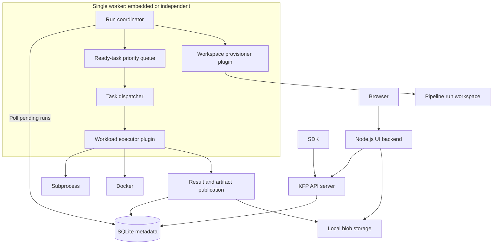
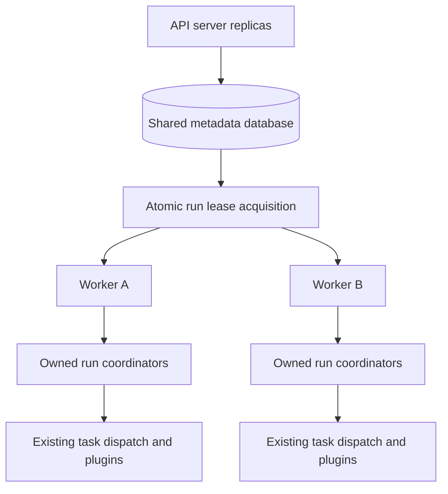

# Run Kubeflow Pipelines Locally Without Kubernetes

## Summary

The proposal is to run a standalone Kubeflow Pipelines (KFP) API server and UI locally, without
requiring Kubernetes, SeaweedFS, or a database server. Users would install an additional `kfp-local`
Python package and run `kfp local ui`, then submit pipelines through the existing SDK or UI.

This requires moving pipeline orchestration out of workflow-engine-specific abstractions and into a
KFP-owned runtime. The runtime would initially execute tasks through subprocess and Docker plugins,
with SQLite for metadata and local blob storage for artifacts. Existing Argo Workflows deployments
would continue to work as they do today.

## Motivation

Running KFP locally should provide a similar experience to running it on a cluster, including the
API, UI, run history, logs, and artifacts. Today, users must either deploy the distributed system or
use the Python SDK's local execution implementation, which duplicates orchestration functionality
and does not provide the full server experience.

Separating orchestration from workload execution would allow the same KFP functionality to be used
locally and with other execution backends. It would also make it possible to add backends such as
Kubernetes, AWS Lambda, or Knative without requiring them to implement pipeline semantics.

### Goals

1. Provide a local server experience using the existing pipeline IR, SDK submission APIs, and UI.
1. Share orchestration, persistence, and artifact handling rather than maintain a separate local
   pipeline engine.
1. Define workload execution and pipeline run workspace interfaces that do not depend on Kubernetes
   or Argo Workflows.

### Non-Goals

1. Removing Argo Workflows support or replacing the production Argo runtime, though the design
   should account for that future possibility.
1. Supporting scheduled workflows in deployments without the Kubernetes scheduled-workflow
   controller, including local and non-Kubernetes multi-worker deployments. Their APIs must reject
   requests explicitly, and the UI must disable the corresponding functionality.
1. Providing production multi-tenant isolation through the local subprocess or Docker executors.

## Proposal

The proposal is split into four phases so local execution can be delivered without first solving
distributed coordination. The design is inspired by MLflow's [job executor plugins RFC][mlflow-rfc]:
the framework owns scheduling and lifecycle semantics, while plugins own backend execution.

The [direct DAG management POC][poc] demonstrates the execution model and has informed the interface
and lifecycle contracts below. The proposal defines the intended architecture without requiring the
POC's exact implementation.

Runtime selection is deployment-level through Phase 3, not a per-run API option. The local commands
select the new runtime, while existing deployments default to Argo. Each worker is configured with
its executor, and the selected backend is persisted for the run so a configuration change cannot
silently reroute unfinished work.

### Phase 1: Local Execution

#### Architecture

The first phase adds a KFP-owned runtime with a single execution worker. The worker may be embedded
in the API server or run as an independent process on the same host. Only one worker may manage a
given installation in this phase, and neither layout requires Kubernetes services.



##### Execution Flow

After the API server validates and stores a pipeline run, the worker picks it up from the database.
The run coordinator checks the entire pipeline's requirements against the configured workload
executor, such as subprocess or Docker, before starting any task. It then identifies tasks whose
dependencies are satisfied, resolves their inputs, and places ready tasks in a queue for dispatch.

The executor runs each workload without interpreting the pipeline's dependencies or control flow. As
tasks complete, the framework publishes their results and updates the run's state, allowing the
coordinator to schedule downstream tasks. Conditions, iterations, caching, retries, and run
completion remain the coordinator's responsibility.

##### Scheduling

The dispatcher runs independent tasks concurrently, subject to the executor's active-task capacity
and the pipeline's parallelism settings.

Scheduling separates task eligibility, priority, and capacity admission. Blocked tasks do not
prevent other eligible tasks from progressing. Bounded scheduling passes replenish available
capacity as tasks complete, without waiting for previously dispatched tasks to finish as a group.

Eligible retries following infrastructure failures take priority over fresh attempts without
preempting running tasks or indefinitely starving new work. User-computation retries receive normal
scheduling priority. Infrastructure retries use capped exponential backoff with jitter, even when
the pipeline specifies no delay, and never retry sooner than its configured backoff allows. They
become eligible only after that delay, preventing persistent infrastructure failures from hogging
the queue. Backoff does not occupy execution capacity.

The database remains authoritative, so pending work and retry eligibility can be reconstructed after
a restart.

##### Local Executors

Like the KFP local experience in the SDK, this KEP proposes adding two local executors: subprocess
and Docker. Subprocess runs lightweight Python components in a local Python environment. Docker runs
components in their specified container images. The framework handles their inputs and output
publication so both use the same KFP APIs and artifact storage.

Using the same pipeline format does not mean every pipeline can run locally. For example, a local
executor cannot satisfy Kubernetes node-affinity requirements. Each executor documents the component
types and execution requirements it supports, and validation reports unsupported requirements
instead of silently ignoring them.

For supported pipelines, local execution preserves KFP's dependency, control-flow, and input/output
semantics.

#### Storage

The new runtime does not require SQLite. This proposal adds SQLite support as the default for a
self-contained local installation, while retaining MySQL and PostgreSQL as alternatives. A
production deployment can use either with a production-ready executor plugin.

With SQLite, the supported layouts are an API server with an embedded worker, or an API server and
one independent worker sharing the database on the same host. SQLite WAL mode and bounded busy
handling must accommodate concurrent API and worker writes; sharing the database file between hosts
is unsupported.

Artifacts are stored through the existing object-store abstraction with a filesystem-backed blob
implementation and `file://` pipeline roots, including a local default pipeline root. The API
server, worker, and UI backend must resolve these locations consistently, including Docker staging
or bind mounts.

Pipeline run workspaces remain separate from artifact storage. When requested by a pipeline, a
workspace provides a shared directory for the run's tasks. Normal artifacts are still published to
the object store; shared runtime code handles artifact staging and transfer.

##### Metadata Schema

The proposal is to extend the `run_details` table with execution metadata and keep temporary
coordination state in runtime-specific tables.

Add these nullable columns to `run_details` so executor and workspace information belongs to the run
and can be exposed through its API and UI:

| New column             | Type                    | Purpose                                                                   |
| ---------------------- | ----------------------- | ------------------------------------------------------------------------- |
| `ExecutorType`         | Nullable string         | Resolved executor selection; non-null for runs managed by the new runtime |
| `WorkspaceProvisioner` | Nullable string         | Provisioner selected when the pipeline requests a workspace               |
| `WorkspaceReference`   | Nullable versioned JSON | Provisioner-owned handle for the pipeline run workspace                   |

**`runtime_tasks`** is a new table and has one row per non-terminal task, combining scheduling and
current-attempt state rather than retaining execution history:

| Column               | Type                    | Purpose                                                                                                                 |
| -------------------- | ----------------------- | ----------------------------------------------------------------------------------------------------------------------- |
| `TaskUUID`           | UUID, primary key       | References `tasks.UUID`                                                                                                 |
| `RunUUID`            | UUID                    | References `run_details.UUID`; identifies the owning run                                                                |
| `AttemptUUID`        | Nullable UUID, unique   | Current execution identity, assigned before submission                                                                  |
| `State`              | Enum                    | Current scheduling or execution phase, through finalization                                                             |
| `RetryCount`         | Integer                 | Task retries used; recovery and internal executor retries do not increment it                                           |
| `NextEligibleAt`     | Nullable timestamp      | Earliest dispatch time for a scheduled retry                                                                            |
| `ExecutionRequest`   | Nullable versioned JSON | Resolved request, immutable within an attempt; uses credential references rather than resolved secrets or access tokens |
| `ExecutionReference` | Nullable versioned JSON | Backend-owned workload reference, absent until known                                                                    |

`State` covers dependency waiting, readiness, in-flight execution, retry backoff, recovery, and
finalization. The task's hierarchy, inputs, cache fingerprint, and API-visible state reuse existing
`tasks` columns. Skipped and cached tasks are finalized without launching a workload, removing any
existing runtime row in the same transaction.

Executor configuration is global in this proposal. Recording the selected executor in `run_details`
makes it visible to users and accommodates future per-run selection without introducing that API
now. The recorded selection remains fixed while the run has unfinished work. On restart, if the
configured executor differs from a run's recorded executor, fail the unfinished run with an explicit
executor-mismatch error rather than resume it through the new executor.

Task outputs are provisional until the task succeeds: they are not eligible for downstream execution
or cache reuse. Publication uses attempt-scoped artifact identities so repeating it does not create
new artifact records. Artifact bytes and logs stay in blob storage.

Once the executor reports a terminal result and required cleanup is complete, finalize the task's
public state and delete its `runtime_tasks` row in one transaction. Results and task-linked log
references remain in the existing tables. An attempt finishing does not trigger this deletion if the
task will retry or still needs recovery or cleanup.

Reject new-runtime run deletion until the run is terminal, workloads have stopped, and required
execution and workspace cleanup is complete. Return a failed-precondition error with recovery
guidance; automated deletion skips such runs. Check and delete atomically against dispatch, retries,
and cleanup, preserving recovery references until safe. Argo deletion is unchanged.

In addition to the references shown in the table, a composite foreign key `(TaskUUID, RunUUID)`
references `tasks(UUID, RunUUID)` so the task and owning run cannot disagree.

Phase 1 adds the nullable run columns and `runtime_tasks`; existing Argo rows retain null values and
need no backfill.

#### Frontend and Logs

The UI renders the run graph and status from KFP task data, without requiring an Argo workflow
manifest or Pod records.

Run details expose the resolved executor and workspace provisioner. Workspace display must use a
safe description rather than expose opaque plugin data directly.

Users need to inspect component output while a task is running and after it finishes. The source
depends on the executor: subprocess captures the child process's stdout and stderr, while Docker
retrieves the container's logs. The executor plugin's `Logs` method, defined below, gives the
framework access to that output without requiring it to know how each backend stores logs. Logs are
associated with both the task and its execution attempt so retries do not mix their output.

Log sources remain available after cancellation and, where recovery is supported, worker loss until
the framework has durably retained them outside resources being cleaned up. The framework publishes
the logs to blob storage for later retrieval.

The API provides retrieval and streaming through the UI backend's API-server log proxy using task
identity, not Pod names. It distinguishes the current attempt's live logs from earlier attempts'
retained logs and works after restart without Kubernetes or an Argo archive.

Artifact previews and downloads continue through the UI backend, restricted to the configured
artifact root.

##### Deployment Capabilities API

KFP already exposes build and deployment information through `GET /apis/v2/healthz`, which the UI
reads at startup. Extend that response with a `capabilities` object, preserving its existing fields
and health-check behavior.

Each advertised feature has a `supported` boolean and, when unsupported, a `reason` explaining the
restriction. This proposal initially defines `recurring_runs`, covering recurring-run management.
For a deployment without the scheduled-workflow controller, the added response fields are:

```json
{
  "capabilities": {
    "recurring_runs": {
      "supported": false,
      "reason": "The scheduled-workflow controller is not enabled."
    }
  }
}
```

The UI disables explicitly unsupported actions and displays the reason, rather than infer support
from whether KFP is running locally or on Kubernetes. Missing capabilities on older servers mean
support is not advertised, not that every feature is disabled; clients retain their existing
behavior for those servers. Discovery does not replace API enforcement of feature restrictions or
authorization.

#### Plugin Interfaces

`ExecutionSpec` and related workflow-engine interfaces would be deprecated as general runtime
abstractions, but retained for the Argo path. Reusable driver and launcher logic should be shared
without requiring workflow objects or Argo compilation in the new runtime.

Initially, plugins are built-in Go implementations. The following interfaces describe the required
boundaries; exact type definitions and package placement may be refined during implementation.

```go
type ExecutorCapabilities struct {
    RecoverLostTasks               bool
    SupportsMultiUser              bool
    SupportsContainers             bool
    SupportsKubernetes             bool
    SupportedWorkspaceProvisioners []string
}

type ExecutorCapacity struct {
    MaxActiveTasks         *int
}

type WorkloadExecutorPlugin interface {
    Type() string
    Capabilities() ExecutorCapabilities
    Capacity() ExecutorCapacity
    CheckRequirements(ctx context.Context) error
    Start(ctx context.Context) error
    Shutdown(ctx context.Context) error
    Submit(ctx context.Context, request TaskExecutionRequest) (ExecutionReference, error)
    Wait(ctx context.Context, reference ExecutionReference) (TaskExecutionResult, error)
    Cancel(ctx context.Context, reference ExecutionReference) (CancellationResult, error)
    Logs(ctx context.Context, reference ExecutionReference) (ExecutionLogSource, error)
    Cleanup(ctx context.Context, reference ExecutionReference) error
}

type LostTaskRecoverer interface {
    Recover(
        ctx context.Context,
        identity TaskAttemptIdentity,
        reference *ExecutionReference,
    ) (RecoveryResult, error)
}

type WorkspaceProvisionerPlugin interface {
    Type() string
    Provision(ctx context.Context, request WorkspaceRequest) (WorkspaceReference, error)
    ResolveAttachment(
        ctx context.Context,
        reference WorkspaceReference,
        target ExecutionTarget,
    ) (WorkspaceAttachment, error)
    Cleanup(ctx context.Context, reference WorkspaceReference) error
}
```

Subprocess executes lightweight Python components as host processes. Docker executes both
lightweight Python components and container components inside their specified container images. The
coordinator determines which capabilities a pipeline needs. For example:

| Task                                                                 | Required capabilities                                                                                           |
| -------------------------------------------------------------------- | --------------------------------------------------------------------------------------------------------------- |
| Lightweight Python component without container-specific dependencies | Can run through subprocess or Docker; container support is not required                                         |
| Component requiring its container image                              | `SupportsContainers`                                                                                            |
| Container with node affinity or a Kubernetes Secret mount            | `SupportsContainers` and `SupportsKubernetes`, including support for the requested settings                     |
| Task accessing a pipeline run workspace                              | Its provisioner must be in `SupportedWorkspaceProvisioners`, alongside the task's other capability requirements |

These are illustrative requirements and capabilities, not an exhaustive schema. Additional resource
or platform restrictions must be represented explicitly and checked centrally; broad container or
Kubernetes support does not establish support for every setting. The coordinator derives
requirements from the pipeline specification and run inputs.

`MaxActiveTasks` is absent for unlimited capacity; configured values must be positive. Slots cover
submission through confirmed workload termination, including cancellation, rather than only the call
to `Submit`. The limit applies per configured executor instance in each worker, not per host or
deployment. Cache hits and framework-only orchestration do not consume slots.

Boolean capabilities default to false. `SupportsMultiUser` must be explicitly enabled by an
executor, and does not replace KFP authorization. Subprocess and Docker declare
`SupportsMultiUser=false` and require single-user deployments, with embedded or independent workers.
Reject incompatible executors before execution; do not fall back to another executor.

The plugin data contracts are:

| Contract                           | Contents                                                                                                                                                                                                                 |
| ---------------------------------- | ------------------------------------------------------------------------------------------------------------------------------------------------------------------------------------------------------------------------ |
| Task request                       | Stable run, task-instance, and attempt identities; a typed process or container specification; resolved inputs and expected outputs; environment, resources, optional workspace attachment, and scoped reporting context |
| Execution reference                | Backend identity and versioned backend-owned data needed to locate the workload                                                                                                                                          |
| Task result                        | Success or a user-workload/infrastructure failure, including whether the failure is fatal, output values or durable references, and diagnostics                                                                          |
| Workspace request                  | Stable workspace identity and pipeline run storage requirements                                                                                                                                                          |
| Workspace reference and attachment | A durable storage identity and access information for the execution target, such as a directory or bind mount                                                                                                            |
| Cancellation result                | Confirmed termination, termination still pending, or an unknown outcome                                                                                                                                                  |
| Execution log source               | Task/attempt identity and access to live or durably retained stdout and stderr                                                                                                                                           |

Requests must not contain `model.Run`, `PipelineJob`, the full DAG, upstream task collections, or
database clients. Reuse typed IR values such as `ExecutorInput` where appropriate. The framework
owns persistence and lifecycle transitions; tasks receive only the reporting and storage access they
need.

`CheckRequirements` validates installation and backend access, such as checking that the Docker CLI
is installed and the Docker daemon is reachable for the Docker executor. Before the first task
starts, the coordinator compares requirements for every task, including nested DAGs, loop bodies,
and all conditional branches, against `ExecutorCapabilities`. Workspace compatibility uses the
provisioner list described below.

The coordinator rejects requirements without declared support before execution. New requirements
extend this shared check, not plugin-specific validators. The UI uses the same support rules.

`SupportedWorkspaceProvisioners` lists compatible plugins by their `Type()` values; an empty list
means the executor does not support pipeline run workspaces. When a pipeline requests a workspace,
the coordinator checks the resolved provisioner against this list before provisioning or starting
any task. For example, subprocess and Docker support the host-directory provisioner, while a PVC
provisioner requires an executor capable of attaching it, such as Kubernetes.

Workspace provisioning and cleanup must be idempotent, including a crash before the provisioned
reference is recorded. Only tasks requiring the workspace receive an attachment. Cleanup follows the
pipeline's workspace lifecycle and must not occur while outstanding executions still need it. Retain
the workspace reference until cleanup succeeds so failures can be retried. Its retention afterward
is an [open question](#workspace-information-after-cleanup).

An HTTP-forwarding executor could later allow independently deployed implementations without
changing these responsibilities. Its transport protocol and authentication are outside this
proposal.

##### Built-in Executors

Subprocess uses a configurable Python interpreter, defaulting to the interpreter used to launch the
local runtime, with an isolated virtual environment per attempt. Declared `packages_to_install` are
installed there, never into the server's environment. The component's `base_image` is not
reproduced; this is reported explicitly with guidance to use Docker when the image's Python version,
OS packages, or other contents are required.

For both executors, input resolution, artifact staging, command placeholder resolution, and output
publication use shared Go logic in the worker. Docker runs the component command, including the
Python executor when applicable, without injecting a Go launcher into the container. The packaged
runtime therefore needs no Linux Go launcher binary.

#### Completion and Recovery

Durable attempts distinguish a failed workload from a lost observer. Without that distinction,
restarting a worker could repeat successful computation or lose its outputs.

Persist an attempt's identity and selected backend before submitting it, then persist its execution
reference before waiting. Execution identity distinguishes loop iterations and retry attempts,
allowing submission to be idempotent without suppressing legitimate executions. This also prevents
duplicate work when the worker crashes between launching a workload and recording its reference.

`Wait` returns a terminal task result: success, user-workload failure, or infrastructure failure. It
does not expose separate computation and publication phases. Losing contact with a backend leaves
the outcome unknown rather than imply failure. Canceling the context stops observation, not
execution. Shutdown stops admission and performs bounded draining, preserving the execution
information needed after restart.

Completion and cancellation must apply to the current attempt; late or duplicate results must not
overwrite a newer attempt or an accepted cancellation, or recreate deleted runtime state. Task and
artifact reports must identify the current attempt; stale reports are rejected, and repeated reports
are idempotent.

`Cancel` requests workload termination, is idempotent, and reports whether termination is confirmed,
pending, or unknown. Only confirmed termination releases execution capacity. Cancellation preserves
output and log sources; `Cleanup` separately releases retained backend resources, not pipeline run
workspaces. Cleanup is idempotent and occurs only after required results and logs are durably
retained outside those resources. On cleanup failure, keep the execution reference and retry
cleanup, including after a fatal task failure.

The worker invokes executor cleanup during attempt finalization and workspace cleanup when its
lifecycle permits; reconciliation retries unfinished cleanup.

Running an independent worker requires disabling the API server's embedded worker. In Phase 1,
administrators are responsible for ensuring only one worker is active. On startup, the worker
reconciles all non-terminal attempts before admitting new work. It restores queued work and retry
deadlines, recovers submitted attempts, and accounts for active executions against capacity. This
applies from Phase 1, without relying on the leases introduced in Phase 3.

Executors declaring `RecoverLostTasks` must implement `LostTaskRecoverer`. Recovery locates work by
attempt identity, even if its execution reference was never recorded, and distinguishes:

- An existing execution to reattach to.
- A completed execution with a durable result.
- A confirmed stopped execution, which the framework may retry according to policy.
- An unknown outcome, which remains unresolved rather than trigger duplicate execution.

Docker must support this recovery within its execution environment, retaining containers or durable
results until completion is recorded. For example, containers can be labeled with run, task, and
attempt UUIDs at creation so recovery can locate and verify the correct execution even if its
reference was never recorded.

Subprocess does not declare lost-task recovery; interrupted attempts are reported explicitly and are
not automatically replayed when the previous process's termination cannot be established. An orphan
may need manual cleanup. These guarantees do not provide exactly-once external side effects.

##### Artifact Handling Within Execution

Artifact transfers use shared framework-owned code rather than requiring each executor to implement
downloads and uploads. This code runs where task files are accessible: in the worker for local
execution, or through a reusable launcher in a remote execution environment. The executor arranges
its placement, filesystem attachments, and scoped access to storage and reporting endpoints.

The executor owns staging, component execution, and output publication as one task execution. Its
shared execution code handles bounded transfer retries and any durable checkpoints needed to resume
them during recovery of the same attempt. The coordinator neither schedules upload retries nor
tracks internal publication progress; it receives a task-level result and finalizes public state.
Success requires all declared outputs to be durably published.

If publication exhausts its internal retries after computation succeeds, the executor reports a
fatal infrastructure failure. The coordinator fails the task without automatically replaying it,
even when the pipeline's retry policy permits infrastructure retries. Retrying requires an explicit
user request to retry the pipeline run, which may repeat computation and its external side effects.

#### Retries

A task retry creates a new attempt and clears the previous attempt's outputs. Recovery retains the
existing attempt identity and does not consume the task retry budget.

The coordinator reads the retry policy from the run's persisted pipeline IR and applies the runtime
defaults, rather than storing another copy per task. It honors the retry budget and backoff
settings. A zero or absent retry count means no retries. A nonzero user-program exit is a failure;
environment setup, input staging, and backend execution errors are errors. Explicit `OnFailure`,
`OnError`, `Always`, and `OnTransientError` policies select the corresponding outcomes, with the
last limited to errors known to be transient. An unspecified policy defaults to `OnError`, matching
KFP's bundled Argo default.

Fatal failures bypass automatic retry policies, including `Always`. They require a user-requested
pipeline-run retry.

Executor methods distinguish a known task outcome from inability to establish one, using typed
failure categories rather than interpreting message strings. Illustrative handling:

```go
switch condition {
case ObservationError, UncertainSubmission:
    // Reconcile the unknown outcome; do not resubmit.
case UserWorkloadFailure, InvalidDeclaredOutput:
    // Apply the configured task retry policy.
case RetryableInfrastructureFailure:
    // Apply the task retry policy and infrastructure backoff.
case FatalInfrastructureFailure:
    // Fail without automatic retry, e.g. the executor exhausted publication retries.
case ExecutionCleanupError:
    // Retain the execution reference and retry cleanup, not the task.
case StaleAttemptReport:
    // Reject the report without creating a new attempt.
}
```

### Phase 2: Package the Local Experience

Publish `kfp-local` as a separate Python package with platform-specific wheels for Linux and macOS
on amd64 and ARM64. The wheels contain the compiled Go binaries, compiled Node.js backend, and
browser UI assets. Users need Node.js for the UI and Docker for Docker execution, but do not need Go
or frontend build tools. Component images must support the Docker host's CPU architecture, or Docker
must be configured to emulate it.

Decommissioning the Node.js UI server and consolidating its functionality into the Go API server
would simplify packaging and remove the UI's Node.js runtime dependency. This would benefit the
local experience but is outside the scope of this KEP.

The SDK adds a `local` CLI command group that lazily delegates to the optional `kfp-local` package,
with an installation message when it is absent. The package declares the minimum SDK version
providing that integration and uses its own Python module namespace, separate from the existing
`kfp.local` module.

A user can start KFP and submit an existing compiled pipeline:

```shell
pip install kfp-local
kfp local ui
```

The launcher prints the API endpoint. For example, if it is `http://127.0.0.1:3002`, submission uses
the normal client:

```python
from kfp import client

api = client.Client(host="http://127.0.0.1:3002")
api.create_run_from_pipeline_package("pipeline.yaml")
```

`kfp local ui` starts the API server, worker, and UI. `kfp local server` starts the headless API
server and worker without requiring Node.js. The launcher configures the database, artifact storage,
and selected executor, reports startup failures, and manages the child processes' shutdown. The
package and SDK must declare compatible versions; minimum Python, Node.js, OS, and system-library
versions must be documented for the published wheels.

Local API, gRPC, and UI listeners bind to loopback; remote binding is unsupported initially. HTTP
endpoints enforce local `Host` and browser-origin allowlists without requiring `Origin` from SDK
clients.

#### Migration

The existing SDK `local.init(...)` experience would be deprecated, not removed. Documentation and
warnings should direct users to the local server and existing SDK submission APIs. Replacing its
implementation with a headless server-backed adapter can be considered separately; existing calls
must not silently start services or change behavior. This is a migration of the execution
experience, not an automatic import of historical SDK-local output directories.

### Phase 3: Multi-Replica Coordination

#### Architecture

This phase allows multiple workers, embedded in API server replicas or running independently, to
coordinate through a shared metadata database. API-only replicas do not execute work.



Each pipeline run has one orchestration owner. Run ownership does not distribute a pipeline's local
subprocess tasks among hosts; where tasks execute remains the executor's responsibility.

#### Metadata Schema

**`run_leases`** separates ownership from execution state:

| Column       | Type               | Purpose                                          |
| ------------ | ------------------ | ------------------------------------------------ |
| `RunUUID`    | UUID, primary key  | References `run_details.UUID`                    |
| `OwnerID`    | Nullable string    | Owning worker/process incarnation                |
| `Generation` | Integer            | Increases on each lease acquisition              |
| `ExpiresAt`  | Nullable timestamp | Ownership deadline evaluated using database time |

Index `(ExpiresAt, RunUUID)` for lease takeover. Releasing a lease clears its owner and expiration
but preserves its generation. Keep the row until the run is deleted so reacquisition cannot reuse a
previous fencing token.

#### Ownership and Takeover

A worker polls for eligible runs when a compatible executor has task capacity and atomically claims
leases in bounded batches, yielding between polls even with unlimited capacity. Claims honor retry
eligibility and priority. Batching limits prefetch, not active runs, and does not guarantee equal
distribution.

Renewals run independently of task execution and waiting, retaining the generation. Every
coordinator write atomically checks the owner, generation, and expiration using database time,
rejecting stale owners. A worker losing ownership stops dispatching and writing state without
canceling work the new owner may recover.

Leases replace Phase 1's single-worker restriction. Workers reconcile only claimed runs; after lease
expiry, takeover uses the existing attempt-recovery process rather than rerunning the pipeline.
Plugin interfaces and task lifecycle remain unchanged.

Workers sharing runs need access to the same executor backend and storage; an unreachable backend
means an unknown outcome, not a stopped workload. Multi-host deployments use PostgreSQL or MySQL,
not shared SQLite files. Independent workers are trusted control-plane processes and do not pass
database credentials to plugins or workloads.

### Phase 4: Additional Backends

The interfaces also allow Kubernetes execution by submitting tasks as Pods and, when requested,
provisioning pipeline run workspaces through PVCs. Normal artifacts would still use object storage.
This is a possible follow-up, not a requirement to replace Argo Workflows or complete the local
experience.

## Open Questions

### Workspace Information After Cleanup

Should the run API and UI continue to show which workspace was provisioned after it has been
deleted? Clearing `WorkspaceReference` after successful cleanup loses that information. Retaining
the handle requires distinguishing historical information from work still needing cleanup, or
preserving a separate safe workspace description. The retention model is not decided here.

### Garbage Collection and On-Demand Cleanup

Should a periodic garbage collector reconcile runs left with pipeline run workspaces, retained
execution resources, or temporary `runtime_tasks` rows after failed or interrupted attempts? It
would complete outstanding cleanup and finalize the run's terminal state without changing its
success, failure, or cancellation outcome.

At minimum, provide an on-demand CLI cleanup command, similar to Docker's `system prune`, to perform
this reconciliation. Cleanup must respect active work and workspace retention settings, preserve
published artifacts and logs, and retain recovery information when termination or cleanup cannot be
confirmed. Whether automatic collection runs inside a worker or as a separate scheduled process
remains open.

## Test Plan

### Phase 1

1. Verify both executors' pipeline semantics, caching, retries, artifacts, and logs.
2. Reject unsupported requirements before execution.
3. Recover after submission crashes without duplicate execution.
4. Test cancellation/publication races, reference retention on cleanup failure, and deletion guards.
5. Verify loopback and Host/origin protections, SDK access, and Argo compatibility.

### Phase 2

1. Verify wheel installation on all supported platforms and SDK compatibility.
2. Verify headless startup without Node.js.
3. Verify explicit startup errors and bounded child-process shutdown.

### Phase 3

1. Verify lease takeover and stale-owner fencing without duplicate execution.
2. Verify unknown execution outcomes do not trigger resubmission.

### Phase 4

1. Run shared executor and workspace contract tests for each added backend.

## Drawbacks

KFP would own orchestration and recovery behavior that Argo currently supplies. Shared runtime logic
reduces duplication, but maintaining execution semantics across backends remains a significant
responsibility.

Native binaries increase wheel build and release coverage, and the UI still requires a separately
installed Node.js runtime. Local execution also remains limited by host resources and the installed
Python or Docker environment.

## Alternatives

1. **Continue extending SDK local:** this avoids a server dependency but retains a second
   orchestration implementation and cannot provide the normal API/UI experience without adding
   comparable server functionality.
1. **Run the existing deployment on local Kubernetes:** this preserves the current runtime but does
   not remove the infrastructure required to get started.

[mlflow-rfc]:
  https://github.com/mlflow/rfcs/blob/main/rfcs/0002-job-executor-plugins/0002-job-executor-plugins.md
[poc]: https://github.com/kubeflow/pipelines/pull/15099
