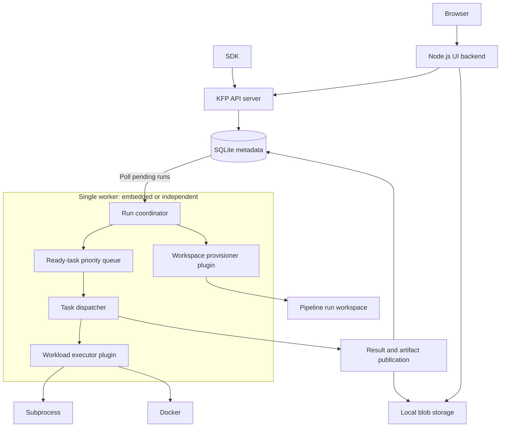
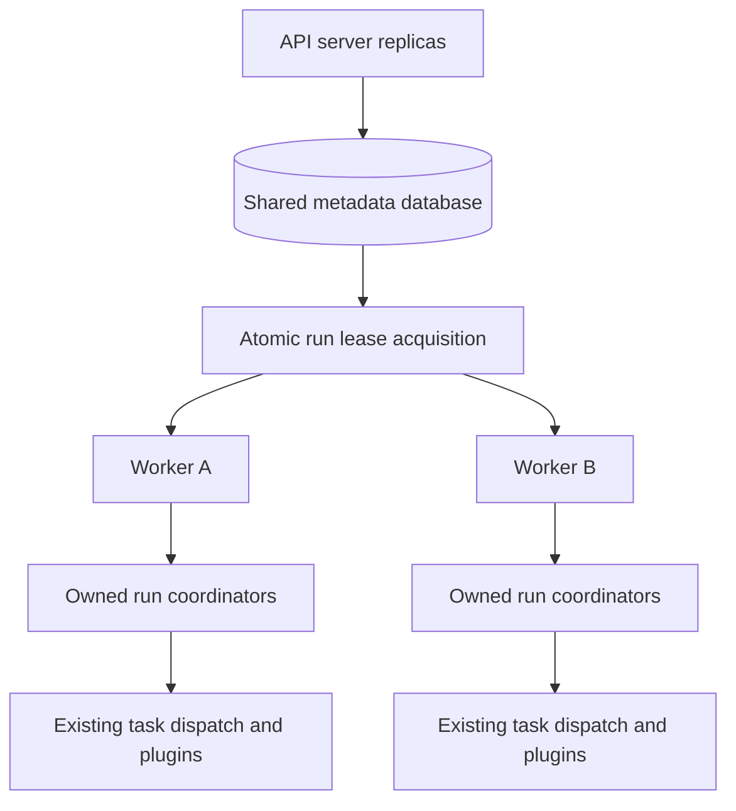

# Run Kubeflow Pipelines Locally Without Kubernetes

## Summary

The proposal is to run a standalone Kubeflow Pipelines (KFP) API server and UI locally, without
requiring Kubernetes, SeaweedFS, or a database server. Users would install an additional `kfp-local`
Python package and run `kfp local ui`, then submit pipelines through the existing SDK or UI.

This requires moving pipeline orchestration out of workflow-engine-specific abstractions and into a
KFP-owned runtime. The runtime would initially execute tasks through subprocess and Docker plugins,
with SQLite for metadata and local blob storage for artifacts. Existing Argo Workflows deployments
would continue to work as they do today.

## Motivation

Running KFP locally should provide a similar experience to running it on a cluster, including the
API, UI, run history, logs, and artifacts. Today, users must either deploy the distributed system or
use the Python SDK's local execution implementation, which duplicates orchestration functionality
and does not provide the full server experience.

Separating orchestration from workload execution would allow the same KFP functionality to be used
locally and with other execution backends. It would also make it possible to add backends such as
Kubernetes, AWS Lambda, or Knative without requiring them to implement pipeline semantics.

### Goals

1. Provide a local server experience using the existing pipeline IR, SDK submission APIs, and UI.
1. Share orchestration, persistence, and artifact handling rather than maintain a separate local
   pipeline engine.
1. Define workload execution and pipeline run workspace interfaces that do not depend on Kubernetes
   or Argo Workflows.
1. Deliver incrementally, starting with one worker and adding packaging and multi-replica
   coordination separately.

### Non-Goals

1. Removing Argo Workflows support or replacing the production Argo runtime.
1. Supporting scheduled workflows in deployments without the Kubernetes scheduled-workflow
   controller, including local and non-Kubernetes multi-worker deployments. Their APIs must reject
   requests explicitly, and the UI must disable the corresponding functionality.
1. Providing production multi-tenant isolation through the local subprocess or Docker executors.
1. Adding new pipeline language constructs or non-DAG workloads. The execution interfaces should not
   preclude them.
1. Defining a dynamic third-party plugin protocol as part of the initial implementation.
1. Introducing a backend-neutral task timeout API.

## Proposal

The proposal is split into four phases so local execution can be delivered without first solving
distributed coordination. The design is inspired by MLflow's [job executor plugins RFC][mlflow-rfc]:
the framework owns scheduling and lifecycle semantics, while plugins own backend execution.

The [direct DAG management POC][poc] demonstrates the basic approach. It is a starting point rather
than the required implementation: in particular, task execution must be parallel, and plugin
requests must not expose entire run or job objects.

Runtime selection is deployment-level through Phase 3, not a per-run API option. The local commands
select the new runtime, while existing deployments default to Argo. Each worker is configured with
its executor, and the selected backend is persisted for the run so a configuration change cannot
silently reroute unfinished work.

### Phase 1: Local Execution

#### Architecture

The first phase adds a KFP-owned runtime with a single execution worker. The worker may be embedded
in the API server or run as an independent process on the same host. Only one worker may manage a
given installation in this phase, and neither layout requires Kubernetes services.



##### Execution Flow

After the API server validates and stores a pipeline run, the worker picks it up from the database.
The run coordinator interprets the pipeline IR and identifies tasks whose dependencies are
satisfied. It resolves their inputs and places ready tasks in a queue. The dispatcher sends these
tasks to the configured workload executor, such as subprocess or Docker.

The executor runs each workload without interpreting the pipeline's dependencies or control flow. As
tasks complete, the framework publishes their results and updates the run's state, allowing the
coordinator to schedule downstream tasks. Conditions, iterations, caching, retries, and run
completion remain the coordinator's responsibility.

##### Scheduling

The dispatcher runs independent tasks concurrently, subject to the executor's active-task capacity
and the pipeline's parallelism settings. There is no separate active-run limit.

Eligible retries take priority over fresh attempts without preempting running tasks or indefinitely
starving new work. Backoff does not occupy execution capacity. The database remains authoritative,
so the queue can be rebuilt after a restart.

##### Local Executors

Subprocess runs lightweight Python components in a local Python environment. Docker runs components
in their specified container images. The framework handles their inputs and output publication so
both use the same KFP APIs and artifact storage.

Accepted pipelines preserve their existing semantics. Each executor documents its supported features
and rejects unsupported requirements rather than silently ignoring them.

#### Storage

SQLite provides the local metadata database. The supported layouts are an API server with an
embedded worker, or an API server and one independent worker sharing the database on the same host.
SQLite WAL mode and bounded busy handling must accommodate concurrent API and worker writes; sharing
the database file between hosts is unsupported.

Artifact bytes use the existing object-store abstraction with a filesystem-backed blob
implementation and `file://` pipeline roots, including a local default pipeline root. The API
server, worker, and UI backend must resolve these locations consistently, including Docker staging
or bind mounts.

Pipeline run workspaces remain separate from artifact storage. When requested by a pipeline, a
workspace provides a shared directory for the run's tasks. Normal artifacts are still published to
the object store; artifact staging is an executor or launcher responsibility. Workspace cleanup must
not delete published artifacts or invalidate cached outputs.

Metadata and artifact directories are persistent and configurable. Stopping or upgrading the local
runtime must not implicitly delete run history or artifacts.

##### Metadata Schema

The proposal is to extend `run_details` with execution metadata and keep temporary coordination
state in runtime-specific tables. Existing `tasks` records remain user-facing, without hiding
scheduling state in `StatusMetadata` and `Pods`. The names below are proposed column names; types
are logical types rather than database-specific SQL.

Each materialized task, including a loop iteration, uses an existing `tasks` row. Its `LogicalKey`
identifies the run, pipeline scope, parent task, and iteration, allowing repeated materialization to
find the same row. Retries retain that task UUID and assign a new attempt UUID.

Add these nullable columns to **`run_details`** so executor and workspace information belongs to the
run and can be exposed through its API and UI:

| New column             | Type                    | Purpose                                                                   |
| ---------------------- | ----------------------- | ------------------------------------------------------------------------- |
| `ExecutorType`         | Nullable string         | Resolved executor selection; non-null for runs managed by the new runtime |
| `WorkspaceProvisioner` | Nullable string         | Provisioner selected when the pipeline requests a workspace               |
| `WorkspaceReference`   | Nullable versioned JSON | Provisioner-owned handle for the pipeline run workspace                   |

The pipeline IR, runtime parameters, namespace, and user-visible run state remain in `run_details`.
Workspace identity is derived from the run before provisioning, so recovery does not depend on
successfully recording a returned reference.

**`runtime_tasks`** has one row per non-terminal task, combining scheduling and current-attempt
state rather than retaining execution history:

| Column               | Type                    | Purpose                                                                                                                 |
| -------------------- | ----------------------- | ----------------------------------------------------------------------------------------------------------------------- |
| `TaskUUID`           | UUID, primary key       | References `tasks.UUID`                                                                                                 |
| `RunUUID`            | UUID                    | References `run_details.UUID`; identifies the owning run                                                                |
| `AttemptUUID`        | Nullable UUID, unique   | Current execution identity, assigned before submission                                                                  |
| `State`              | Enum                    | Current scheduling or execution phase, through finalization                                                             |
| `RetryCount`         | Integer                 | Computation retries used; recovery and publication retries do not increment it                                          |
| `NextEligibleAt`     | Nullable timestamp      | Earliest dispatch time for a scheduled retry                                                                            |
| `ExecutionRequest`   | Nullable versioned JSON | Resolved request, immutable within an attempt; uses credential references rather than resolved secrets or access tokens |
| `ExecutionReference` | Nullable versioned JSON | Backend-owned workload reference, absent until known                                                                    |

`State` covers dependency waiting, readiness, retry backoff, and the execution lifecycle. It
distinguishes successful execution awaiting publication from failed execution awaiting retry or
finalization, so recovery knows whether to publish outputs or handle a failure. The task's
hierarchy, inputs, cache fingerprint, and API-visible state reuse existing `tasks` columns. Skipped
or cached tasks need no attempt UUID.

Executor selection comes from `run_details` and remains fixed while the run has unfinished work.
User-facing results reuse the existing task and artifact columns; no new result columns are added.

Starting a retry atomically increments `RetryCount`, assigns a new `AttemptUUID`, and replaces the
attempt-specific fields and task outputs. The previous execution must have stopped, with required
cleanup complete and its user-facing diagnostics and log references preserved before replacement.
Output-artifact relationships from the previous attempt must not carry into the retry. Recovery
keeps the same attempt UUID and does not spend another retry.

On workload completion, checkpoint output parameters and diagnostics in `tasks`, and artifact
metadata/references in `artifacts` and `artifact_tasks`. Commit these records and the corresponding
runtime phase in one transaction, guarded by the current attempt identity. Keep staging data
recoverable through the execution request/reference until publication finishes. A restart can then
resume publication without rerunning computation or reconstructing an in-memory result.

These outputs are provisional while the task is non-terminal: they are not eligible for downstream
execution or cache reuse. Publication uses attempt-scoped artifact identities so repeating it does
not create new artifact records. Artifact bytes and logs stay in blob storage.

Once publication and required executor cleanup are complete, finalize the task's public state and
delete its `runtime_tasks` row in one transaction. Results and task-linked log references remain in
the existing tables. An attempt finishing does not trigger this deletion if the task will retry or
still needs publication or recovery.

In addition to the references shown in the table, a composite foreign key `(TaskUUID, RunUUID)`
references `tasks(UUID, RunUUID)` so the task and owning run cannot disagree.

Phase 1 adds the nullable run columns and `runtime_tasks`; existing Argo rows retain null values and
need no backfill. Schema and index creation in every phase follow the project's [nonblocking
migration policy][database-migrations].

#### Frontend and Logs

The UI renders the run graph and status from KFP task data, without requiring an Argo workflow
manifest or Pod records. The API reports feature availability so the UI can disable unsupported
actions. Run details expose the resolved executor and workspace provisioner. Workspace display must
use a safe description rather than expose opaque plugin data directly.

Executors capture stdout and stderr per attempt, retaining a durable source across worker loss where
recovery is supported. The framework publishes the logs to blob storage under the attempt's
identity. The API provides retrieval and streaming of available logs through the UI backend's
API-server log proxy, without treating task identities as Pod names. Log access must work during
execution and after restart without Kubernetes or an Argo log archive.

Artifact previews and downloads continue through the UI backend, restricted to the configured
artifact root.

#### Plugin Interfaces

`ExecutionSpec` and related workflow-engine interfaces would be deprecated as general runtime
abstractions, but retained for the Argo path. Reusable driver and launcher logic should be shared
without requiring workflow objects or Argo compilation in the new runtime.

Initially, plugins are built-in Go implementations. The following interfaces describe the required
boundaries; exact type definitions and package placement may be refined during implementation.

```go
type WorkloadKind string

const (
    WorkloadKindProcess   WorkloadKind = "process"
    WorkloadKindContainer WorkloadKind = "container"
)

type ExecutorCapabilities struct {
    RecoverLostTasks       bool
    SupportsMultiUser      bool
    SupportedWorkloadKinds []WorkloadKind
}

type ExecutorCapacity struct {
    MaxActiveTasks         *int
}

type WorkloadExecutorPlugin interface {
    Type() string
    Capabilities() ExecutorCapabilities
    Capacity() ExecutorCapacity
    CheckRequirements(ctx context.Context) error
    Start(ctx context.Context) error
    Shutdown(ctx context.Context) error
    Submit(ctx context.Context, request TaskExecutionRequest) (ExecutionReference, error)
    Wait(ctx context.Context, reference ExecutionReference) (TaskExecutionResult, error)
    Cancel(ctx context.Context, reference ExecutionReference) error
}

type LostTaskRecoverer interface {
    Recover(
        ctx context.Context,
        identity TaskAttemptIdentity,
        reference *ExecutionReference,
    ) (RecoveryResult, error)
}

type WorkspaceProvisionerPlugin interface {
    Type() string
    Provision(ctx context.Context, request WorkspaceRequest) (WorkspaceReference, error)
    ResolveAttachment(
        ctx context.Context,
        reference WorkspaceReference,
        target ExecutionTarget,
    ) (WorkspaceAttachment, error)
    Cleanup(ctx context.Context, reference WorkspaceReference) error
}
```

`WorkloadKindProcess` describes a command executed in a host process; `WorkloadKindContainer`
describes an image and command executed in a container. These identify request types, not executor
backends: subprocess supports process workloads, while Docker supports container workloads.

`MaxActiveTasks` is absent for unlimited capacity; configured values must be positive. Slots cover
submission through confirmed workload termination, including cancellation, rather than only the call
to `Submit`. The limit applies per configured executor instance in each worker, not per host or
deployment. Cache hits and framework-only orchestration do not consume slots.

Both boolean capabilities default to false. `SupportsMultiUser` must be explicitly enabled by an
executor, and does not replace KFP authorization. Subprocess and Docker declare
`SupportsMultiUser=false` and are restricted to standalone, single-user deployments. Incompatible
multi-user configuration or executor selection must fail explicitly before execution, without
falling back to another executor. Standalone refers to the deployment, not whether its worker is
embedded.

The plugin data contracts are:

| Contract                           | Contents                                                                                                                                                                                                                 |
| ---------------------------------- | ------------------------------------------------------------------------------------------------------------------------------------------------------------------------------------------------------------------------ |
| Task request                       | Stable run, task-instance, and attempt identities; a typed process or container specification; resolved inputs and expected outputs; environment, resources, optional workspace attachment, and scoped reporting context |
| Execution reference                | Backend identity and versioned backend-owned data needed to locate the workload                                                                                                                                          |
| Task result                        | Terminal outcome, output values or durable references, failure classification, and diagnostics                                                                                                                           |
| Workspace request                  | Stable workspace identity and pipeline run storage requirements                                                                                                                                                          |
| Workspace reference and attachment | A durable storage identity and access information for the execution target, such as a directory or bind mount                                                                                                            |

Requests must not contain `model.Run`, `PipelineJob`, the full DAG, upstream task collections, or
database clients. Reuse typed IR values such as `ExecutorInput` where appropriate. The framework
owns persistence and lifecycle transitions; tasks receive only the reporting and storage access they
need.

Workspace provisioning and cleanup must be idempotent, including a crash before the provisioned
reference is recorded. Only tasks requiring the workspace receive an attachment. Cleanup follows the
pipeline's workspace lifecycle and must not occur while outstanding executions still need it. Retain
the workspace reference until cleanup succeeds so failures can be retried. Its retention afterward
is an [open question](#workspace-information-after-cleanup).

An HTTP-forwarding executor could later allow independently deployed implementations without
changing these responsibilities. Its transport protocol and authentication are outside this
proposal.

##### Built-in Executors

Subprocess uses a configurable Python interpreter, defaulting to the interpreter used to launch the
local runtime, with an isolated virtual environment per attempt. Declared `packages_to_install` are
installed there, never into the server's environment. The component's `base_image` is not
reproduced; this is reported explicitly with guidance to use Docker when the image's Python version,
OS packages, or other contents are required.

For both executors, input resolution, artifact staging, command placeholder resolution, and output
publication use shared Go logic in the worker. Docker runs the component command, including the
Python executor when applicable, without injecting a Go launcher into the container. The packaged
runtime therefore needs no Linux Go launcher binary in macOS wheels.

#### Completion and Recovery

Durable attempts distinguish a failed workload from a lost observer. Without that distinction,
restarting a worker could repeat successful computation or lose its outputs.

Persist an attempt's identity and selected backend before submitting it, then persist its execution
reference before waiting. Execution identity distinguishes loop iterations and retry attempts,
allowing submission to be idempotent without suppressing legitimate executions. This also prevents
duplicate work when the worker crashes between launching a workload and recording its reference.

`Wait` returns a terminal outcome; losing contact with a backend is not a workload failure.
Canceling its context stops observation, while `Cancel` explicitly requests workload termination and
must be idempotent. Shutdown stops admission and performs bounded draining, preserving the execution
information needed after restart.

Completion and cancellation must apply to the current attempt; late or duplicate results must not
overwrite a newer attempt or an accepted cancellation, or recreate deleted runtime state.

Required outputs and execution results must be durable before task success is finalized or recovery
information is cleaned up. A transient publication error should retry publication, not automatically
rerun successful computation.

Running an independent worker requires disabling the API server's embedded worker. On startup, an
OS-held installation lock rejects a second worker and is released if its owner exits. The worker
then reconciles all non-terminal attempts before admitting new work. It restores queued work and
retry deadlines, recovers submitted attempts, and accounts for active executions against capacity.
This applies from Phase 1, without relying on the leases introduced in Phase 3.

Executors declaring `RecoverLostTasks` must implement `LostTaskRecoverer`. Recovery locates work by
attempt identity, even if its execution reference was never recorded, and distinguishes:

- An existing execution to reattach to.
- A completed execution with a durable result.
- A confirmed stopped execution, which the framework may retry according to policy.
- An unknown outcome, which remains unresolved rather than trigger duplicate execution.

Docker must support this recovery within its execution environment, retaining containers or durable
results until completion is recorded. Subprocess does not declare lost-task recovery; interrupted
attempts are reported explicitly and are not automatically replayed when the previous process's
termination cannot be established. An orphan may need manual cleanup. These guarantees do not
provide exactly-once external side effects.

#### Retries

The coordinator reads the retry policy from the run's persisted pipeline IR and applies the runtime
defaults, rather than storing another copy per task. It honors the retry budget and backoff
settings. A zero or absent retry count means no retries. For classification, a nonzero program exit
is a failure; environment setup, input staging, and backend execution errors are errors. Explicit
`OnFailure`, `OnError`, `Always`, and `OnTransientError` policies select the corresponding outcomes,
with the last limited to errors known to be transient. An unspecified policy defaults to `OnError`,
matching KFP's bundled Argo default.

Cancellation is not retried. An observation error or uncertain submission is reconciled first; no
policy permits replaying work whose termination cannot be established. An interrupted subprocess may
be retried if its termination is confirmed and the retry policy permits it, without claiming support
for reattaching to the old process.

Output publication has separately bounded retries and does not consume the task's computation retry
budget.

### Phase 2: Package the Local Experience

Publish `kfp-local` as a separate Python package with platform-specific wheels for Linux and macOS
on amd64 and ARM64. The wheels contain the compiled Go binaries, compiled Node.js backend, and
browser UI assets. Users need Node.js for the UI and Docker for Docker execution, but do not need Go
or frontend build tools. Container images must support the Docker execution architecture; wheel
compatibility alone does not establish component image compatibility.

Decommissioning the Node.js UI server and consolidating its functionality into the Go API server
would simplify packaging and remove the UI's Node.js runtime dependency. This would benefit the
local experience but is outside the scope of this KEP.

The SDK adds a `local` CLI command group that lazily delegates to the optional `kfp-local` package,
with an installation message when it is absent. The package declares the minimum SDK version
providing that integration and uses its own Python module namespace, separate from the existing
`kfp.local` module.

A user can start KFP and submit an existing compiled pipeline:

```shell
pip install kfp-local
kfp local ui
```

The launcher prints the API endpoint. For example, if it is `http://127.0.0.1:3002`, submission uses
the normal client:

```python
from kfp import client

api = client.Client(host="http://127.0.0.1:3002")
api.create_run_from_pipeline_package("pipeline.yaml")
```

`kfp local ui` starts the API server, worker, and UI. `kfp local server` starts the headless API
server and worker without requiring Node.js. The launcher configures the database, artifact storage,
and selected executor, reports startup failures, and manages the child processes' shutdown. The
package and SDK must declare compatible versions; minimum Python, Node.js, OS, and system-library
versions must be documented for the published wheels.

Local endpoints bind to loopback by default. Subprocess executes with the worker's OS permissions;
Docker supplies container isolation for local development, not production hostile-code isolation.
Privileged containers and broad host mounts must not be enabled by default. Exposing services
remotely requires explicit access-control configuration.

#### Migration

The existing SDK `local.init(...)` experience would be deprecated, not removed. Documentation and
warnings should direct users to the local server and existing SDK submission APIs. Replacing its
implementation with a headless server-backed adapter can be considered separately; existing calls
must not silently start services or change behavior. This is a migration of the execution
experience, not an automatic import of historical SDK-local output directories.

### Phase 3: Multi-Replica Coordination

#### Architecture

This phase allows multiple workers, embedded in API server replicas or running independently, to
coordinate through a shared metadata database. API-only replicas do not execute work.



Each pipeline run has one orchestration owner. Run ownership does not distribute a pipeline's local
subprocess tasks among hosts; where tasks execute remains the executor's responsibility.

#### Metadata Schema

**`run_leases`** separates ownership from execution state:

| Column       | Type               | Purpose                                                                              |
| ------------ | ------------------ | ------------------------------------------------------------------------------------ |
| `RunUUID`    | UUID, primary key  | References `run_details.UUID`                                                        |
| `OwnerID`    | Nullable string    | Owning worker/process incarnation                                                    |
| `Generation` | Integer            | Increases on acquisition; independent of attempt numbering and Argo retry generation |
| `ExpiresAt`  | Nullable timestamp | Ownership deadline evaluated using database time                                     |

Index `(ExpiresAt, RunUUID)` for lease takeover. Releasing a lease clears its owner and expiration
but preserves its generation. Keep the row until the run is deleted so reacquisition cannot reuse a
previous fencing token.

#### Ownership and Takeover

A worker polls for eligible runs when a compatible executor has task capacity and atomically claims
a run lease. Each poll claims a bounded batch and yields before polling again, even when executor
capacity is unlimited. Bounded prefetch prevents a worker from draining the pending queue into its
own dispatch backlog; it is not an active-run limit or a guarantee of equal distribution. Retry
eligibility and priority also apply when selecting unowned runs.

Each lease records a worker/process identity, an expiration evaluated using database time, and an
ownership generation that increases on acquisition. Renewals keep the same generation. Coordinator
writes must atomically check current, unexpired ownership and its generation, fencing a paused old
owner from updating state after another worker takes over.

Renewal operates independently of task execution, including while tasks wait for capacity or retry
deadlines. A worker that loses ownership stops dispatching and committing state; it must not blindly
cancel work a new owner may recover. Run leases replace Phase 1's exclusive installation lock, and
workers reconcile only runs they have claimed. Lease expiry invokes the same attempt reconciliation
used at startup, not resubmission of the entire pipeline.

A shared database does not make a local Docker daemon, workspace, or artifact directory accessible
to other workers. Workers sharing runs must be configured to access the same executor backend and
required storage. An executor that cannot reach its backend reports an unknown recovery outcome, not
a stopped workload. Independent workers are trusted control-plane processes; plugins and task
workloads do not receive their database credentials.

Multi-host coordination uses a supported shared database such as PostgreSQL or MySQL, not a SQLite
file shared between hosts. The plugin interfaces and task lifecycle from Phase 1 remain unchanged.

### Phase 4: Additional Backends

The interfaces also allow Kubernetes execution by submitting tasks as Pods and, when requested,
provisioning pipeline run workspaces through PVCs. Normal artifacts would still use object storage.
This is a possible follow-up, not a requirement to replace Argo Workflows or complete the local
experience.

## Open Questions

### Workspace Information After Cleanup

Should the run API and UI continue to show which workspace was provisioned after it has been
deleted? Clearing `WorkspaceReference` after successful cleanup loses that information. Retaining
the handle requires distinguishing historical information from work still needing cleanup, or
preserving a separate safe workspace description. The retention model is not decided here.

## Test Plan

To be determined

## Drawbacks

KFP would own orchestration and recovery behavior that Argo currently supplies. Shared runtime logic
reduces duplication, but maintaining execution semantics across backends remains a significant
responsibility.

Native binaries increase wheel build and release coverage, and the UI still requires a separately
installed Node.js runtime. Local execution also remains limited by host resources and the installed
Python or Docker environment.

## Alternatives

1. **Continue extending SDK local:** this avoids a server dependency but retains a second
   orchestration implementation and cannot provide the normal API/UI experience without adding
   comparable server functionality.
1. **Run the existing deployment on local Kubernetes:** this preserves the current runtime but does
   not remove the infrastructure required to get started.
1. **Require an external workflow engine for every backend:** this delegates orchestration but makes
   lightweight subprocess and Docker execution depend on another service.

[mlflow-rfc]:
  https://github.com/mlflow/rfcs/blob/main/rfcs/0002-job-executor-plugins/0002-job-executor-plugins.md
[poc]: https://github.com/kubeflow/pipelines/pull/14399
[database-migrations]: ../../docs/agents/database-migrations.md
