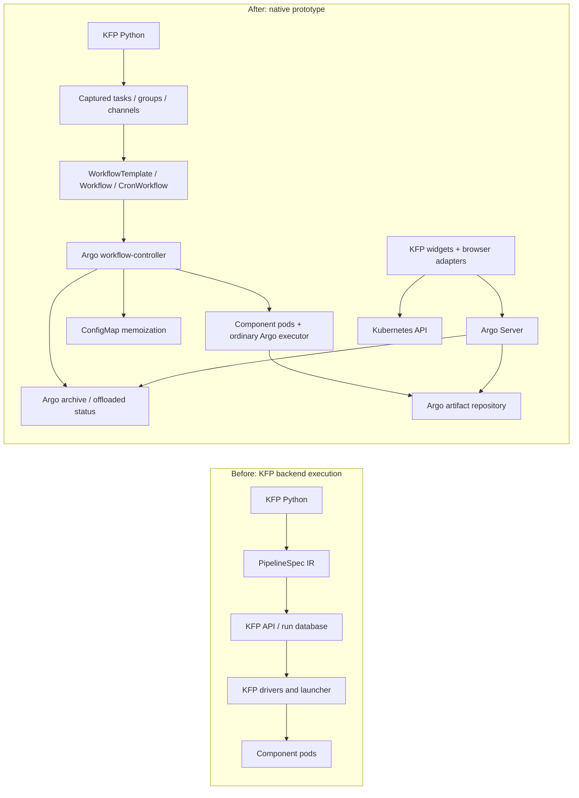

# Native Argo prototype

This fork captures the KFP Python DSL and compiles ordinary Argo resources. It does
not call the KFP IR builder on that path. Python components use a small bridge in
their own container; Argo schedules tasks, transfers artifacts, memoizes outputs
and records status. There are no KFP API, driver, scheduler or metadata services in
the deployment.

The native UI uses KFP's graph, artifact cards, inspector and log widgets. Its
browser adapters talk to Argo Server and Kubernetes, not recreated KFP endpoints.
It supports pipeline versions, experiments, submissions, schedules, live/archived
run details, typed artifacts, input lineage, selected-run metrics and run actions.

## Local deployment

The deployed target is Kubernetes context `orbstack`, namespace `kfp-argo`.
Use a disposable, single-user namespace. The upstream quick-start has development
object-store/database credentials; Argo's internal certificate is self-signed.
The UI requires a namespace-scoped token, but this is **not a production or
multi-tenant installation**. Keep the port-forward on loopback.

Requirements: OrbStack Kubernetes, Docker, kubectl, Argo CLI, uv, and the Node/npm
versions pinned in `frontend/.nvmrc` and `frontend/package.json`.

From the repository root:

```sh
orbctl start k8s
uv build --package kfp --wheel
docker build -f samples/argo-native/Dockerfile -t kfp-argo-demo:dev .

cd frontend
npm ci
npm run build
cd ..
docker build -f samples/argo-native/Dockerfile.ui -t kfp-argo-ui:dev .

uv run python samples/argo-native/deploy.py > /tmp/kfp-argo-deployment.yaml
kubectl --context orbstack -n kfp-argo apply --server-side -f /tmp/kfp-argo-deployment.yaml
kubectl --context orbstack -n kfp-argo rollout status deploy/postgres
kubectl --context orbstack -n kfp-argo rollout status deploy/minio
kubectl --context orbstack -n kfp-argo rollout status deploy/workflow-controller
kubectl --context orbstack -n kfp-argo rollout status deploy/argo-server
kubectl --context orbstack -n kfp-argo rollout status deploy/kfp-argo-ui
```

`deploy.py` uses `third_party/argo/VERSION` (verified with v4.1.6), PostgreSQL
archive/node-status offloading, and PVCs for SQL and object-store data. It configures
Argo **client** authentication, namespace-scoped editor/reader roles, and a static
Nginx UI/proxy with no Kubernetes privileges of its own. No browser token is built
into the image, put in a URL, or stored in browser storage.

Keep this running:

```sh
kubectl --context orbstack -n kfp-argo port-forward svc/kfp-argo-ui 3003:80
```

Open <http://127.0.0.1:3003/argo.html?namespace=kfp-argo>. Generate a token for the
login field. On macOS, copy it without printing it:

```sh
kubectl --context orbstack -n kfp-argo create token argo-ui-editor --duration=2h | pbcopy
```

Use `argo-ui-reader` instead to test denied mutations. These are namespace roles,
not cluster-admin credentials. Tokens are cleared when the UI reloads. Restart a
port-forward after its target pod is replaced; a stale forward can keep its port
bound until its next request detects that the old pod is gone.

## Compile and submit

`components.py` is the dataset → model → metrics example. The ordinary
`compiler.Compiler().compile(...)` entrypoint defaults to a content-addressed
`WorkflowTemplate`; `resource_kind='Workflow'` creates a standalone run and
`resource_kind='CronWorkflow', schedule='0 9 * * *'` creates a suspended schedule.

For the local example:

```sh
uv run python samples/argo-native/compile_demo.py --output /tmp/native-pipeline.yaml
kubectl --context orbstack -n kfp-argo apply -f /tmp/native-pipeline.yaml
```

The helper verifies the Docker image ID and creates a `kfp-<sha256>` image tag,
refusing to overwrite a conflicting snapshot. `Compiler(image_digests={...})`
uses that content-named local reference, so later rebuilds of `:dev` do not change
an existing version's image. For registry images, use an actual immutable digest
in `base_image`. Kubernetes does not itself enforce tag or WorkflowTemplate
immutability; do not mutate content-named resources outside this convention.

Use the UI's **Pipelines and versions** page to upload a version, select parameters
and an experiment, and start a run or create a suspended CronWorkflow. Versions
are create-only in the UI; the editor role cannot update them. Experiments are
ConfigMaps, and membership is a label rather than an owner reference.

The CLI also supports native output:

```sh
uv run kfp dsl compile --py samples/argo-native/components.py \
  --output /tmp/uncached-run.yaml --resource-kind Workflow \
  --namespace kfp-argo --disable-caching
uv run kfp visualize samples/argo-native/components.py --format both -o /tmp/pipeline.html
```

Python previews disable caching while projecting the graph, so they do not need
registry access or deployment image identities. They do not submit a run. Native
HTML exports retain nested graph expansion, artifact cards and the JSON inspector.

### Argo CLI with offloaded status

Use Argo Server rather than direct Kubernetes mode to inspect offloaded nodes:

```sh
export ARGO_SERVER=127.0.0.1:3003
export ARGO_BASE_HREF=/argo
export ARGO_HTTP1=true
export ARGO_SECURE=false
export ARGO_TOKEN="Bearer $(kubectl --context orbstack -n kfp-argo create token argo-ui-editor --duration=2h)"
argo list -n kfp-argo
argo submit -n kfp-argo --from workflowtemplate/NAME_FROM_NATIVE_PIPELINE_YAML --watch
```

Direct `kubectl` remains useful for resources, but its raw Workflow status need not
contain nodes. The deployment deliberately enables node-status offloading to test
this boundary.

## Runtime and cache contract

`--argo_input` is static `kfp-argo/v1` port configuration. Argo supplies parameter
values separately with `--argo_parameters '{{inputs.parameters}}'`; user strings
cannot alter that JSON contract. The bridge invokes KFP's Python `Executor` against
staged paths and writes scalar outputs and metadata files for Argo to capture.

Artifact payloads have actual S3 identities containing the workflow UID and pod
name. Full Python metadata and task summaries are Argo artifacts, with distinct
local paths and S3 keys. Only small producer/type/URI identities are put in workflow
parameters. A 100 KB metadata test verifies that downstream Python receives the
whole metadata object without putting it in workflow parameters. Native container
components can supply a small static metadata companion inline; missing required
Python metadata fails instead of inventing empty metadata.

Cache keys include the component/template implementation, immutable image identity,
execution configuration, resolved parameter strings and input artifact identities.
Cached metadata retains the original producer. Mutable secret/config-map/PVC inputs
and runtime package installation require caching to be disabled. The prototype
uses a one-hour ConfigMap cache; retained artifact data must outlive it. Do not
reuse a cache after deleting its object-store data.

## Verification

Core Python coverage on both supported versions:

```sh
uv run python -m pytest -q \
  sdk/python/kfp/dsl/{pipeline_task_test.py,base_component_test.py,executor_test.py,argo_runtime_test.py} \
  sdk/python/kfp/compiler/{argo_compiler_test.py,native_contract_test.py} \
  sdk/python/kfp/cli/{native_cli_test.py,visualize_test.py} \
  samples/argo-native/{install_demo_test.py,deploy_test.py}
# Repeat with: uv run --python 3.11 --isolated --frozen --extra test python -m pytest ...
```

With the Argo CLI environment above, run the actual Kubernetes compatibility corpus:

```sh
uv run python samples/argo-native/verify_compatibility.py \
  --context orbstack --namespace kfp-argo \
  --image-digest "$(docker image inspect kfp-argo-demo:dev --format '{{.Id}}')"
```

The nine cases cover nested DAGs, both conditional branches, bounded loops and
integer collection, failed loop iterations, successful/failing bodies and failing
cleanup, a native container artifact crossing a nested pipeline boundary, large
metadata transfer, and actual retry attempts with pod resource requests/limits. Deliberate failures are asserted, not retried into success.

For the deployed browser test, supply a compiled WorkflowTemplate name as the base.
It creates a new version with isolated cache keys rather than clearing existing
cache data:

```sh
cd frontend
ARGO_EDITOR_TOKEN="$(kubectl --context orbstack -n kfp-argo create token argo-ui-editor --duration=2h)" \
ARGO_READER_TOKEN="$(kubectl --context orbstack -n kfp-argo create token argo-ui-reader --duration=2h)" \
ARGO_VERSION_NAME=YOUR_COMPILED_WORKFLOW_TEMPLATE \
node --test scripts/argo-deployment.smoke.mjs
```

This uses a fresh headless Chrome context and real APIs. It verifies UI upload and
submission, image identity, three task pods followed by two on cache reuse, both
scores, artifact download, logs, offloaded status, a native approval gate, denied
Kubernetes/Argo mutations, CronWorkflow persistence and CLI changes, archive access
after live deletion, non-cascading experiment deletion, and SQL/object-store data
after deployment restarts. It leaves its named test resources for inspection.

Evidence is written to `/tmp/kfp-argo-deployment-evidence.json` and screenshots to
`/tmp/kfp-argo-{deployed-runs,denied,archived}.png`. Do not publish tokens or raw
browser traces containing authorization headers.

## Scope and remaining compatibility limits

This is a tested prototype, not full upstream SDK compatibility. Unsupported
constructs fail compilation instead of emitting KFP IR or invoking an in-process
runner. Current limits include importers/root artifact arguments, artifact-list
fan-in, some nested collection/conditional merge patterns, workspaces, dynamic
execution configuration, task-config passthroughs and unmapped Kubernetes/cloud
extensions. Non-Python container scalar outputs currently require `String`; use
the Python bridge for validated numeric/boolean/list/dict returns. Task-final-status
verification covers success and failure, not every legacy cancellation/error-code
semantic. Component images must contain this checkout's runtime or install its
wheel, not an unmodified upstream KFP runtime.

The native entrypoint does not mount KFP client/server providers. Upstream IR/client
compatibility is intentionally not provided. Broad upstream SDK runs were attempted
on Python 3.11/3.13 and failed on those old contracts; the complete upstream suite
is **not green**. Those results are not presented as successful native verification.
Legacy backend/IR source and historical tests remain in the monorepo during this
prototype; the deployed execution path does not use them. The Docker Python
dependency remains necessary for component image building, not local execution.

Discovery is bounded to 100 live/archive list results per source and five explicitly
selected runs for comparison. Lineage is derived from declared task inputs/outputs
and producer metadata. There is no global artifact index, migration service, new
application backend or custom controller. The initial handwritten workflow and
Stage A setup tests remain as runtime-contract evidence; use `deploy.py`, not the
old Stage A installer, for the current deployment.

<details>
<summary>Failure fixes and architecture evidence</summary>

- The interrupted Stage A setup used a retired MinIO image and lacked scoped cache
  update permission. Reproducer tests failed before those fixes and passed afterward.
- Exit-handler verification caught successful cleanup masking a failed body. Both
  `body` and `exit` are now explicit Argo DAG targets, with failure-aware dependency
  expressions. No extra control pod is introduced.
- Argo 4 rejects the old singular `spec.schedule`; SDK/UI now emit `spec.schedules`.
- The retry test caught Argo rejecting the string factor `2.0`. Integral factors
  are now normalized to integer strings, duration aliases use the SDK's existing
  normalizer, and unsupported fractional factors fail compilation.
- Read-only log access also requires pod-watch permission; mutations remain denied.
- Argo 4 includes persisted SQL rows in its workflow list. The browser recognizes
  them and retrieves artifacts/logs by archive UID, including after CR deletion.
- Regression tests cover parameter types/non-finite JSON, malformed metadata,
  same-name replacement checks, metadata path/key collisions, large metadata,
  mutable cache inputs and rejection of unresolved dynamic execution settings.



</details>
